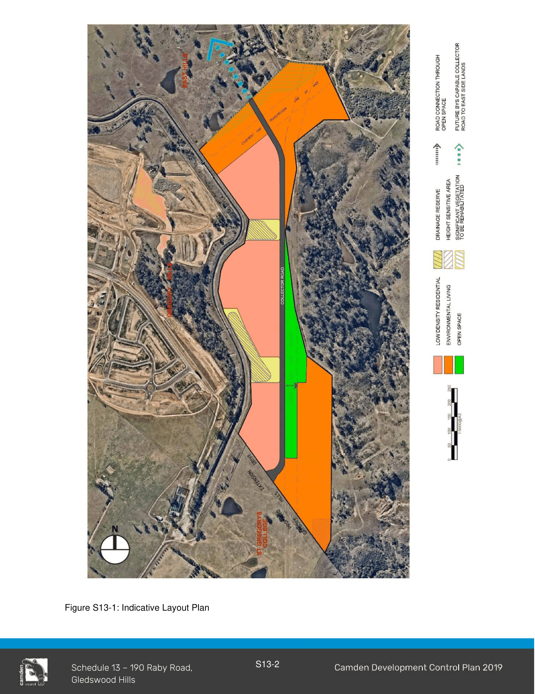

# Camden Development Control Plan 2019 - Schedule 13 190 Raby Road, Gledswood Hills

> This chapter is split into 4 section file(s), one per numbered heading, in the order they appear in the PDF.

Source PDF: [DCP-2019-Final-Schedule-13-190-Raby-Road-Gledswood-Hills-v2.pdf](DCP-2019-Final-Schedule-13-190-Raby-Road-Gledswood-Hills-v2.pdf)

### Contents

S13.1 Introduction ........................................................................................................................... S13-1 S13.1.1 Indicative Layout Plan ................................................................................................ S13-1

S13.2 Street, Pedestrian and Cycle Network.................................................................................. S13-4

S13.3 Parks and Open Space ........................................................................................................ S13-5

S13.4 Environmental Living Zone ................................................................................................... S13-6 S13.4.1 Retention of remnant vegetation in the C4 Environmental Living zone ..................... S13-6 S13.4.2 Residential controls for dwellings in Environmental Living Zone ............................... S13-6

S13.5 Scenic Amenity Protection .................................................................................................... S13-7

### Table of Figures

Figure S13-1: Indicative Layout Plan

S13-2

## 190 Raby Road, Gledswood Hills S13.1 Introduction

The subject site is located on the eastern boundary of the Camden LGA, adjacent to the Campbelltown LGA Scenic Hills land and the South West Growth Area. Immediately to the west of the site is the Sydney Water Upper Canal and to the north is the El Caballo Blanco, Gledswood and East Side release area.

Access to the development will be provided via Gregory Hills Drive at its southern boundary. A new collector road will run through the development to provide a connection between Gregory Hills Drive in the south and the El Caballo Blanco, Gledswood and East Side release area to the north. This will provide an improved public transport link.

The gas pipeline easements will be integrated within the development through their embellishment and utilisation as a linear open space area that will provide a range of pedestrian, cycleway and passive recreation uses. The pedestrian path/cycleway will provide good connections to the surrounding urban areas. This linear open space will be complemented by two drainage areas. An area adjoining the easement area will also be embellished as a park and playground.

Housing on the site will benefit from the natural setting and retention of select areas of native vegetation that will be restored. It will also provide a transition of larger lots between the Scenic Hills ridgeline to well established and newly developing release areas to the west and north.

In order to protect the scenic landscape, additional controls to establish appropriate building height, setbacks, material and colours have been specified for land located to the east of the collector road shown on the Indicative Layout Plan (ILP) in Figure S13-1.

#### S13.1.1 Indicative Layout Plan

The Indicative Layout Plan (ILP) is shown in Figure S13-1 and establishes a framework for the urban form and defines the critical components of the site. These include land use, drainage areas, vegetation conservation areas, access points and collector road, easements and open space, and restriction on heights area.

> [Picture on page 4: a picture, saved as a picture (images/schedule-13-190-raby-road-gledswood-hills-page-4-1.gif, 150 dpi).]

Figure S13-1: Indicative Layout Plan

### Relationship to other Plans

190 Raby Road, Gledswood Hills indicative layout plan is based on the following technical and environmental studies:

• Distinctive, November 2015, Landscape and Visual Assessment;

• MUSEcape, October 2016, Visual Impact Assessment Peer Review;

• MUSEcape, January 2017, Visual Impact Assessment Peer Review with Supplement;

• Lesryk, November 2015, Flora and Fauna Assessment;

• Traffix, July 2015, Traffic Impact Assessment;

• Dominic Steel Consulting Archaeology, December 2015, Preliminary Aboriginal & Cultural Heritage Assessment;

• PKA Acoustic Consulting, May 2015, Acoustic Assessment;

• ABPP, March 2015, Bushfire Constraints Assessment;

• Douglas Partners, February 2014, Geotechnical Assessment;

• GLN Planning, November 2015, Open Space and Community Facilities Assessment;

• Douglas Partners, February 2014, Salinity Assessment;

• Stefani Group, April 2015, Stormwater Management and Flood Assessment;

• Douglas Partners, February 2014, Preliminary Site Investigation.

<!-- sections -->
## Sections

1. [S13.2 Street, Pedestrian and Cycle Network](01-s13-2-street-pedestrian-and-cycle-network.md)
2. [S13.3 Parks and Open Space](02-s13-3-parks-and-open-space.md)
3. [S13.4 Environmental Living Zone](03-s13-4-environmental-living-zone.md)
4. [S13.5 Scenic Amenity Protection](04-s13-5-scenic-amenity-protection.md)
