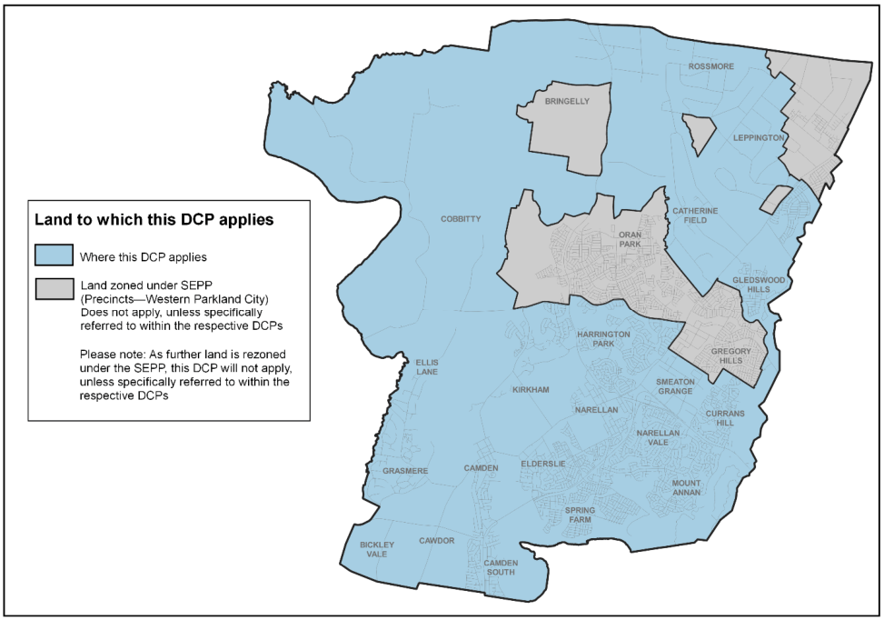
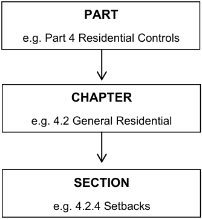
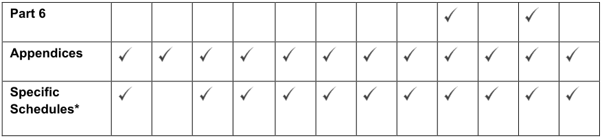

### 1.1 Preliminary

#### 1.1.1 What is the Name of this DCP?

This DCP is known as the Camden Development Control Plan 2019 (DCP).

#### 1.1.2 What date did the DCP commence?

This DCP was made under Section 3.43 of the Environmental Planning and Assessment Act 1979 (EP&A Act) and Part 3 of the Environmental Planning and Assessment Regulation 2000. The DCP was adopted by Council on 13 August 2019. The DCP came into force 16 September 2019.

#### 1.1.3 Where does this DCP apply?

This DCP applies to all land within the Camden Local Government Area (LGA) and zoned under Camden Local Environmental Plan 2010. The DCP does not apply to land zoned under State Environmental Planning Policy (Precincts – Western Parkland City) 2021, unless referred to within the respective DCPs. It is noted that as further land is rezoned under State Environmental Planning Policy (Precincts – Western Parkland City) 2021, this DCP will not apply, unless  referred to within the respective DCPs.

> [Picture on page 4: a picture, saved as a picture (images/table-of-contents-page-4-16.gif, 150 dpi).]

Figure 1-1: Where this DCP applies

#### 1.1.4 What does this DCP seek to achieve?

The objectives of this DCP are to ensure that:

a. Camden LGA retains its valued heritage qualities and scenic landscapes whilst providing for sustainable urban growth;

b. New communities are planned and developed in an orderly, integrated and sustainable manner;

c. Impacts from development on the natural environment are minimised and overall improvements to the natural systems in Camden LGA are achieved;

d. New developments are integrated with existing and planned transport systems and promote sustainable transport behaviour in Camden LGA;

e. Appropriate housing opportunities are provided for all existing and future residents of Camden LGA at all stages of their life cycle;

f. New developments deliver upon the desired future character of the places in Camden LGA;

g. New development is designed and located to ensure the health, safety and security of people and property in Camden LGA;

h. Identified and potential Aboriginal and European heritage places are conserved and respected;

i. New developments are planned and constructed to contribute to the social, environmental and economic sustainability of Camden LGA.

j. The agricultural production potential of rural lands within Camden is protected and fragmentation of rural land is prevented.

#### 1.1.5 Relationship between this DCP and Camden LEP 2010

This DCP is to be read in conjunction with Camden Local Environmental Plan 2010 (CLEP 2010). In the event of an inconsistency between the provisions of the two documents, the provisions of CLEP 2010 will prevail to the extent of the inconsistency.

#### 1.1.6 Revocation of Camden DCP 2011

Pursuant to Section 3.43(4) of EP&A Act, the Camden Development Control Plan 2019 revokes Camden Development Control Plan 2011 which covered land for which this development control plan now applies.

#### 1.1.7 Relationship between this DCP and Council’s Engineering Specifications

This DCP must be read in conjunction with Council’s Engineering Design and Construction Specifications and the Camden Open Space Design Manual.

#### 1.1.8 Structure of this DCP

The main body of this DCP is structured in six Parts containing objectives and controls which apply to all development in Camden. The DCP also contains Schedules for site specific areas.

In the event of an inconsistency between a Schedule and the main body of this DCP, the Schedule prevails.

| Part | Summary |
|---|---|
| 1 – Introduction | Sets out the aims and objectives of the DCP, identifies the land to which the DCP applies, explains the structure of the document and the relationship of the DCP to other planning documents. |
| 2 – General Planning Controls | Sets out the controls that apply to all development types in the Camden LGA. Part 2 contains the objectives and controls that underpin the orderly and sustainable development of the Camden LGA. Accordingly, this part of the DCP must be consulted in the first instance. |
| 3 – Residential Subdivision | Sets out the controls that apply to development applications which involve the subdivision of residential land in the Camden LGA. |
| 4 – Residential Development | Provides the objectives and controls that guide residential development, including dwelling houses, semi-detached, attached dwellings, multi dwelling housing, secondary dwellings, dual occupancies and residential flat buildings. Also, covers residential amenity controls such as streetscape, safety, privacy, sustainable building design and fencing. |
| 5 – Employment Zones Development Controls | Provides objectives, controls and design principles for development in employment zones, including commercial and industrial development in Camden, Narellan, Smeaton Grange, and Glenlee. |
| 6 – Specific Land Use Controls | Provides controls to guide the development of rural areas. This section also contains controls applying to specific land uses such as child care centres, restricted premises, sex service premises, exhibition homes and villages, home businesses and home industry and wood fired heaters. |
| Appendix A - Glossary | Explains the terms used in the DCP. |
| Appendix B – Landscape Design Principles and Submission Requirements | Provides landscape design principles, submission requirements and recommended street tree planting. |
| Site Specific Schedules | Site specific schedule provides additional objectives and controls which are specific to a specific area. |

Table 1-1: Summary of the content of each of the sections and the appendices.

Each Part is subdivided into Chapters and Sections as illustrated in Figure 1-2. Each Chapter contains sections. In order to ensure the proposed development is compliant, the sections must be read, and the objectives and controls followed. Generally, the sections are broken down into:

Background – contains information that is essential to understanding the objectives and controls.

Objectives – state what is to be achieved and covers the range of desired outcomes to achieve a goal.

Controls – contain standards in order to achieve the objectives.

Further Information – provide supplementary references which also need compliance e.g. Camden

> [Picture on page 7: a picture, saved as a picture (images/table-of-contents-page-7-4.gif, 150 dpi).]
> Words printed on the picture (copied from the PDF):
> e.g. Part 4 Residential Controls
> e.g. 4.2 General Residential

Council’s Engineering Specifications.

#### PART

#### CHAPTER

#### SECTION

e.g. 4.2.4 Setbacks

Figure 1-2: Camden DCP Structure

#### 1.1.9 How to Use this DCP

Table 1-2 summarises the Parts of the DCP that apply to the main types of development that are permissible under CLEP 2010.

Table 1-2: Guide to which parts apply to different developments

| Relevant DCP Parts | Subdivision Residential | Subdivision Industrial | House Dwelling | Occupancy Dual | Dwellings Attached | Semi-Detached Dwellings | Housing Multi-Dwelling | Flat Residential Buildings | Non-Residential Development | Housing Top Shop | Commercial / Retail Development | Development Industrial |
|---|---|---|---|---|---|---|---|---|---|---|---|---|
| Part 1 |  |  |  |  |  |  |  |  |  |  |  |  |
| Part 2 |  |  |  |  |  |  |  |  |  |  |  |  |
| Part 3 |  |  |  |  |  |  |  |  |  |  |  |  |
| Part 4 |  |  | * | * | * | * | * | * |  | * |  |  |
| Part 5 |  |  |  |  |  |  |  |  |  |  |  |  |

> [Picture on page 8: a picture, saved as a picture (images/table-of-contents-page-8-1.gif, 150 dpi).]
> Words printed on the picture (copied from the PDF):
> Part 6
> Appendices
> Specific
> Schedules*

\*Additional site specific controls may also be contained within relevant Schedules

#### 1.1.10 Where do I find the Relevant Controls?

The Table of Contents located at the beginning of the DCP provides a list of all matters covered by the DCP. In addition, Table 1-2 (above) is a tool to cross-reference the specific Parts of the DCP which apply to certain development types.

#### 1.1.11 Does the entire DCP apply from the Date of Commencement (Transitional Provisions)?

This DCP does not apply to an application under EP&A Act which was lodged with Council but not finally determined before the commencement of this DCP. Any application lodged before the commencement of this DCP will be assessed in accordance with any relevant previous DCPs or other Council’s policy which applied at the time of application lodgement.

#### 1.1.12 What are the standard application requirements?

Each development application submitted to Council must include all information outlined in the relevant Development Application Checklist. Specific Development Application Checklists apply to certain types of development.

If a development is “Integrated Development” as detailed in Section 4.46 of EP&A Act, approvals may be required from one or more authorities.

Throughout this DCP specific submission requirements may be detailed with the controls relating to specific land uses or specific sites in Camden.

#### 1.1.13 Table of Amendments

| Amendment | Adopted Date |  | Description of Changes |
|---|---|---|---|
| No. |  |  |  |
| Original | 16 September 2019 |  | Camden DCP 2019 came into effect. |
| 1 | 7 2020 | January | Additional Schedule 13 – 190 Raby Road, Gledswood Hills came into effect. |
| 2 | 26 May 2020 |  | Additional Part 6.4.4 site specific controls for Little Street Camden came into effect |
| 3. | 9 June 2020 |  | New Sub Chapter 6.4.5 – Glenlee Industrial Precinct |
| 4. | 22 June 2020 |  | Updated Schedule 6 – Camden Lakeside to increase dwellings, amend Masterplan and road hierarchy |
| 5. | 25 2021 | October | Removed Section 1.2 – Notification and Advertising Requirements which has been replaced by the new Camden Community Participation Plan 2021. |
| 6. | 1 June 2023 |  | Introduced ‘Employment Zone Hierarchy’ to Section 5.1. Moved Sections ‘6.3 Industrial Land Uses’ and ‘6.4 Site Specific Industrial Controls’ to Part 5. Revised references to previous B, IN, and E zones. Revised references to SEPPs. Amended page, table, and figure numbering. |
| 7. | 30 July 2024 |  | Amendments to Schedule 5 - Mater Dei and Kirkham Rise. |
| 8. | 19 September 2024 |  | Amendments to Schedule 8 – Emerald Hills. |
