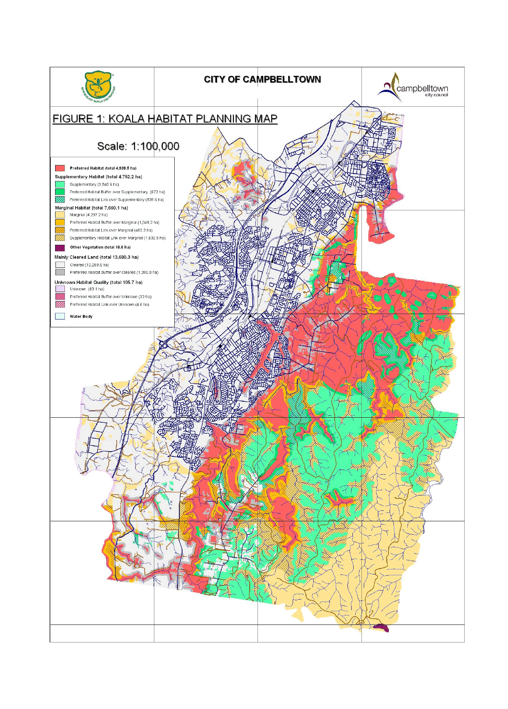

# Campbelltown Sustainable City Development Control Plan 2015 - Koala Habitat Planning Map

Source PDF: [koalahabitatplanningmap.pdf](koalahabitatplanningmap.pdf)

> [Page 1 is a scanned picture of text. The text below was read by OCR (machine reading) and may contain errors; check it against the original PDF.]

#### CITY OF CAMPBELLTOWN

#### campbelltown

= city council Ss

#### FIGURE 1: KOALA HABITAT PLANNING MAP

#### Scale: 1:100,000

a “ Habitat (total 4,999.5 ha) a Supplementary Habitat (total 4,752.2 ha) supplementary (3,540.6 na) fi GE) Preterrea Habitat Butter over Supplementary (672 ha) ai By Preferred Habitat Link over Supplementary (539.6 ha) Marginal Habitat (total 7,660.1 ha) LS Marginal (4,297.2 hay Habitat Buffer over Marginal (1,048.2 ha) BS Preferred Habitat Link over Marginal (482.2 ha) a Supplementary Habitat Link over Marginal (1,832.5 ha) > Other Vegetation (total 16.6 ha) 4 Mainly Cleared Land (total 13,680.3 ha) (12,289.5 na) y Habitat Butter over Cleared (1,390.8 ha) \ Unknown Habitat Quality (total 105.7 ha) ow Unknown (69.1 ha) Preferred Habitat Buffer over Unknown (32 ha) Habitat Link over Unknown (4.6 ha) [| water Body a ™ q = o a = Mk Tt Wg ~ =

i a i 2 7 ES : = 2

-ae for x ~ — +

> [End of OCR text from page 1.]
