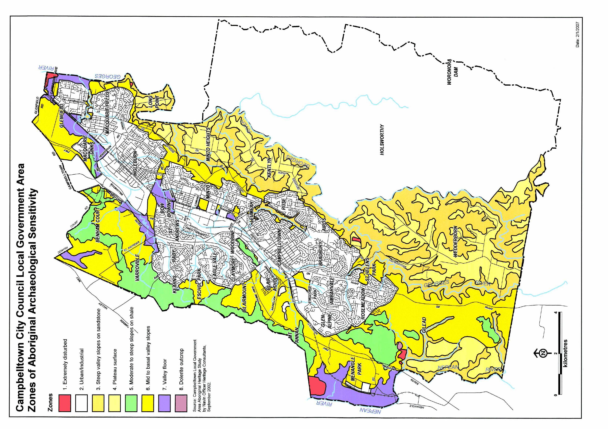

# Campbelltown Sustainable City Development Control Plan 2015 - Zones of Aboriginal Archaeological Sensitivity Map

> This chapter is split into 3 section file(s), one per numbered heading, in the order they appear in the PDF.

Source PDF: [zonesofaboriginalarchaeologicalsensitivitymap.pdf](zonesofaboriginalarchaeologicalsensitivitymap.pdf)

> [Page 1 is a scanned picture of text. The text below was read by OCR (machine reading) and may contain errors; check it against the original PDF.]

#### Campbelltown City Council Local Government Area

#### Zones of Aboriginal Archaeological Sensitivity

#### Zones

#### fee] 1. Extremely disturbed

<!-- sections -->
## Sections

1. [2 Urban/Industrial](01-2-urban-industrial.md)
2. [4 Plateau surface](02-4-plateau-surface.md)
3. [8 Dolerite outcrop](03-8-dolerite-outcrop.md)
