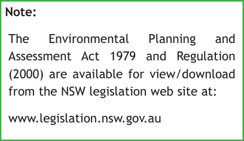

### 1.5 Acronyms of Volume 1.

– All development proposals must comply with the relevant requirements of the Building Code of Australia.

> [Picture on page 9: a picture, saved as a picture (images/vol-1-part-01-preliminary-page-9-12.gif, 150 dpi).]

#### Note:

#### Note:

The Environmental Planning and Assessment Act 1979 and Regulation

(2000) are available for view/download from the NSW legislation web site at: www.legislation.nsw.gov.au

Figures included under this Plan are for illustration purposes only and are not to be interpreted or taken in any way or form as a development control.
