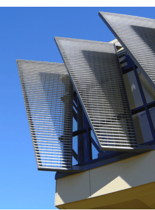
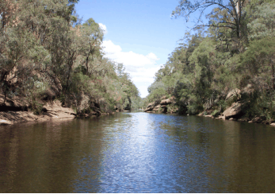

### 1.3 Campbelltown 2025 and the Plan

Council has adopted Campbelltown 2025 – Looking Forward, an overarching town planning strategy that informs all Council planning policies. Campbelltown 2025 -Looking Forward aims to guide the planning decisions within the City to ensure that sustainable planning outcomes can be achieved. Campbelltown 2025 Looking Forward contains a “vision” for the City, along with six (6) strategic directions to facilitate realisation of the vision. The Plan has been developed to be consistent with and add value to the strategic directions: a)

a)	 Growing the Regional Centre.

Growing the Regional Centre. b)

b)	 Building a distinctive Campbelltown sense of place.

Building a distinctive Campbelltown sense of place. c)

c)	 Protecting and enhancing the City’s environmental

Protecting and enhancing the City’s environmental assets.

assets. d)

d)	 Getting around the City.

Getting around the City. e)

e)	 Building and maintaining quality public

Building and maintaining quality public infrastructure.

infrastructure. f)

f) Creating education, employment and  entrepreneurial

Creating education, employment and  entrepreneurial activities.

activities.

#### 1.3.1 The Vision

#### 1.3.1 The Vision

#### Campbelltown

In 2025 we will live in a safe, prosperous, just, and proud community that enjoys a healthy lifestyle and access to high quality amenities.

2025 and the

#### Plan

We are proud to celebrate our diverse culture, creativity, and spirit at home with our families and at the places where and at the times when we come together as a community. Prosperity and wellbeing stems from a diverse economy, where the skills of our workforce adapt to changes in emerging technology and markets.  New enterprises are committed to the principles of cleaner production and environmental efficiency.

> [Picture on page 11: a picture, saved as a picture (images/vol-1-part-01-preliminary-page-11-17.gif, 150 dpi).]

There is an emphasis on self-containment and sustainable community living.  More than 50% of the people who live in Campbelltown City who are employed, work in Campbelltown. Business centres are a focus for community amenity and interaction, not just shopping centres. This has been assisted by the integration of in-centre living opportunities within the centres, as part of vibrant mixed use developments. We move around our City and region in safe and environmentally sustainable ways, promoting public transport as the primary means of mobility.  Integrated land use, development and transport planning minimises travel times and promotes more convenient access to amenities and employment areas. The City has grown to be the ‘hub’ of the Greater South Western Sydney Region, where access to high level retail, commercial, education, health, community, recreation and cultural amenities is assured.  This has been a major conduit for employment development, as has been the University of Western Sydney, the TAFE and the Campbelltown Hospital.

> [Picture on page 11: a picture, saved as a picture (images/vol-1-part-01-preliminary-page-11-31.gif, 150 dpi).]

Campbelltown is renowned for its ‘leading edge’ built environmental character, setting it apart from other metropolitan localities.  This is reinforced by a distinctive landscape quality incorporated into the design and treatment of urban environments including the preservation of indigenous vegetation and other natural landscape features. Our cultural heritage, indigenous and non-indigenous, is respected. The bushland, the Scenic Hills, rural landscape settings, the rivers, and our unique flora and fauna have been protected in recognition of the valuable contribution they make to our quality of life, and the City’s identity. Scarce natural resources - water, soil and clean air, are now appropriately valued, and we use them wisely in the interests of future generations. The City has achieved much and prospered.   We have maintained our natural environmental qualities, yet built a contemporary and striking City image that is renowned across Sydney. New economic development opportunities have been secured and our community spirit and culture flourishes. The City of Campbelltown looks forward to a sustainable future.
