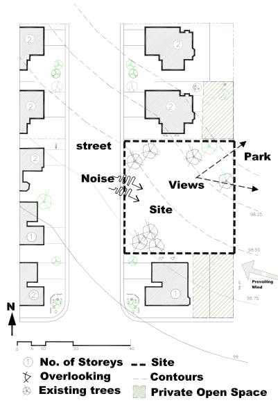

### 2.2 Site Analysis

#### Site Analysis

The site analysis is the foundation of good design and is used as an initial source of information upon which to base the design and configuration of development taking account of all environmental constraints and opportunities, as they relate to the unique features of the site and nearby land.

#### Objectives:

■Identify the constraints and opportunities for the development of the site. ■Provide an understanding of how the development relates to the site. ■Identify the capability and suitability of the site for development.

> [Picture on page 5: a picture, saved as a picture (images/vol-1-part-02-requirements-applying-to-all-types-of-developm-page-5-11.gif, 150 dpi).]

#### Design Requirements

a)

a)	 A Site Analysis Plan shall be lodged with

A Site Analysis Plan shall be lodged with the development application for all

the development application for all development involving the construction

development involving the construction of a building and the Torrens title

of a building and the Torrens title subdivision of land. The scope of the

subdivision of land. The scope of the site analysis will depend on the scale

site analysis will depend on the scale and nature of the development and

and nature of the development and shall address:

shall address: i)

i) contours, slope and north point;

contours, slope and north point; ii)

ii)	 existing landscaping and

existing landscaping and vegetation;

vegetation; iii)

iii)	 existing buildings and structures;

existing buildings and structures; iv)

iv)	 location of windows and other

location of windows and other openings on adjoining buildings;

openings on adjoining buildings; v)

v)	 roads, access points, parking, and

roads, access points, parking, and traffic management devices and

traffic management devices and the like;

the like;

Figure 2.2.1 - Example of a site analysis plan.

vi)

vi)	 linkages; open space networks,

linkages; open space networks, pedestrian/cycle paths and the

pedestrian/cycle paths and the like;

like; vii)

vii)	easements, services, existing

easements, services, existing infrastructure and utilities;

infrastructure and utilities; viii)

viii)	hydraulic features, drainage

hydraulic features, drainage lines, water features, drainage

lines, water features, drainage constraints, and the like;

constraints, and the like; ix)

ix)	 natural hazards (e.g. flooding,

natural hazards (e.g. flooding, bushfire);

bushfire); x)

x)	 solar orientation, overshadowing,

solar orientation, overshadowing,

prevailing winds;

prevailing winds;

#### Site Analysis

xi)

xi)	 views and vistas to, from and within

views and vistas to, from and within the site;

the site; xii)

xii)	a streetscape analysis;

a streetscape analysis; xiii)

xiii)	special environmental features

special environmental features such as threatened species

such as threatened species habitat, endangered ecological

habitat, endangered ecological communities and wetlands;

communities and wetlands; xiv)

xiv)	items and relics of  and/or aboriginal

items and relics of  and/or aboriginal place of heritage significance ; and

place of heritage significance ; and xv)

xv)	 any identified road widening

any identified road widening applying to the subject land.

applying to the subject land.
