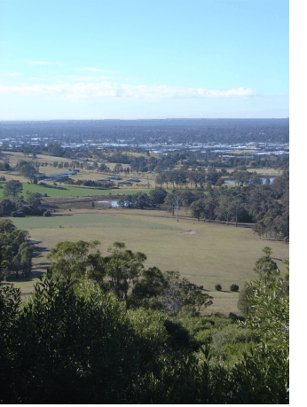

### 2.3 Views and Vistas

Views and

#### Vistas

#### Objectives:

■Protect the scenic value of Campbelltown’s natural and built environment. ■Protect significant views and vistas from and to public places.

> [Picture on page 7: a picture, saved as a picture (images/vol-1-part-02-requirements-applying-to-all-types-of-developm-page-7-7.gif, 150 dpi).]

#### Design Requirements

a)

a)	 Development shall appropriately

Development shall appropriately respond to Campbelltown’s important

respond to Campbelltown’s important views and vistas to and from public

views and vistas to and from public places. These include views and vistas

places. These include views and vistas to and from:

to and from: i)

i) the Scenic Hills;

the Scenic Hills; ii)

ii)	 rural/semi rural landscape areas;

rural/semi rural landscape areas; iii)

iii)	 the Georges and Nepean River

the Georges and Nepean River corridors;

corridors; iv)

iv)	 areas of significant public open

areas of significant public open space (formal and informal); and

space (formal and informal); and v)

v)	 heritage items.

heritage items.

Figure 2.3.1 - Example of a significant view corridor.

b)

b)	 District views and existing significant

District views and existing significant view corridors as viewed to and from

view corridors as viewed to and from public places shall be protected.

public places shall be protected. c)

c)	 The opportunity to create new view/

The opportunity to create new view/ vista corridors shall be taken wherever

vista corridors shall be taken wherever possible and appropriate.

possible and appropriate.

#### Note:

In certain circumstances Council may require the preparation of a visual analysis study as part of a development application or a planning proposal.
