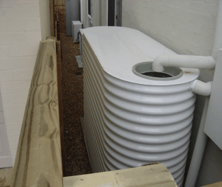
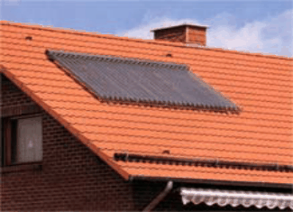
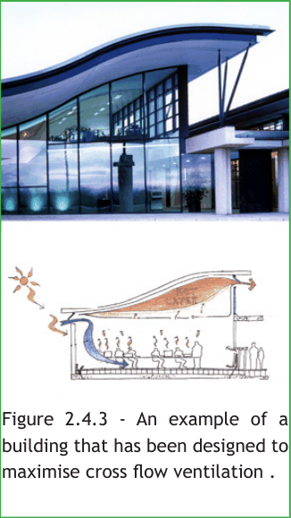

### 2.4 Sustainable Building Design

#### Sustainable

#### Objectives:

#### Building

#### Design

■Encourage building design and siting to reduce energy consumption. ■Encourage the use of solar power in building design. ■Encourage the use of  water recycling. ■Ensure that residential buildings meet the requirements of BASIX.

> [Picture on page 8: a picture, saved as a picture (images/vol-1-part-02-requirements-applying-to-all-types-of-developm-page-8-10.gif, 150 dpi).]

#### 2.4.1 Rain Water Tanks

#### 2.4.1 Rain Water Tanks

a)

a)	 In addition to satisfying BASIX,

In addition to satisfying BASIX, residential development is encouraged

residential development is encouraged to provide  a rain water tank for new

to provide  a rain water tank for new buildings.

buildings. b)

b)	 A rain water tank shall be provided for

A rain water tank shall be provided for all new buildings containing a roof area

all new buildings containing a roof area greater than 100sqm for all development

greater than 100sqm for all development not specified by BASIX. The rain water

not specified by BASIX. The rain water tank shall have a minimum capacity in

tank shall have a minimum capacity in accordance with Table 2.4.1.

accordance with Table 2.4.1.

Figure 2.4.1 - An example of a domestic rainwater tank.

> [Picture on page 8: a picture, saved as a picture (images/vol-1-part-02-requirements-applying-to-all-types-of-developm-page-8-37.gif, 150 dpi).]

c)

c)	 All rainwater tanks shall comply

All rainwater tanks shall comply with

with AS3500 (as amended) - National

AS3500 (as amended) - National Plumbing and Drainage Code Guidelines

Plumbing and Drainage Code Guidelines for Plumbing Associated with Rainwater

for Plumbing Associated with Rainwater Tanks in Urban Areas

Tanks in Urban Areas and

and Sydney

Sydney

Water’s Guideline for Rainwater Tanks

Water’s Guideline for Rainwater Tanks on Residential Properties.

on Residential Properties. d)

d)	 The rainwater tank incorporated in new

The rainwater tank incorporated in new commercial and industrial development

commercial and industrial development exceeding 5,000sqm shall be connected

exceeding 5,000sqm shall be connected to the plumbing in the building to

to the plumbing in the building to provide water for toilets

provide water for toilets. e)

e)	 Where it is intended that the

Where it is intended that the development be strata title subdivided,

development be strata title subdivided, the tank shall be sited in a location to

the tank shall be sited in a location to be common property.

be common property. f)

f) Above ground water tanks shall be

Above ground water tanks shall be located behind the primary or secondary

located behind the primary or secondary building line.

building line.

Figure 2.4.2 - Solar hot water panels facing north.

#### 2.4.2 Solar Hot Water

#### 2.4.2 Solar Hot Water

a)

a)	 All new buildings are encouraged to

All new buildings are encouraged to provide  a solar hot water system.

provide  a solar hot water system.

b)

b)	 Where the site is connected to the gas main,

Where the site is connected to the gas main, the solar hot water system is encouraged to

the solar hot water system is encouraged to be gas boosted.

be gas boosted.

#### Sustainable

#### Building

#### 2.4.3 Natural Ventilation

#### 2.4.3 Natural Ventilation

#### Design

a)	 The design of new buildings shall be encouraged to maximise opportunities for cross flow ventilation, where practical, thus minimising the need for air conditioning.

#### 2.4.4 Light Pollution

#### 2.4.4 Light Pollution

a)

a)	 Outdoor lighting shall be

Outdoor lighting shall be  designed to minimise

designed to minimise

pollution from the unnecessary dispersion

pollution from the unnecessary dispersion of light into the night sky and neighbouring

of light into the night sky and neighbouring properties.

properties.

> [Picture on page 9: a picture, saved as a picture (images/vol-1-part-02-requirements-applying-to-all-types-of-developm-page-9-29.gif, 150 dpi).]

Figure 2.4.3 - An example of a

building that has been designed to maximise cross flow ventilation .

> [Picture on page 9: a picture, saved as a picture (images/vol-1-part-02-requirements-applying-to-all-types-of-developm-page-9-32.gif, 150 dpi).]

#### 2.4.5 BASIX

#### 2.4.5 BASIX

#### Note:

The Building Sustainability Index (BASIX) is an interactive, internet-based planning tool designed to assess the potential performance of residential development against a range of sustainability indices. The focus of BASIX is on the key indices of water and energy, and the related indices of landscape, stormwater and thermal comfort, reflecting the NSW Government’s decision to establish water consumption and greenhouse gas emission reduction targets for all new dwellings built in NSW. For Development standards requirements for a

Development standards requirements for a BASIX certificate refer to

BASIX certificate refer to  www.basix.nsw.gov.au

A BASIX Certificate is not required for relocatable homes. However, a BASIX Certificate would be required as part of a development application (or complying development certificate application) to install a flat-pack kit. For more information on this matter, refer to  the Department of Planning and

#### Environment website at: www.planning.nsw.gov.au

#### Table 2.4.1 Rainwater Tank Capacity

| Roof Area | Capacity of Rainwater Tank |
|---|---|
| 101 m² to 200 m² | 3,000L |
| 201 m² to 1,000 m² | 5,000L |
| 1,001 m² to 5,000 m² | 10,000L |
| 5,001 m² to 10,000 m² | 20,000L |
| 10,001 m² to 20,000 m² | 50,000L |
| above 20,000 m² | 100,000L |
