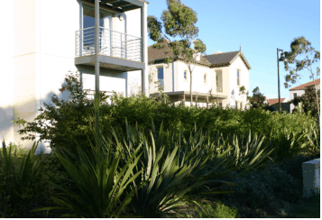

### 2.5 Landscaping

#### Landscaping

#### Objectives:

■Maintain and rehabilitate the natural environment and assist in the conservation of Campbelltown’s landscape character. ■ Provide landscaping that complements the scale of development.

> [Picture on page 10: a picture, saved as a picture (images/vol-1-part-02-requirements-applying-to-all-types-of-developm-page-10-7.gif, 150 dpi).]

■ Enhance the appearance of development.

#### Design Requirements

a)

a)	 Landscape design shall enhance the

Landscape design shall enhance the visual character of the development

visual character of the development and complement the design/use of

and complement the design/use of spaces within and adjacent to the site.

spaces within and adjacent to the site. b)

b)	 Landscape design shall retain and

Landscape design shall retain and enhance the existing native flora and

enhance the existing native flora and fauna characteristics of a site wherever

fauna characteristics of a site wherever possible.

possible.

Figure 2.5.1 – Example of appropriate landscape treatment within the primary building setback.

c)

c)	 Landscape design shall add value

Landscape design shall add value to the quality and character of the

to the quality and character of the streetscape.

streetscape. d)

d)	 A Landscape Concept Plan is required

A Landscape Concept Plan is required to be submitted with a development

to be submitted with a development application for:

application for: i)

i)	 	Semi-detached dwellings;

Semi-detached dwellings; ii)

ii)	 dual occupancies;

dual occupancies; iii)

iii)	attached dwellings;

attached dwellings;

#### Note:

An invasive species is a species occurring, as a result of human activities, beyond its accepted normal distribution and which threatens valued environmental, agricultural or other social resources by the damage it causes.

iv)

iv)		multi dwelling housing;

multi dwelling housing; v)

v)	 	residential flat buildings;

residential flat buildings; vi)

vi)		mixed use development;

mixed use development; vii)

vii)	boarding houses;

boarding houses; viii)

viii)	shop top housing;

shop top housing;

#### Note:

For information on native species refer to Council’s Native Gardening Guide and  Tree Planting Guide which are available at:

ix)

ix)	child care centres;

child care centres;

www.campbelltown.nsw.gov.au

x)

x)	 places of Worship;

places of Worship; xi)

xi)		commercial development;

commercial development; xii)

xii)	industrial development;and

industrial development;and xiii)

xiii)	any other development that in the

any other development that in the opinion of Council a landscape plan

opinion of Council a landscape plan

is required.

is required.

#### Weed

#### Management

e)

e)	 The Landscape Concept Plan shall illustrate

The Landscape Concept Plan shall illustrate mature height, spread of species, trees to be

mature height, spread of species, trees to be removed/retained and shall be prepared by a

removed/retained and shall be prepared by a suitably qualified person.

suitably qualified person. f)

f) Landscaping shall maximise the use of locally

Landscaping shall maximise the use of locally indigenous and other drought tolerant native

indigenous and other drought tolerant native plants and avoid the use of invasive species.

plants and avoid the use of invasive species.
