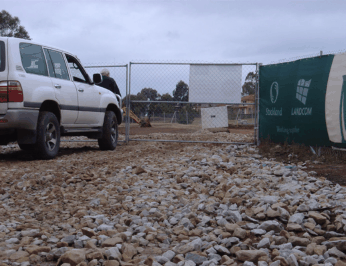

### 2.7 Erosion and Sediment Control

Erosion and

#### Sediment

#### Objective:

#### Control

■ Ensure that any potential loss of soil from a site and/or into the stormwater system is prevented by means of:

•• appropriate planning prior to the start of construction works; and

appropriate planning prior to the start of construction works; and

### •• the effective interception, diversion and control of stormwater within

the effective interception, diversion and control of stormwater within

> [Picture on page 12: a picture, saved as a picture (images/vol-1-part-02-requirements-applying-to-all-types-of-developm-page-12-12.gif, 150 dpi).]

the site.

the site.

#### Design Requirements

Figure 2.7.1 - Example of a stabilised, all weather access point.

a)

a)	 An Erosion and Sediment Control Plan

An Erosion and Sediment Control Plan (ESCP) shall be prepared and submitted

(ESCP) shall be prepared and submitted with a development application

with a development application proposing construction and/or

proposing construction and/or activities involving the disturbance

activities involving the disturbance of the land surface. For requirements

of the land surface. For requirements relating to the preparation of an ESCP,

relating to the preparation of an ESCP, refer to Appendix 5 of Volume 1 and

refer to Appendix 5 of Volume 1 and Council’s Engineering Design Guide for Development available from Council’s website at www.campbelltown.nsw. gov.au . b)

b)	 Site activities shall be planned and

Site activities shall be planned and managed to minimise soil disturbance.

managed to minimise soil disturbance. c)

c)	 Catch drains or diversion banks shall be

Catch drains or diversion banks shall be designed and constructed to divert water

designed and constructed to divert water around any area of soil disturbance.

around any area of soil disturbance. d)

d)	 All stockpiles shall be located within the

All stockpiles shall be located within the sediment control zone and shall not be

sediment control zone and shall not be located within an overland flow path.

located within an overland flow path.
