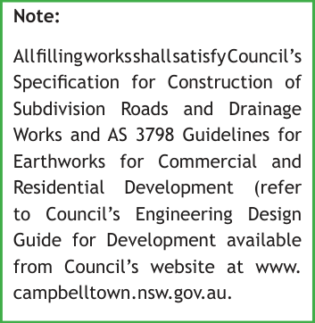
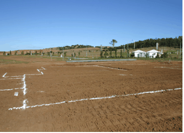

### 2.8 Cut, Fill and Floor Levels

Cut, Fill and

#### Floor Levels

#### Objectives:

■Minimise the extent of earthworks associated with development. ■Ensure that development appropriately responds to site conditions with proper consideration given to land capability and privacy/amenity of adjoining properties. ■Ensure that excavation is minimised and properly retained. ■Ensure that adequate freeboard is provided to protect development from overland flows and flooding.

#### 2.8.1 Cut and Fill

#### Design Requirements

a)

a)	 A Cut and Fill Management Plan (CFMP)

A Cut and Fill Management Plan (CFMP) shall be submitted with a development

shall be submitted with a development application where the development

application where the development incorporates cut and/or fill operations.

incorporates cut and/or fill operations. Note: For the requirements relating to a

Note: For the requirements relating to a CFMP refer to Appendix 6.

CFMP refer to Appendix 6.

Natural Ground

Level

Building Platform

Max. 1.0 metre Cut

Max. 1.0 metre Fill

b)

b)	 For any dwellings  within residential

For any dwellings  within residential zones, the maximum level of cut shall

zones, the maximum level of cut shall not exceed 1.0 metre below the ground

not exceed 1.0 metre below the ground level (existing) and the maximum level

level (existing) and the maximum level of fill shall not exceed 1.0 metre above

of fill shall not exceed 1.0 metre above ground level (existing), when measured

ground level (existing), when measured at any corner of the building platform.

at any corner of the building platform.

Figure 2.8.1 – Cross section of cut and fill on a residential site.

> [Picture on page 13: a picture, saved as a picture (images/vol-1-part-02-requirements-applying-to-all-types-of-developm-page-13-49.gif, 150 dpi).]

Note:

c)

c)	 Any excavation within the zone of

Any excavation within the zone of influence of any other structure requires

influence of any other structure requires a ‘dilapidation report’ (prepared by a

a ‘dilapidation report’ (prepared by a suitably qualified person) demonstrating

suitably qualified person) demonstrating that adequate ameliorative measures

that adequate ameliorative measures are to be implemented to protect the

are to be implemented to protect the integrity of any structure.

integrity of any structure. d)

d)	 Development incorporating any cut

Development incorporating any cut or  fill shall comply with the following

or  fill shall comply with the following requirements:

requirements: i)

i) minimum cross fall of 1% to any

minimum cross fall of 1% to any adjoining waterway; and

adjoining waterway; and

For additional information and requirements on how to address salinity, refer to Salinity Section of Council’s Engineering Design Guide for Development (available from Council’s website at www. campbelltown.nsw.gov.au)

ii)

ii)	 batters to be no steeper than 2H:1V

batters to be no steeper than 2H:1V (‘H’ stands for the term ‘horizontal

(‘H’ stands for the term ‘horizontal distance’ and ‘V’ stands for the

distance’ and ‘V’ stands for the

term ‘Vertical distance’;

term ‘Vertical distance’;

> [Picture on page 14: a picture, saved as a picture (images/vol-1-part-02-requirements-applying-to-all-types-of-developm-page-14-3.gif, 150 dpi).]

#### Note:

iii)

iii)	 batters to be no steeper than 6H:1V

batters to be no steeper than 6H:1V for public areas.

for public areas.

Cut, Fill and

#### Floor Levels

e)

e)	 All fill shall be ‘Virgin Excavated Natural

All fill shall be ‘Virgin Excavated Natural Material’ (VENM).

Material’ (VENM). f)

f) No fill shall be deposited in the vicinity

No fill shall be deposited in the vicinity of native vegetation.

of native vegetation. g)

g)	 All basement excavation shall be

All basement excavation shall be setback a minimum of 900mm from the

setback a minimum of 900mm from the property boundaries.

property boundaries.

All filling works shall satisfy Council’s Specification for Construction of Subdivision Roads and Drainage Works and AS 3798 Guidelines for Earthworks for Commercial and Residential Development (refer to Council’s Engineering Design Guide for Development available from Council’s website at www. campbelltown.nsw.gov.au.

> [Picture on page 14: a picture, saved as a picture (images/vol-1-part-02-requirements-applying-to-all-types-of-developm-page-14-39.gif, 150 dpi).]

h)

h)	 Provisions of basements shall not result

Provisions of basements shall not result in non-compliance with deep soil

in non-compliance with deep soil planting controls contained within this

planting controls contained within this plan.

plan.

#### 2.8.2 Surface Water and Floor Levels

#### 2.8.2 Surface Water and Floor Levels

#### Design Requirements

a)

a)	 Development shall not occur on

Development shall not occur on land  that is affected by the 100-year

land  that is affected by the 100-year ARI event unless the development is

ARI event unless the development is consistent with the NSW Floodplain

consistent with the NSW Floodplain Development Manual.

Development Manual.

Figure 2.8.2 – Proposed building platform.

b)

b)	 All development on land affected by

All development on land affected by stormwater flow from main stream,

stormwater flow from main stream, local creek or over land flow shall

local creek or over land flow shall satisfy the relevant fill and floor level

satisfy the relevant fill and floor level requirements as specified in Table 2.8.1.

requirements as specified in Table 2.8.1.

#### Note:

c)

c)	 All development shall have a ground

All development shall have a ground surface level, at or above  a minimum,

surface level, at or above  a minimum, equal to the 100-year ‘average

equal to the 100-year ‘average recurrence interval’ (ARI) flood level.

recurrence interval’ (ARI) flood level.

The minimum heights refer to under Clause 2.8.2 d) are to the top of the finished ground level after completion of paving and similar.

#### Note:

The development shall satisfy Sydney Water’s requirements for 150mm clearance between finished floor level and the surface of the sewer surcharge gully.

d)

d)	 For development on land not affected

For development on land not affected by an overland flow path the minimum

by an overland flow path the minimum height of the slab above finished ground

height of the slab above finished ground level shall be 150 mm, except in sandy,

level shall be 150 mm, except in sandy, well-drained areas where the minimum

well-drained areas where the minimum height shall be 100mm. These heights

height shall be 100mm. These heights can be reduced locally to 50mm near

can be reduced locally to 50mm near adjoining paved areas that slope away

adjoining paved areas that slope away from the building in accordance with

from the building in accordance with AS 2870 (Residential Slabs and Footings

AS 2870 (Residential Slabs and Footings Construction)

Construction). .

e)	 Buildings involving basements,

Cut, Fill and

#### Floor Levels

hospitals, seniors living dwellings and educational establishment with more than 50 students shall comply with the provisions of Council’s Engineering Design Guide for Development available from Council’s website at www. campbelltown.nsw.gov.au.

#### Note:

f)

f) Any solid fence constructed across an

Any solid fence constructed across an overland flow path shall be a minimum

overland flow path shall be a minimum 100mm above the finished surface level

100mm above the finished surface level of the overland flow path.

of the overland flow path.

Any allotments located on land that has been filled, shall be burdened by an 88B restriction regarding that fill and shall be noted on the respective Section 149 certificate.

g)

g)	 Where underground car parking is

Where underground car parking is proposed, measures shall be taken

proposed, measures shall be taken in design and construction to ensure

in design and construction to ensure escape routes, pump out drainage

escape routes, pump out drainage systems (which include backup systems)

systems (which include backup systems) and location of service utilities

and location of service utilities (including power, phone, lifts) are

(including power, phone, lifts) are appropriately located in relation to the

appropriately located in relation to the 100 year ARI event, in accordance with

100 year ARI event, in accordance with Section 4.13.8 of Council’s

Section 4.13.8 of Council’s Engineering Design Guide for Development available from Council’s website at www. campbelltown.nsw.gov.au.

#### Table 2.8.1 Floor Level Requirements

| Development Criteria | Where the depth of flow is: | Minimum Freeboard above the predicted 100yr ARI Flood level |
|---|---|---|
| Floor Level for any dwelling room* including all commercial or industrial areas | < 300mm > 300mm | 300mm 500mm |
| Floor Level in relation to any creek or major stormwater line including detention basins for any dwelling room# including all commercial or industrial areas | Any depth | 500mm |
| Garage or shed Floor Level** | <300mm >300mm | 100mm 300mm |
| Underside of solid fencing where overland flow is to be accommodated | Any depth | 100mm (min) |

\* For the purpose of Clause 2.8.2 b) ‘a dwelling room’ is any room within or attached to a dwelling excluding a garage or shed.

\** Garages and sheds with floor levels set to these standards will not be permitted to be converted to dwelling rooms at any time in the future.
