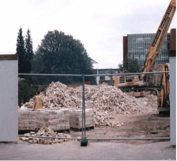

### 2.9 Demolition

#### Demolition

#### Objectives:

■ Ensure that demolition is carried out in accordance with the relevant legislation and guidelines. ■ Ensure that demolition does not have an adverse impact on the environment, buildings, footpaths and roadways or upon the safety, health and well being of

> [Picture on page 16: a picture, saved as a picture (images/vol-1-part-02-requirements-applying-to-all-types-of-developm-page-16-8.gif, 150 dpi).]

the community.

#### Design Requirements

a)

a)	 A development application involving

A development application involving demolition shall be considered having

demolition shall be considered having regard to the following information:

regard to the following information: i)

i) a detailed work plan prepared

a detailed work plan prepared by a suitably qualified person, in

by a suitably qualified person, in accordance with AS2601-2001-

accordance with AS2601-2001- The Demolition of Structures ( as

The Demolition of Structures ( as amended);

amended); ii)

ii)	 details of the licensed demolition

details of the licensed demolition contractor engaged to carry out the

contractor engaged to carry out the work (including name, address and

work (including name, address and building licence number);

building licence number);

Figure 2.9.1 – Demolition waste materials separated and stored on-site until they are safely removed for reuse, recycling or  disposal.

iii)

iii)	 a hazardous materials report that

a hazardous materials report that lists details of methods to prevent

lists details of methods to prevent air, noise and water pollution and

air, noise and water pollution and the escape of hazardous substances

the escape of hazardous substances into the public domain;

into the public domain; iv)

iv)	 details of any asbestos or other

details of any asbestos or other hazardous substances to be

hazardous substances to be removed from the site and/or

removed from the site and/or damaged during demolition; and

damaged during demolition; and v)

v)	 a dilapidation report where any

a dilapidation report where any demolition work is to be undertaken

demolition work is to be undertaken within the zone of influence of any

within the zone of influence of any other structure.

other structure.

b)

b)	 Where appropriate, demolished

Where appropriate, demolished materials  shall be recycled for reuse on

materials  shall be recycled for reuse on site.

site. Note: All demolition work shall comply with AS2601-2001 - The Demolition of Structures (as amended).
