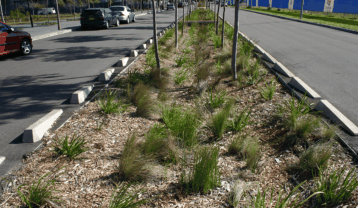
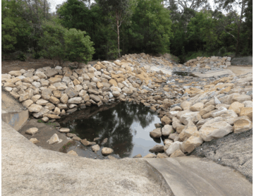

### 2.10 Water Cycle Management

#### Objectives:

#### Water Cycle

#### Management

■ Ensure  that   water cycle management appropriately responds to site and water catchment conditions. ■ Ensure that Water Sensitive Urban Design (WSUD) principles are incorporated into development. ■ Retain and reinstate (where appropriate) the natural water course into stormwater management measures. ■ Ensure that the development is protected from mainstream, local catchment

> [Picture on page 17: a picture, saved as a picture (images/vol-1-part-02-requirements-applying-to-all-types-of-developm-page-17-12.gif, 150 dpi).]

and overland flow aspects of flooding.

#### 2.10.1 Water Cycle Management

#### 2.10.1 Water Cycle Management

#### Design Requirements

a)

a)	 A comprehensive Water Cycle

A comprehensive Water Cycle Management Plan (WCMP) shall be

Management Plan (WCMP) shall be prepared and submitted as part of  a

prepared and submitted as part of  a development application.

development application.

Figure 2.10.1 - Example of a WSUD ap­ proach to water quality.

Note: For requirements relating to the preparation of a WCMP refer to Council’s Engineering Design Guide for Development available from Council’s website at www. campbelltown.nsw.gov.au .

Note: Refer to Table 2.1 Thresholds for when a WCMP is needed.

#### 2.10.2 Stormwater

#### 2.10.2 Stormwater

#### Design Requirements

a)

a)	 All stormwater systems shall be

All stormwater systems shall be sized to accommodate the 100-

sized to accommodate the 100-year ARI event (refer to Section 4 of

year ARI event (refer to Section 4 of Council’s Engineering Design Guide for Development available from Council’s website at www.campbelltown.nsw. gov.au. b)

b)	 The design and certification of any

The design and certification of any stormwater system shall be undertaken

stormwater system shall be undertaken by a suitably qualified person.

by a suitably qualified person. c)

c)	 Water quality control structures shall

Water quality control structures shall be located generally off line to creek

be located generally off line to creek paths or other watercourses. Major

paths or other watercourses. Major

detention storages shall not be located

detention storages shall not be located on areas of native vegetation or within

on areas of native vegetation or within riparian areas.

riparian areas.

#### Water Cycle

#### Management

d)

d)	 Development shall not impact on

Development shall not impact on adjoining sites by way of overland flow

adjoining sites by way of overland flow of stormwater  unless an easement is

of stormwater  unless an easement is provided. All overland flow shall be

provided. All overland flow shall be directed to designated overland flow

directed to designated overland flow paths such as roads.

paths such as roads. e)

e)	 Safe passage of the Probable Maximum

Safe passage of the Probable Maximum Flood (PMF) shall be demonstrated for

Flood (PMF) shall be demonstrated for major systems.

major systems. f)

f) A treatment train approach to water

A treatment train approach to water quality shall be incorporated into

quality shall be incorporated into the design and construction of major

the design and construction of major systems.

systems.

> [Picture on page 18: a picture, saved as a picture (images/vol-1-part-02-requirements-applying-to-all-types-of-developm-page-18-38.gif, 150 dpi).]

Figure 2.10.2 - Water quality devices can improve water quality and give an important visual enhancement to a development area.

g)

g)	 A major/minor approach to drainage

A major/minor approach to drainage is to be taken for stormwater flows.

is to be taken for stormwater flows. Generally the piped drainage system

Generally the piped drainage system shall be sized to accommodate the

shall be sized to accommodate the difference between the 100-year ARI

difference between the 100-year ARI flow and the maximum safe overland

flow and the maximum safe overland flow, with minimum requirements as set

flow, with minimum requirements as set out in section 4 of

out in section 4 of Council’s Engineering Design Guide for Development available from Council’s website at www.campbelltown.nsw.gov.au.

#### Note:

Refer to Appendix A14 - Obtaining a

Refer to Appendix A14 - Obtaining a Stormwater Easement for additional

Stormwater Easement for additional information.

information.

h)

h)	 Stormwater collected on a

Stormwater collected on a development site shall be disposed of

development site shall be disposed of (under gravity) directly to the street

(under gravity) directly to the street or to another Council drainage system/

or to another Council drainage system/ device. Where stormwater  cannot be

device. Where stormwater  cannot be discharged directly to a public drainage

discharged directly to a public drainage facility, a drainage easement of  a

facility, a drainage easement of  a suitable width shall be created over

suitable width shall be created over a downstream property(s) allowing

a downstream property(s) allowing for the provision of a drainage pipe

for the provision of a drainage pipe of suitable size to adequately drain

of suitable size to adequately drain the proposed development to a public

the proposed development to a public drainage facility.

drainage facility. Note: Rubble pits and charged lines are not generally considered a suitable drainage solution. i)

i) All proposed drainage structures

All proposed drainage structures incorporated within new development

incorporated within new development

shall be designed to maintain public

shall be designed to maintain public safety at all times.

safety at all times.

#### Water Cycle

#### Management

j)

j) Development shall not result in water

Development shall not result in water run-off causing flooding or erosion on

run-off causing flooding or erosion on adjacent properties.

adjacent properties. k)

k)	 Stormwater run-off shall be

Stormwater run-off shall be appropriately channelled into a

appropriately channelled into a stormwater drain in accordance with

stormwater drain in accordance with Council’s Engineering Design Guide for Development available from Council’s website at www.campbelltown.nsw. gov.au. l)

l) Where  applicable, the development

Where  applicable, the development shall incorporate the creation of an

shall incorporate the creation of an appropriate easement to manage

appropriate easement to manage stormwater in accordance with

stormwater in accordance with Council’s Engineering Design Guide for Development available from Council’s website at www.campbelltown.nsw. gov.au.

#### 2.10.3 Stormwater Drainage

#### 2.10.3 Stormwater Drainage

#### Design Requirements

a)

a)	 A stormwater Drainage Concept

A stormwater Drainage Concept Plan shall be prepared by a suitably

Plan shall be prepared by a suitably qualified person, and submitted with

qualified person, and submitted with all development applications, involving

all development applications, involving construction (except for internal

construction (except for internal alterations/fitouts), demonstrating to

alterations/fitouts), demonstrating to Council how the stormwater will be

Council how the stormwater will be collected and discharged from the site.

collected and discharged from the site. b)

b)	 The stormwater concept plan shall

The stormwater concept plan shall include the following information as a

include the following information as a minimum:

minimum: i)

i) locations, layouts and sizes of

locations, layouts and sizes of stormwater pipes and pits;

stormwater pipes and pits; ii)

ii)	 minimum grades and  capacity of

minimum grades and  capacity of stormwater pipes; and

stormwater pipes; and iii)

iii)	 existing and proposed easements,

existing and proposed easements, site contours and overland flow

site contours and overland flow path/s.

path/s.
