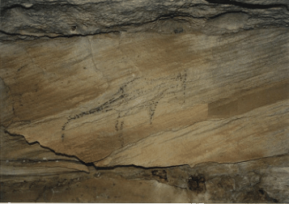
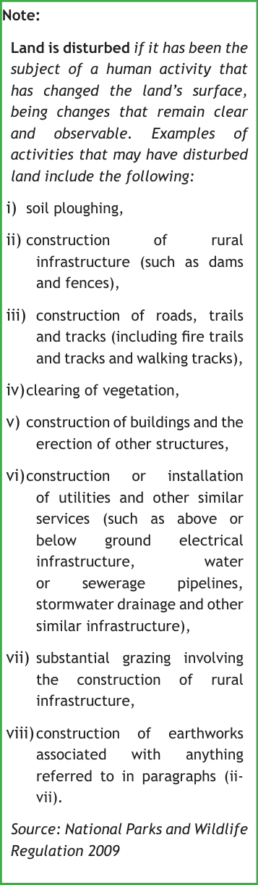
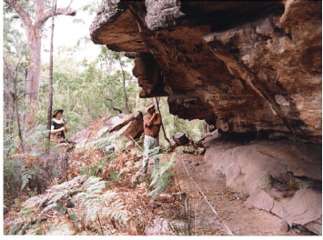
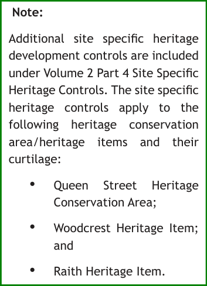
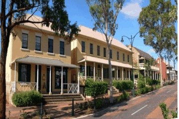

### 2.11 2.11 Heritage Conservation

#### Heritage

#### Objectives:

#### Conservation

■ Ensure that new development takes appropriate account of the significance of heritage items, heritage conservation areas, relics and their settings. ■ Respect the City’s heritage resource. ■ Promote the protection or conservation of those resources wherever possible. ■ To conserve the environmental and cultural heritage of the City in accordance with the the principles contained within the Burra Charter.

#### 2.11.1 Aboriginal Heritage

#### 2.11.1 Aboriginal Heritage

#### Design Requirements

#### Note:

The controls provided under this section are in addition to the requirements provided under Clause 5.10 Heritage Conservation of the CLEP.

> [Picture on page 20: a picture, saved as a picture (images/vol-1-part-02-requirements-applying-to-all-types-of-developm-page-20-20.gif, 150 dpi).]

a)

a)	 All developments that have the potential

All developments that have the potential to impact upon Aboriginal cultural

to impact upon Aboriginal cultural heritage must provide an assessment

heritage must provide an assessment in accordance with the “Due Diligence

in accordance with the “Due Diligence Code of Practice for the Protection of

Code of Practice for the Protection of Aboriginal Objects in NSW”, published

Aboriginal Objects in NSW”, published by the Office of Environment and

by the Office of Environment and Heritage (OEH). This requires an initial

Heritage (OEH). This requires an initial investigation of the potential impact of

investigation of the potential impact of a development on Aboriginal Cultural

a development on Aboriginal Cultural Heritage in circumstances  where

Heritage in circumstances  where the proposed development involves

the proposed development involves disturbance to cultural sites (eg.

disturbance to cultural sites (eg. Aboriginal culturally modified trees),

Aboriginal culturally modified trees), or the ground surface. This initial

or the ground surface. This initial investigation is to be undertaken by the

investigation is to be undertaken by the applicant and requires an assessment of

applicant and requires an assessment of whether there are:

whether there are:

Figure 2.11.1 - Aboriginal rock art.

i)

i) any known Aboriginal sites within

any known Aboriginal sites within the development site (determined

the development site (determined by undertaking a search of the

by undertaking a search of the Aboriginal Heritage Information

Aboriginal Heritage Information Management System (AHIMS)

Management System (AHIMS) database (which is maintained

database (which is maintained by the Office of Environment and

by the Office of Environment and Heritage); and/or

Heritage); and/or ii)

ii)	 any other sources of relevant

any other sources of relevant information of which a person is

information of which a person is already aware; and/or

already aware; and/or iii)

iii)	 Whether the development is on a

Whether the development is on a site that is not disturbed land and

site that is not disturbed land and

is:

is:

> [Picture on page 21: a map, saved as a picture (images/vol-1-part-02-requirements-applying-to-all-types-of-developm-page-21-3.gif, 150 dpi); the street names and other small labels are on the picture.]
> Words printed on the picture (title and legend, copied from the PDF):
> i)	 soil ploughing,
> ii)	construction of rural
> construction of rural
> iii)	 construction of roads, trails
> iv)	clearing of vegetation,
> v)	construction of buildings and the
> erection of other structures,
> erection of other structures,
> vi)	construction or installation
> construction or installation
> vii)	substantial grazing involving
> viii)	construction of earthworks

#### Note:

– within 200m of waters, or

#### Heritage Conservation

– located on a ridge top, ridge line or headland, or

– located within 200m below or above a cliff face, or

Land is disturbed if it has been the subject of a human activity that has changed the land’s surface, being changes that remain clear and observable. Examples of activities that may have disturbed land include the following:

– within 20m of/or in a cave, rock shelter, or a cave mouth.

infrastructure (such as dams

infrastructure (such as dams and fences),

and fences), construction of roads, trails and tracks (including fire trails

and tracks (including fire trails and tracks and walking tracks),

and tracks and walking tracks), clearing of vegetation, construction of buildings and the

b)

b)	 Where the initial investigation confirms

Where the initial investigation confirms the presence or likely presence of

the presence or likely presence of Aboriginal objects or the above

Aboriginal objects or the above landscape features, further assessment

landscape features, further assessment and visual inspection must be conducted

and visual inspection must be conducted in accordance with the “Due Diligence

in accordance with the “Due Diligence Code of Practice for the Protection of

Code of Practice for the Protection of Aboriginal Objects in NSW” by a person

Aboriginal Objects in NSW” by a person with expertise in Aboriginal cultural

with expertise in Aboriginal cultural heritage management.

heritage management.

c)	 If this assessment indicates that there

of utilities and other similar

of utilities and other similar services (such as above or

services (such as above or below ground electrical

below ground electrical infrastructure, water

infrastructure, water or sewerage pipelines,

or sewerage pipelines, stormwater drainage and other

stormwater drainage and other similar infrastructure),

similar infrastructure), substantial grazing involving the construction of rural

the construction of rural infrastructure,

infrastructure,

are, or are likely to be, Aboriginal objects, and/or an Aboriginal Place in the area of the proposed activity, more detailed investigation and an impact assessment shall be required and must be prepared by a person with expertise in Aboriginal cultural heritage management.  Where it is determined that harm could occur to Aboriginal objects then an Aboriginal Heritage Impact Permit application must be made to the OEH (and be approved prior to works occurring).

d)	 The assessment shall be prepared

construction of earthworks associated with anything

associated with anything referred to in paragraphs (ii-

referred to in paragraphs (ii-vii).

vii).

in accordance with the following documents:

Source: National Parks and Wildlife Regulation 2009

i) Due Diligence Code of Practice for the Protection of Aboriginal Objects in NSW (2010);

ii)	 Code of Practice for Archaeological Investigation of Aboriginal Objects in New South Wales (2010); and

iii)	 Aboriginal cultural heritage consultation requirements for proponents 2010.  Part 6 National

Parks and Wildlife Act 1974 (2010).

e)	 The assessment shall take into account

#### Heritage

the following documents:

#### Conservation

i)

i) Operational Policy: Protecting

Operational Policy: Protecting Aboriginal Cultural Heritage

Aboriginal Cultural Heritage (February 2009);

(February 2009);

ii)	 OEH Guide to investigating, assessing and reporting on Aboriginal cultural heritage in NSW (2011).

Note: The Office of Environment and Heritage web site has further information about how to do a detailed investigation and Aboriginal Heritage Impact Permit applications (www.environment.nsw.gov. au).

> [Picture on page 22: a picture, saved as a picture (images/vol-1-part-02-requirements-applying-to-all-types-of-developm-page-22-23.gif, 150 dpi).]

Figure 2.11.2 - Rock shelters often contain artefacts in the form of rock art or occupation deposits.

Note. For the purpose of this Section: Aboriginal culturally modified tree means a tree that, before or concurrent with (or

both) the occupation of the area in which the tree is located by persons of non- Aboriginal extraction, has been scarred, carved or modified by an Aboriginal person by:

(a) the deliberate removal, by traditional methods, of bark or wood from the tree, or

(b) the deliberate modification, by traditional methods, of the wood of the tree.

> [Picture on page 23: a picture, saved as a picture (images/vol-1-part-02-requirements-applying-to-all-types-of-developm-page-23-1.gif, 150 dpi).]
> Words printed on the picture (title and legend, copied from the PDF):
> Queen Street Heritage
> Conservation Area;
> Conservation Area;
> Woodcrest Heritage Item;
> and
> and
> Raith Heritage Item.

#### Note:

#### 2.11.2 Heritage

#### 2.11.2 Heritage

#### Design Requirements

#### Heritage

#### Conservation

a)

a)	 Any development application made in

Any development application made in respect to development on land that is:

respect to development on land that is: i)

i) occupied by a heritage item; or

occupied by a heritage item; or ii)

ii)	 adjoining land occupied by a

adjoining land occupied by a heritage item; or

heritage item; or

Additional site specific heritage development controls are included under Volume 2 Part 4 Site Specific Heritage Controls. The site specific heritage controls apply to the following heritage conservation area/heritage items and their curtilage:

iii)

iii)	 located within a heritage

located within a heritage conservation area,

conservation area,

•• Queen Street Heritage •• Woodcrest Heritage Item;

### •• Raith Heritage Item.

shall provide a Statement of Heritage Impact (SHI) that assesses the impact of the proposed development  on the heritage significance, visual curtilage and setting of the heritage item or conservation area. b)

b)	 Any development on land occupied by

Any development on land occupied by an item of heritage, or land located

an item of heritage, or land located within a heritage conservation area

within a heritage conservation area shall be designed by a suitably qualified

shall be designed by a suitably qualified person and have regard to the provisions

person and have regard to the provisions of any relevant study or Conservation

of any relevant study or Conservation Management Plan (CMP) .

Management Plan (CMP) .

#### Heritage Impact Statement

is a document consisting of a statement demonstrating the heritage significance of a heritage item or heritage conservation area, or of a building work, archaeological site, tree or place within a heritage conservation area, an assessment of the impact that proposed development

development

will have on that significance

will have on that significance and proposals for measures to

and proposals for measures to minimise impacts.

minimise impacts.

> [Picture on page 23: a picture, saved as a picture (images/vol-1-part-02-requirements-applying-to-all-types-of-developm-page-23-75.gif, 150 dpi).]

c)

c)	 Unless otherwise advised by council, a

Unless otherwise advised by council, a Conservation Management Plan (CMP)

Conservation Management Plan (CMP) shall be required for all proposed

shall be required for all proposed development involving the adaptive

development involving the adaptive reuse of a heritage item, or major

reuse of a heritage item, or major alterations and additions.

alterations and additions. Note: The CMP shall be prepared by a suitably qualified person in accordance with the relevant guidelines of the NSW Office of Environment and Heritage.

Note: For requirements relating to the preparation of a heritage impact assessment report refer to Appendix 9.

Figure 2.11.3 - Careful consideration shall be given to any development that has the potential to impact on items of heritage and their setting.

Note: A Heritage Impact Statement  must be prepared by a suitably qualified person in accordance with the document “Statements of Heritage Impact” published by the NSW Heritage Branch and available for view at:www.environment.nsw.gov.au
