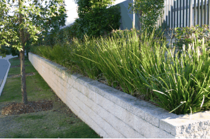

### 2.12 2.12  Retaining Walls

#### Retaining Walls

#### Objective:

■ Ensure that retaining walls visible to a public place are compatible with the character and scale of development within the streetscape and other public

> [Picture on page 24: a picture, saved as a picture (images/vol-1-part-02-requirements-applying-to-all-types-of-developm-page-24-7.gif, 150 dpi).]

domain areas in the locality.

#### Design Requirements

a)

a)	 Any retaining wall that is not complying

Any retaining wall that is not complying or exempt development as specified

or exempt development as specified in the E&CDC shall be designed by a

in the E&CDC shall be designed by a suitably qualified person.

suitably qualified person. b)

b)	 In the case of retaining walls

In the case of retaining walls constructed to support proposed fill

constructed to support proposed fill on an allotment, the following design

on an allotment, the following design criteria shall apply:

criteria shall apply:

Figure 2.12.1 - Example of a retaining wall.

i)

i) No filling shall be permitted within

No filling shall be permitted within 2 metres of any property boundary

2 metres of any property boundary unless sufficient details are

unless sufficient details are submitted to Council illustrating

submitted to Council illustrating how privacy, overshadowing,

how privacy, overshadowing, stormwater management and

stormwater management and access issues have been addressed

access issues have been addressed to Council’s satisfaction.

to Council’s satisfaction.

c)

c)	 In the case of retaining walls

In the case of retaining walls constructed to support proposed cut

constructed to support proposed cut on an allotment, the following design

on an allotment, the following design criteria shall apply:

criteria shall apply: i)

i) The retaining wall shall be setback

The retaining wall shall be setback a minimum of 450mm from the

a minimum of 450mm from the rear and side boundary of the lot

rear and side boundary of the lot containing the cut.

containing the cut.

Note: Council will consider on merit, a

Note: Council will consider on merit, a zero setback of retaining walls, only where

zero setback of retaining walls, only where neighbours’ consent has been obtained

neighbours’ consent has been obtained and submitted as part of the DA. This

and submitted as part of the DA. This must include consent for the creation of

must include consent for the creation of a 900 mm maintenance easement over the

a 900 mm maintenance easement over the neighbouring property.

neighbouring property. d)

d)	 Any retaining wall shall not adversely

Any retaining wall shall not adversely alter surface flows to adjoining private

alter surface flows to adjoining private land.

land. e)

e)	 Any retaining wall and associated

Any retaining wall and associated

#### Retaining Walls

structures shall be designed to be

structures shall be designed to be located wholly within the property

located wholly within the property boundary, except where written or

boundary, except where written or legal agreements have been reached

legal agreements have been reached between relevant parties to Council’s

between relevant parties to Council’s satisfaction.

satisfaction. f)

f) Any excavation within the zone of

Any excavation within the zone of influence for any other structure

influence for any other structure or building requires a Structural

or building requires a Structural Engineering Report (prepared by

Engineering Report (prepared by a suitably qualified professional)

a suitably qualified professional) demonstrating that adequate and

demonstrating that adequate and appropriate measures are to be

appropriate measures are to be implemented to protect the integrity of

implemented to protect the integrity of any structure.

any structure. g)

g)	 Where retaining walls are proposed

Where retaining walls are proposed along the side boundary of the property,

along the side boundary of the property, the side setback where the retaining

the side setback where the retaining wall is proposed shall be increased

wall is proposed shall be increased from0.9metres to 1.2 metres.

from0.9metres to 1.2 metres. h)

h)	 Any retaining wall requiring work on

Any retaining wall requiring work on neighbouring properties shall require

neighbouring properties shall require the consent of the adjoining owner/s.

the consent of the adjoining owner/s. i)

i) Retaining walls higher than 600mm shall

Retaining walls higher than 600mm shall be designed by a structural engineer

be designed by a structural engineer and made from appropriate material.

and made from appropriate material. j)

j) Any retaining wall(s) proposed on land

Any retaining wall(s) proposed on land designated as being bush fire prone

designated as being bush fire prone must be constructed of non-combustible

must be constructed of non-combustible materials.

materials.
