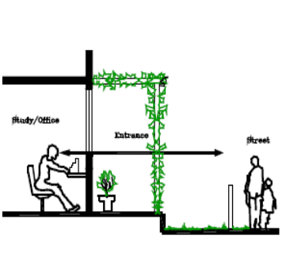

### 2.13 Security

#### Security

#### Objective:

■ Ensure that development incorporates security features in accordance with the principles of Crime Prevention Through Environmental Design (CPTED) to:

> [Picture on page 26: a picture, saved as a picture (images/vol-1-part-02-requirements-applying-to-all-types-of-developm-page-26-6.gif, 150 dpi).]

•• minimise opportunities for crime; and

minimise opportunities for crime; and

### •• enhance security.

enhance security.

#### Design Requirements

a)

a)	 Development shall be designed to:

Development shall be designed to: i)

i) maximise, where possible,

maximise, where possible, casual 	surveillance opportunities

casual 	surveillance opportunities to the 	street and surrounding

to the 	street and surrounding public places;

public places; ii)

ii)	 minimise dead ends and other

minimise dead ends and other possible entrapment areas;

possible entrapment areas; iii)

iii)	 clearly  identify and illuminate

clearly  identify and illuminate access points to buildings and

access points to buildings and designated public places; and

designated public places; and

Figure 2.13.1 - Illustration of how buildings may be designed to provide for passive surveillance to and from a public place.

iv)

iv)	 clearly differentiate between

clearly differentiate between private and public space.

private and public space.

b)

b)	 External lighting shall be designed to:

External lighting shall be designed to: i)

i) encourage the use of safe areas;

encourage the use of safe areas; ii)

ii)	 define safe corridors for movement

define safe corridors for movement of people; and

of people; and iii)

iii)	 allow facial recognition of

allow facial recognition of approaching pedestrians at 15

approaching pedestrians at 15 metres.

metres.

c)

c)	 Development shall incorporate

Development shall incorporate appropriate landscaping, fencing and

appropriate landscaping, fencing and security devices to assist in crime

security devices to assist in crime prevention.

prevention. d)

d)	 Commercial and industrial buildings

Commercial and industrial buildings that are not secured from public

that are not secured from public access after close of business shall

access after close of business shall have external finishes that are graffiti

have external finishes that are graffiti resistant.

resistant. e)

e)	 Development applications for multi

Development applications for multi dwelling housing, attached dwellings

dwelling housing, attached dwellings residential flat buildings, mixed-use

residential flat buildings, mixed-use

#### Security

development, boarding houses, shop

development, boarding houses, shop top housing, commercial development,

top housing, commercial development, industrial development  and large

industrial development  and large scale subdivision comprising more

scale subdivision comprising more than 10 dwellings/units allotments or

than 10 dwellings/units allotments or incorporating works to be dedicated

incorporating works to be dedicated to Council shall be accompanied by a

to Council shall be accompanied by a crime prevention plan to be  prepared

crime prevention plan to be  prepared by a suitably qualified person addressing

by a suitably qualified person addressing how the development

how the development embraces the principles of  Crime Prevention Through Environmental Design. Note: For requirements relating to the preparation of a Crime Prevention Plan refer to Appendix 13.
