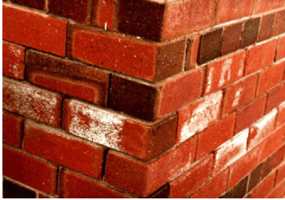
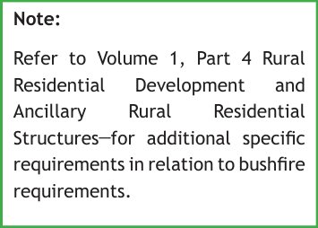

### 2.14 2.14 Risk Management

#### Objective:

#### Risk

#### Management

■ Ensure that hazards of the site are addressed so as to minimise the risk of:

> [Picture on page 28: a picture, saved as a picture (images/vol-1-part-02-requirements-applying-to-all-types-of-developm-page-28-6.gif, 150 dpi).]

•• injury to persons/property;

injury to persons/property;

•• damage to the environment; and

damage to the environment; and

### •• financial loss.

financial loss.

#### 2.14.1 Salinity

#### 2.14.1 Salinity

#### Design Requirements

a)

a)	 Any development :

Any development : i)

i) within 50 metres of the top of the

within 50 metres of the top of the bank of a watercourse;

bank of a watercourse; ii)

ii)	 located in an area that has bare soil

located in an area that has bare soil patches or salt scalds;

patches or salt scalds; iii)

iii)	 occupied by soils that appear

occupied by soils that appear ‘puffy’ when dry, or greasy when

‘puffy’ when dry, or greasy when wet;

wet; iv)

iv)	 located in an area that is occupied

located in an area that is occupied by salt tolerant plant species;

by salt tolerant plant species; v)

v)	 located in an area that has

located in an area that has white 	staining on  nearby house

white 	staining on  nearby house foundations or walls; or

foundations or walls; or vi)

vi)	 located on soils that are derived

located on soils that are derived from Wianamatta Shale;

from Wianamatta Shale; shall be designed in accordance with Section 5.8 Council’s Engineering Design Guide for Development available from Council’s website at www.campbelltown.nsw.gov.au.

b)

b)	 A detailed Salinity Analysis and

A detailed Salinity Analysis and Remedial Action Plan shall be prepared

Remedial Action Plan shall be prepared and submitted with the development

and submitted with the development application if:

application if: i)

i) the site has been identified as being

the site has been identified as being subject to  a salinity hazard; or

subject to  a salinity hazard; or

Figure 2.14.1 - Salt damage in the brickwork of buildings identifies a possible salinity problem in the area.

ii)

ii)	 an investigation reveals that the

an investigation reveals that the land is saline.

land is saline.

#### 2.14.2 Bushfire

#### 2.14.2 Bushfire

#### Design Requirements

#### Risk Management

a)

a)	 Development shall be designed and

Development shall be designed and located so as to minimise the risk of loss

located so as to minimise the risk of loss of life or property from bushfire.

of life or property from bushfire. b)

b)	 Development on bush fire prone land (as

Development on bush fire prone land (as detailed on the Campbelltown Bush Fire

detailed on the Campbelltown Bush Fire Prone Lands Map) shall comply with the

Prone Lands Map) shall comply with the requirements of

requirements of Planning for Bushfire

Planning for Bushfire

Protection, ( NSW Rural Fire Service)  as

Protection, ( NSW Rural Fire Service)  as amended.

amended. c)

c)	 Development applications relating to

Development applications relating to land identified on the Bushfire  Prone

land identified on the Bushfire  Prone Land Map shall be accompanied by a

Land Map shall be accompanied by a Bushfire Hazard Assessment Report

Bushfire Hazard Assessment Report prepared by a suitably qualified person.

prepared by a suitably qualified person. d)

d)	 All ‘Asset Protection Zones’ shall

All ‘Asset Protection Zones’ shall be provided within the boundary of

be provided within the boundary of the subject land. National Parks,

the subject land. National Parks, Crown Reserves, water catchments,

Crown Reserves, water catchments, easements, Council managed reserves,

easements, Council managed reserves, riparian corridors other private land

riparian corridors other private land shall not be considered as part of asset

shall not be considered as part of asset protection zones unless approved by the

protection zones unless approved by the NSW Rural Fire Service.

NSW Rural Fire Service. e)

e)	 Adequate water reserves for fire fighting

Adequate water reserves for fire fighting shall be available and accessible on site

shall be available and accessible on site as specified in

as specified in Planning for Bushfire

Planning for Bushfire

Protection, as amended

Protection, as amended. Hazard

. Hazard

reduction (burning or mechanical)

reduction (burning or mechanical) proposals shall be in accordance with

proposals shall be in accordance with the

the Campbelltown Bush Fire Risk

Campbelltown Bush Fire Risk

Management Plan and the Bush Fire

Management Plan and the Bush Fire Environmental Assessment Code

Environmental Assessment Code. . Landowners wishing to undertake

Landowners wishing to undertake hazard reduction shall contact the

hazard reduction shall contact the NSW Rural Fire Service (NSWRFS)

NSW Rural Fire Service (NSWRFS) for

for

any requirements. Applications to

any requirements. Applications to undertake hazard reduction will be

undertake hazard reduction will be assessed by the

assessed by the NSWRFS

NSWRFS under the

under the

Bushfire Environmental Assessment

Bushfire Environmental Assessment Code.

Code. Guidelines for hazard reduction include: i)

i) as far as possible, the frequency,

as far as possible, the frequency, time of year and intensity of any

time of year and intensity of any

hazard reduction burning in native

hazard reduction burning in native vegetation  is  to   approximate

vegetation  is  to   approximate the natural regime; and

the natural regime; and

#### Risk

#### Management

ii)

ii)	 periodic weed monitoring and

periodic weed monitoring and control shall be undertaken after

control shall be undertaken after bushfires   and hazard reduction

bushfires   and hazard reduction burning, and appropriate action

burning, and appropriate action taken as necessary.

taken as necessary.

> [Picture on page 30: a picture, saved as a picture (images/vol-1-part-02-requirements-applying-to-all-types-of-developm-page-30-20.gif, 150 dpi).]

#### Note:

f)

f) Any development proposing the removal

Any development proposing the removal of native vegetation for APZ purposes

of native vegetation for APZ purposes shall investigate the environmental

shall investigate the environmental impact of the removal of that vegetation.

impact of the removal of that vegetation.

Refer to Volume 1, Part 4 Rural Residential Development and Ancillary Rural Residential Structures for additional specific requirements in relation to bushfire requirements.

#### 2.14.3 Subsidence

#### 2.14.3 Subsidence

#### Design Requirements

a)

a)	 Any development on a site located within

Any development on a site located within South Campbelltown Mine Subsidence

South Campbelltown Mine Subsidence District, or Appin Mine Subsidence

District, or Appin Mine Subsidence District may be at risk of  the effects

District may be at risk of  the effects of subsidence from past and/or future

of subsidence from past and/or future underground mining. An appropriate

underground mining. An appropriate engineering outcome shall be achieved.

engineering outcome shall be achieved. b)

b)	 An applicant shall make appropriate

An applicant shall make appropriate enquiries and have plans stamped  with

enquiries and have plans stamped  with the Mine Subsidence Board regarding any

the Mine Subsidence Board regarding any construction requirements for any type

construction requirements for any type of development involving the erection

of development involving the erection of a building within a mine subsidence

of a building within a mine subsidence district prior to a development

district prior to a development application being submitted to Council.

application being submitted to Council. Note: A copy of the South Campbelltown Mine Subsidence District map can be inspected at Council’s Civic Centre or at www.minesub. nsw.gov.au.

#### 2.14.4 Public Health

#### 2.14.4 Public Health

#### Design Requirements

a)

a)	 Cooling towers shall be located in

Cooling towers shall be located in accordance with the requirements of

accordance with the requirements of the following standards:

the following standards: i)

i) Australian Standard No. AS/

Australian Standard No. AS/ NZS 3666 Part 1,

NZS 3666 Part 1, Air-Handling

Air-Handling

and Water Systems of Buildings-

and Water Systems of Buildings- Microbial Control Installation and

Microbial Control Installation and

Commissioning (as amended).

Commissioning (as amended).

#### Risk

#### Management

ii)

ii)	 Australian Standard No. AS/

Australian Standard No. AS/ NZS 3666 Part 2,

NZS 3666 Part 2, Air-Handling

Air-Handling

and Water Systems of Buildings-

and Water Systems of Buildings- Microbial Control Operation and

Microbial Control Operation and maintenance (as amended).

maintenance (as amended). iii)

iii)	 Australian Standard No. AS/

Australian Standard No. AS/ NZS 3666 Part 3,

NZS 3666 Part 3, Air-Handling

Air-Handling

and Water Systems of Buildings-

and Water Systems of Buildings- Microbial Control Performance-

Microbial Control Performance-based maintenance of cooling

based maintenance of cooling water systems  (as amended).

water systems  (as amended).
