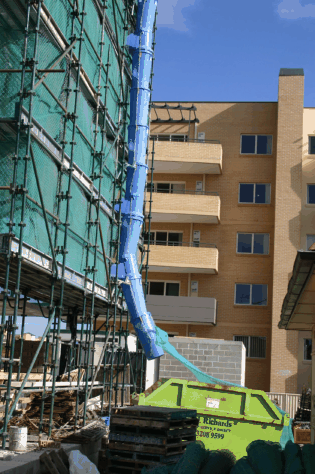

### 2.15 2.15 Waste Management

#### Waste Management

#### Objectives:

■ Ensure waste systems are easy to use and that, where necessary, collection vehicles are able to access buildings to remove waste. ■ Ensure that developments meet requirements for long term sustainability and best practice. ■ Ensure developments achieve effective waste and resource recovery management. ■ Ensure that developments protect and enhance the quality of life for the community. ■ Ensure healthy and safe practices for the storage, handling and collection of waste and recycling materials. ■ Prevent stormwater pollution that may occur as a result of poor or incorrect storage and management arrangements for recyclables and waste. ■ Promote the principles of Ecologically Sustainable Development through appropriate resource recovery and recycling, leading to a reduction in the consumption of finite natural resources.

#### 2.15.1 Waste Management Plan

#### 2.15.1 Waste Management Plan

#### Design Requirements

a)

a)	 A detailed Waste Management Plan

A detailed Waste Management Plan (WMP), prepared by an appropriately

(WMP), prepared by an appropriately qualified waste management

qualified waste management professional, shall accompany

professional, shall accompany development applications for certain

development applications for certain types of development/land uses, as

types of development/land uses, as detailed in Table 2.15.1 and for any

detailed in Table 2.15.1 and for any other development that in

other development that in the opinion

the opinion

of Council a WMP is required.

of Council a WMP is required. b)

b)	 Plans submitted with a development

Plans submitted with a development application shall detail the following

application shall detail the following (as applicable):

(as applicable): i)

i) the size and location of waste and

the size and location of waste and recycling storage areas;

recycling storage areas; ii)

ii)	 routes for occupants to access

routes for occupants to access waste and recycling areas;

waste and recycling areas; iii)

iii)	 collection point and/or access

collection point and/or access route for collection vehicles;

route for collection vehicles;

iv)

iv)	 ventilation of waste and recycling

ventilation of waste and recycling storage areas;

storage areas;

#### Waste Management

v)

v)	 location of garbage chute and service

location of garbage chute and service rooms;

rooms; vi)

vi)	 bin and storage area washing facilities;

bin and storage area washing facilities; and

and vii)

vii)	occupants’ disposal points for all

occupants’ disposal points for all waste streams.

waste streams.

Note: Waste Management Plan forms are available on Council’s web site at www. campbelltown.nsw.gov.au.

#### 2.15.2	Waste Management During

#### 2.15.2	Waste Management During Demolition and Construction

#### Demolition and Construction

#### Design Requirements

a)

a)	 Waste and recyclable streams shall be

Waste and recyclable streams shall be stored separately on site.

stored separately on site.

> [Picture on page 33: a picture, saved as a picture (images/vol-1-part-02-requirements-applying-to-all-types-of-developm-page-33-36.gif, 150 dpi).]

Figure 2.15.1 – Example of management of construction waste.

> [Picture text on page 33 is stored in the PDF without readable letters (no character map), so it could not be copied; see the original PDF.]

b)

b)	 All storage areas/containers for each waste

All storage areas/containers for each waste and recycling stream shall be kept on the

and recycling stream shall be kept on the site at all times and shall be indicated on

site at all times and shall be indicated on the site plans/drawings as part of the WMP.

the site plans/drawings as part of the WMP. c)

c)	 Where material cannot be reused or

Where material cannot be reused or recycled, it shall be disposed of at an

recycled, it shall be disposed of at an

#### Table 2.15.1 – Requirements for submitting a WMP

| Development Type | Demolition | Construction | Ongoing |
|---|---|---|---|
| Dwelling houses (including secondary dwellings and out­ buildings) |  |  |  |
| Dual occupancies, semi-detached dwellings |  |  |  |
| Multi dwelling housing, manor houses, attached dwellings |  |  |  |
| Residential flat buildings and boarding houses |  |  |  |
| Mixed use development |  |  |  |
| Centre-based child care facilities |  |  |  |
| Seniors housing and housing for people with a disability |  |  |  |
| Building fit out |  |  |  |
| Commercial development |  |  |  |
| Industrial development |  |  |  |

appropriately licensed waste management

appropriately licensed waste management or recycling facility. Details of disposal

or recycling facility. Details of disposal arrangements shall be specified in the WMP

arrangements shall be specified in the WMP for each material type.

for each material type. d)

d)	 Convenient and safe heavy vehicular access

Convenient and safe heavy vehicular access to waste and recycling material storage areas

to waste and recycling material storage areas shall be provided.

shall be provided. e)

e)	 The removal, handling and disposal of

The removal, handling and disposal of asbestos or other hazardous materials shall

asbestos or other hazardous materials shall be carried out in accordance with WorkCover

be carried out in accordance with WorkCover NSW, NSW Environment & Protection Authority

NSW, NSW Environment & Protection Authority (EPA), Office of Environment and Heritage

(EPA), Office of Environment and Heritage and other regulatory authority guidelines and

and other regulatory authority guidelines and requirements.

requirements.

#### 2.15.3 On-going Waste Management

#### 2.15.3 On-going Waste Management

#### Design Requirements

a)

a)	 Provision shall be made for all waste and

Provision shall be made for all waste and recycling storage containers to be located

recycling storage containers to be located behind the primary and secondary building

behind the primary and secondary building line and out of public view.

line and out of public view. b)

b)	 Any room(s) for storing garbage and recycling

Any room(s) for storing garbage and recycling recepticles shall be located in a position that

recepticles shall be located in a position that provides convenient access for residents,

provides convenient access for residents, maintanence and waste collection staff.

maintanence and waste collection staff. Bin storage rooms shall complement the

Bin storage rooms shall complement the development and not be visibly obtrusive

development and not be visibly obtrusive when viewed from any public place.

when viewed from any public place. c)

c)	 A waste collection point shall be nominated

A waste collection point shall be nominated demonstrating that waste-loading operations

demonstrating that waste-loading operations can occur on a level surface not adjacent to

can occur on a level surface not adjacent to steep gradients, vehicle ramps and pedestrian

steep gradients, vehicle ramps and pedestrian access points.

access points. d)

d)	 The path for wheeling bins between waste

The path for wheeling bins between waste storage area(s) and the collection vehicle shall

storage area(s) and the collection vehicle shall be free of steps or kerbs and have a maximum

be free of steps or kerbs and have a maximum gradient of 1V:8H.

gradient of 1V:8H. e)

e)	 For safety and ease of manoeuvrability, the

For safety and ease of manoeuvrability, the distance required for residents, building

distance required for residents, building managers and caretakers to wheel bins to

managers and caretakers to wheel bins to their collection point shall be the minimum

their collection point shall be the minimum achievable.

achievable. f)

f) Where the bin-carting route from the storage

Where the bin-carting route from the storage area to the collection point exceeds the

area to the collection point exceeds the maximum distance or gradient, or a large

maximum distance or gradient, or a large

number of bins need to be moved around the

number of bins need to be moved around the site, a dock leveler, bin lift or tow tug device

site, a dock leveler, bin lift or tow tug device may be used.

may be used. g)

g)	 Where any such device listed above is

Where any such device listed above is proposed to be used, details of the device and

proposed to be used, details of the device and its proposed operation must be provided. This

its proposed operation must be provided. This information must demonstrate that the device

information must demonstrate that the device can be used safely by a nominated competent

can be used safely by a nominated competent person, and that the use of the device will not

person, and that the use of the device will not conflict with other activities to be carried out

conflict with other activities to be carried out on the site (such as vehicle access).

on the site (such as vehicle access). h)

h)	 The maximum travel distance between any

The maximum travel distance between any storage area/point and the collection point

storage area/point and the collection point for all bins shall be 30 metres.

for all bins shall be 30 metres. (Note: In accordance with Part 2.7 the EPA’s

(Note: In accordance with Part 2.7 the EPA’s “Better practice guide for resource recovery in

“Better practice guide for resource recovery in residential development”, dated April 2019.)

residential development”, dated April 2019.) i)

i) Where it is intended that collection vehicles

Where it is intended that collection vehicles are to drive onto private property to collect

are to drive onto private property to collect waste and recycling, the development shall

waste and recycling, the development shall be designed to provide for:

be designed to provide for: i)

i) the safe and efficient service of the

the safe and efficient service of the development with minimal need to

development with minimal need to reverse;

reverse; ii)

ii)	 adequate clearance to accommodate

adequate clearance to accommodate waste collection by a heavy rigid vehicle,

waste collection by a heavy rigid vehicle, in accordance with the dimensions

in accordance with the dimensions detailed in Table 2.15.2.

detailed in Table 2.15.2. iii)

iii)	 vehicles to enter and exit in a forward

vehicles to enter and exit in a forward direction;

direction; iv)

iv)	 pavement construction that is sufficient

pavement construction that is sufficient to withstand a heavy rigid collection

to withstand a heavy rigid collection vehicle of 24 tonnes gross vehicle mass.

vehicle of 24 tonnes gross vehicle mass.

Note: No waste incineration or waste compaction devices shall be located on the site.

j)

j) Where bins are to be collected from

Where bins are to be collected from the kerbside, at least 1.5m of clear and

the kerbside, at least 1.5m of clear and unobstructed footpath area per dwelling

unobstructed footpath area per dwelling must be provided within the confines of the

must be provided within the confines of the site’s frontage (not impeding driveways or

site’s frontage (not impeding driveways or neighbouring lots) to allow for the presentation

neighbouring lots) to allow for the presentation of bins and kerbside clean up material.

of bins and kerbside clean up material. k)

k)	 The bin storage area must be located in a

The bin storage area must be located in a

position that does not require any bins to be

position that does not require any bins to be transported through any habitable room to

transported through any habitable room to reach the collection point.

reach the collection point. l)

l) A development must be designed in a manner

A development must be designed in a manner that allows for servicing by Council’s waste

that allows for servicing by Council’s waste collection vehicles, regardless of the intended

collection vehicles, regardless of the intended servicing arrangements.

servicing arrangements.

#### 2.15.4 Environmental Sustainability and

#### 2.15.4 Environmental Sustainability and Best Practice

#### Best Practice

#### Design Requirements

a)

a)	 Systems shall be designed to maximize waste

Systems shall be designed to maximize waste separation and resource recovery;

separation and resource recovery; b)

b)	 Innovative and best practice waste management

Innovative and best practice waste management collection systems and technologies shall be

collection systems and technologies shall be supported where appropriate; and

supported where appropriate; and c)

c)	 Designs shall be flexible to allow for future

Designs shall be flexible to allow for future changes in waste generation rates, materials

changes in waste generation rates, materials collected and methods of collection.

collected and methods of collection.

#### 2.15.5 Effective Waste and Resource

#### 2.15.5 Effective Waste and Resource Management

#### Management

a)

a)	 Collection services shall occur in a safe and

Collection services shall occur in a safe and seamless manner;

seamless manner; b)

b)	 Access to resource recovery and waste

Access to resource recovery and waste disposal services shall be safe and convenient

disposal services shall be safe and convenient for all residents; and

for all residents; and c)

c)	 Functional and adequate storage spaces be

Functional and adequate storage spaces be provided for all waste and recycling streams,

provided for all waste and recycling streams, including temporary storage areas for bulky

including temporary storage areas for bulky waste materials.

waste materials.

#### 2.15.6 Clean, Safe and Healthy Living

#### 2.15.6 Clean, Safe and Healthy Living Environments

#### Environments

a)

a)	 Negative impacts on amenity for residents,

Negative impacts on amenity for residents, neighbours and the general public such as

neighbours and the general public such as visually unpleasant waste storage areas, bad

visually unpleasant waste storage areas, bad odours and noise from bin collection shall be

odours and noise from bin collection shall be minimised.

minimised. b)

b)	 Illegal dumping and litter from bins shall

Illegal dumping and litter from bins shall be minimised through good planning and

be minimised through good planning and installation of adequate storage and waste

installation of adequate storage and waste recovery infrastructure.

recovery infrastructure.

c)

c)	 Safe and easy access to waste and resource

Safe and easy access to waste and resource recovery storage areas shall be provided for

recovery storage areas shall be provided for residents, building managers and collection

residents, building managers and collection service providers.

service providers. d)

d)	 All resource recovery and waste systems

All resource recovery and waste systems shall be easy to use and, where necessary,

shall be easy to use and, where necessary, collection vehicles shall be able to safely

collection vehicles shall be able to safely enter sites and access buildings to remove

enter sites and access buildings to remove waste and recyclables.

waste and recyclables. e)

e)	 Healthy and safe practices for the storage,

Healthy and safe practices for the storage, handling and collection of waste and recycling

handling and collection of waste and recycling materials shall be provided.

materials shall be provided.

#### 2.15.7 Vehicle Turning Circles

#### 2.15.7 Vehicle Turning Circles

Figure 2.15.2– Example of

#### Rear-loading waste collection vehicle

a)

a)	 Turning circles and clearances to kerbs,

Turning circles and clearances to kerbs, existing buildings or other obstructions shall

existing buildings or other obstructions shall be designed to accommodate the largest

be designed to accommodate the largest collection vehicle that could service the

collection vehicle that could service the property (heavy rigid class in most cases).

property (heavy rigid class in most cases).

#### Figure 2.15.3 – Example of Side Loading Vehicle

b)

b)	 Any turning circle considerations shall also

Any turning circle considerations shall also include allowances for driver steering error

include allowances for driver steering error (manoeuvring clearance) and overhangs.

(manoeuvring clearance) and overhangs. Better practice design always requires vehicle

Better practice design always requires vehicle entry and exit from a development with the

entry and exit from a development with the vehicle travelling in a forward direction.

vehicle travelling in a forward direction. c)

c)	 Where there is a requirement for collection

Where there is a requirement for collection vehicles to turn at a cul-de- sac head within

vehicles to turn at a cul-de- sac head within a development, the design shall incorporate

a development, the design shall incorporate either a bowl, T- or Y-shaped arrangement.

either a bowl, T- or Y-shaped arrangement. d)

d)	 Vehicles shall not be required to make more

Vehicles shall not be required to make more than a three-point turn.

than a three-point turn.

#### Figure 2.15.4 – Example of Front-lift waste collection vehicle

e)

e)	 Vehicle turning circles can be reduced from

Vehicle turning circles can be reduced from those in the Table 2.15.3 by using mechanical

those in the Table 2.15.3 by using mechanical turntable (or similar) equipment (subject to

turntable (or similar) equipment (subject to Council approval).

Council approval). Note: A manual override will be required for any

Note: A manual override will be required for any turntable. Turntables allow safe entry and exit

turntable. Turntables allow safe entry and exit for heavy vehicles in a forward direction where

for heavy vehicles in a forward direction where space is limited. Some RFBs have turntables fitted

space is limited. Some RFBs have turntables fitted for cars and other small vehicles. A turntable

for cars and other small vehicles. A turntable for a waste collection vehicle needs to have an

for a waste collection vehicle needs to have an additional minimum 12.5m diameter circular

additional minimum 12.5m diameter circular clearance zone.

clearance zone.

#### 2.15.8 Improving Resource Recovery

#### 2.15.8 Improving Resource Recovery

a)

a)	 Waste management systems shall be

Waste management systems shall be convenient and simple to use.

convenient and simple to use. b)

b)	 Effective systems shall encourage proper use,

Effective systems shall encourage proper use, reduce illegal dumping, maintain cleanliness

reduce illegal dumping, maintain cleanliness and amenity of the building and its surrounds

and amenity of the building and its surrounds and reduce contamination.

and reduce contamination. Note: Contamination occurs when the incorrect

Note: Contamination occurs when the incorrect items are placed in the wrong bin. High levels

items are placed in the wrong bin. High levels of contamination in recycling or organic bins are

of contamination in recycling or organic bins are likely to result in materials being rejected at the

likely to result in materials being rejected at the recycling facility and ending up in landfill.

recycling facility and ending up in landfill.

Table 2.15.2 - Indicative dimensions of waste collection vehicles

Table 2.15.2 - Indicative dimensions of waste collection vehicles

|  | Side loading collection vehicle | Front loading collection vehicle | Rear loading collection vehicle* |
|---|---|---|---|
| Overall length | 10.4 metres | 9.2 metres | 8 metres |
| Overall width | 2.5 metres | 2.5 metres | 2.5 metres |
| Operational height** | 5.2 metres | 6 metres | 4 metres |
| Operational Width | 4.65 metres | 4.65 metres | 4.65 metres |
| Travel height | 4 metres | 4 metres | 4 metres |
| Weight (vehicle only) | 13 tonnes | 16.5 tonnes | 13 tonnes |
| Weight (payload) | 9.5 tonnes | 11 tonnes | 9.5 tonnes |
| Turning circle radius | 12.5 metres | 12.5 metres | 12.5 metres |
| Wheel Base | 5.5 metres | 5.5 metres | 5.5 metres |

Note * These specifications are indicative only and may vary depending on vehicle

Note * These specifications are indicative only and may vary depending on vehicle brand, model, axle configuration etc.

brand, model, axle configuration etc. * * The maximum reach of a side-arm is 3.0 metres; and ** Unobstructed height - refer

\* * The maximum reach of a side-arm is 3.0 metres; and ** Unobstructed height - refer to Figures 2.15.2, 2.15.3 and 2.15.4 for types of waste vehicles.

to Figures 2.15.2, 2.15.3 and 2.15.4 for types of waste vehicles.

Table 2.15.3 - Vehicle Turning Circles

Table 2.15.3 - Vehicle Turning Circles

| Vehicle Class | Length | Design Width | Design Turning Radius | Swept Circle | Travel Height |
|---|---|---|---|---|---|
| Medium rigid vehicle | 8.8m | 2.5m | 10.0m | 21.6m | 4.5m |
| Heavy rigid vehicle | 12.5m | 2.5m | 12.5m | 27.8m | 4.5m |

#### Note:

Methods to encourage resource recovery and minimise contamination include:

– locating recycling and organics bins adjacent to waste bins;

– providing adequate storage space within each dwelling for sorting materials ready for disposal into the correct bin;

– providing separate bins for each dwelling, marked with the unit number to encourage ownership of bins;

– displaying information signs in common areas clearly identifying waste, recycling and organics bins and storage areas;

– using standard and consistent signage and colour coding that provides instruction on how to use each bin correctly; and

– having enough space to allow flexibility in services including space for additional recycling options – for example an organics bin or e-waste collection.

Table 2.15.4 - Commonly used bin types and sizes in the Campbelltown Local

Table 2.15.4 - Commonly used bin types and sizes in the Campbelltown Local Government Area

Government Area

| Stream | Common single dwelling bin sizes | Common residential flatbuilding sizes | Common bin lid colour coding |
|---|---|---|---|
| Household Garbage | 140L | 240L, 660L, 1100L | Red |
| Co-mingled recyclables | 240L | 240L | Yellow |
| Garden organics | 240L | 240L | Green/Lime Green |

#### Note:

#### 2.15.9 Bin Storage Areas

#### 2.15.9 Bin Storage Areas

a)

a)	 The design of the bin storage areas

The design of the bin storage areas shall be considered early in the design

shall be considered early in the design process so that they can be successfully

process so that they can be successfully integrated into the overall design of the

integrated into the overall design of the development and are convenient for all

development and are convenient for all users.

users.

Refer to Appendix B (pp 75-79) of the EPA’s “Better Practice Guide for Resource Recovery in Residential Developments”, April 2019, for further details regarding collection service design issues that should be considered such as vehicle access, loading areas, bin carting route and road surfaces.

b)

b)	 Sufficient areas/space shall be made

Sufficient areas/space shall be made available within the property boundary

available within the property boundary to store the range of bins for the

to store the range of bins for the quantity of waste, recycling and

quantity of waste, recycling and organics (and other materials where

organics (and other materials where appropriate) likely to be generated

appropriate) likely to be generated between collections.

between collections.

Refer to Appendix H (pp 110-111) of the EPA’s “Better Practice Guide for Resource Recovery in Residential Developments”, April 2019, for further details regarding access and turning circle requirements.

c)

c)	 Residents shall not be required to walk

Residents shall not be required to walk more than a maximum distance of 30m

more than a maximum distance of 30m to access the bin storage area.

to access the bin storage area. Refer to Part 2.7 ‘Better Practice Guide

Refer to Part 2.7 ‘Better Practice Guide for Resource Recovery in Residential

for Resource Recovery in Residential Developments, April 2019, for more

Developments, April 2019, for more information on bin storage area.

information on bin storage area.

Table 2.15.6 - Bin-carting design standards

Table 2.15.6 - Bin-carting design standards

| Bin capacity | Up to 360L | 360L – 1100L | More than 1100L |
|---|---|---|---|
| Maximum distance | 30m | 5m | 3m |
| Maximum surface grades | 1:14 | 1:14 | 1:30 |
| Steps or kerbs | None | None | None |

Table 2.15.7 - Average dimension ranges for two-wheel mobile bins

Table 2.15.7 - Average dimension ranges for two-wheel mobile bins

| Bin capacity | 80L | 120L | 140L | 240L | 360L |
|---|---|---|---|---|---|
| Height( mm) | 870mm | 940mm | 1,650mm | 1,080mm | 1,100mm |
| Depth (mm) | 530mm | 530mm | 615mm | 735mm | 850mm |
| Width (mm) | 450mm | 485mm | 535mm | 585mm | 680mm |
| Approx. footprint (sqm) | 0.24sqm | 0.26 – 0.33 sqm | 0.27 – 0.33 sqm | 0.41 – 0.43 sqm | 0.49 sqm |
| Approx. Weight (kg) | 8.5 kgs | 9.5kgs | 10.4kgs | 15.5kgs | 20kgs |
| Approx.( Max Load) | 23kgs | 48kgs | 56kgs | 96kgs | 140kgs |

Table 2.15.8 - Average dimension ranges for selected four-wheel bulk bins

Table 2.15.8 - Average dimension ranges for selected four-wheel bulk bins

| Bin capacity | 660L | 1,100L |
|---|---|---|
| Height( mm) | 1,250mm | 1,245mm |
| Width (mm) | 1,370mm | 1,370mm |
| Approx. footprint (sqm) | 0.86 – 1.16 sqm | 1.33 – 1.74 sqm |
| Approx. Weight (kg) | 45kgs | 65gs |
| Approx.( Max Load) | 310kgs | 440kgs |
