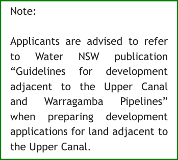

### 2.18 Work on Land Adjacent to the Upper Canal Corridor

#### Land adjacent

### Work on land

#### Objectives:

### adjacent

■ Ensure that the Upper Canal is taken into account in siting, designing and constructing any proposed development adjoining or in the vicinity of the Canal

to the

### Upper Canal

### Corridor

■ Ensure that development adjacent to the Upper Canal corridor does not impact on the continued operation of the Canal infrastructure. ■ Provide for the safety and amenity of the public living or visiting areas adjacent to the upper Canal. ■ Protect water quality by preventing stormwater or other pollutants entering the Upper Canal system. ■ Ensure that development adjacent to the Upper Canal corridor considers and

> [Picture on page 47: a picture, saved as a picture (images/vol-1-part-02-requirements-applying-to-all-types-of-developm-page-47-18.gif, 150 dpi).]
> Words printed on the picture (title and legend, copied from the PDF):
> Note:
> Note:

responds to its heritage value.

#### Design Requirements

a)

a)	 Where subdivision or major

Where subdivision or major development (other than individual

development (other than individual residential dwellings and ancillary

residential dwellings and ancillary structures) is proposed adjacent to the

structures) is proposed adjacent to the Upper Canal corridor, applicants shall

Upper Canal corridor, applicants shall consult with Water NSW as part of the

consult with Water NSW as part of the process of preparing the development

process of preparing the development application.

application.

Applicants are advised to refer

Applicants are advised to refer to Water NSW publication

to Water NSW publication “Guidelines for development

“Guidelines for development adjacent to the Upper Canal

adjacent to the Upper Canal and Warragamba Pipelines”

and Warragamba Pipelines” when preparing development

when preparing development applications for land adjacent to

applications for land adjacent to the Upper Canal.

the Upper Canal.

Note:

b)

b)	 Any written requirements of  Water NSW

Any written requirements of  Water NSW shall be submitted with the development

shall be submitted with the development application and the development

application and the development application documentation shall show

application documentation shall show how the requirements have been

how the requirements have been addressed.

addressed. c)

c)	 Prior written approval shall be obtained

Prior written approval shall be obtained from Water NSW for any access that

from Water NSW for any access that may be required to the Upper Canal

may be required to the Upper Canal corridor during the construction phase.

corridor during the construction phase. d)

d)	 Access points to the Upper Canal for

Access points to the Upper Canal for Water NSW staff and contractors to carry

Water NSW staff and contractors to carry out inspections and maintenance shall

out inspections and maintenance shall be retained or provided in accordance

be retained or provided in accordance with Water NSW  requirements.

with Water NSW  requirements.

The Upper Canal is owned and managed by Water NSW and is located on land classified as a controlled area under Water NSW  Act 2014.  The Canal begins at Pheasants Nest Weir on the Nepean River and transfers water from the Upper Nepean dams to the Prospect Water Filtration Plant to supply a significant part of Sydney’s drinking water. The upper Canal is historically significant having functioned as part of Sydney’s main water supply system for more than 120 years and is listed on the State Heritage Register.

e)

e)	 Site preparation and construction works

Site preparation and construction works carried out adjacent to or crossing the

carried out adjacent to or crossing the Upper Canal shall avoid impacting on

Upper Canal shall avoid impacting on water quality and damaging the Canal

water quality and damaging the Canal

infrastructure, in accordance with

infrastructure, in accordance with Water NSW requirements.

Water NSW requirements.

#### Land adjacent

### Work on land

### adjacent

to the

### Upper Canal

### Corridor

f)

f) Stormwater systems serving

Stormwater systems serving development adjacent to the Upper

development adjacent to the Upper Canal shall be designed to ensure that

Canal shall be designed to ensure that stormwater does not enter the Canal.

stormwater does not enter the Canal. Stormwater management measures

Stormwater management measures shall accommodate and not impede

shall accommodate and not impede upstream flows from any systems that

upstream flows from any systems that convey stormwater across, along or

convey stormwater across, along or under the Upper Canal.

under the Upper Canal. g)

g)	 Appropriate security fencing shall

Appropriate security fencing shall be provided, or existing security

be provided, or existing security fencing retained along the length of

fencing retained along the length of development boundaries that directly

development boundaries that directly adjoin the Upper Canal corridor

adjoin the Upper Canal corridor boundary, in accordance with Water

boundary, in accordance with Water NSW requirements.

NSW requirements. h)

h)	 Road, pedestrian and cycleway crossings

Road, pedestrian and cycleway crossings of the Upper Canal shall be minimised

of the Upper Canal shall be minimised and located and designed in accordance

and located and designed in accordance with Water NSW requirements.

with Water NSW requirements. i)

i) A local road shall be provided, or existing

A local road shall be provided, or existing roads retained, between development

roads retained, between development and the Upper Canal corridor.  The

and the Upper Canal corridor.  The road shall contain a landscaped verge

road shall contain a landscaped verge or footpath/bicycle path between the

or footpath/bicycle path between the road carriageway and Canal corridor.

road carriageway and Canal corridor. j)

j) The State Heritage status of the Upper

The State Heritage status of the Upper Canal shall be taken into account when

Canal shall be taken into account when designing development adjacent to the

designing development adjacent to the Canal corridor.

Canal corridor.
