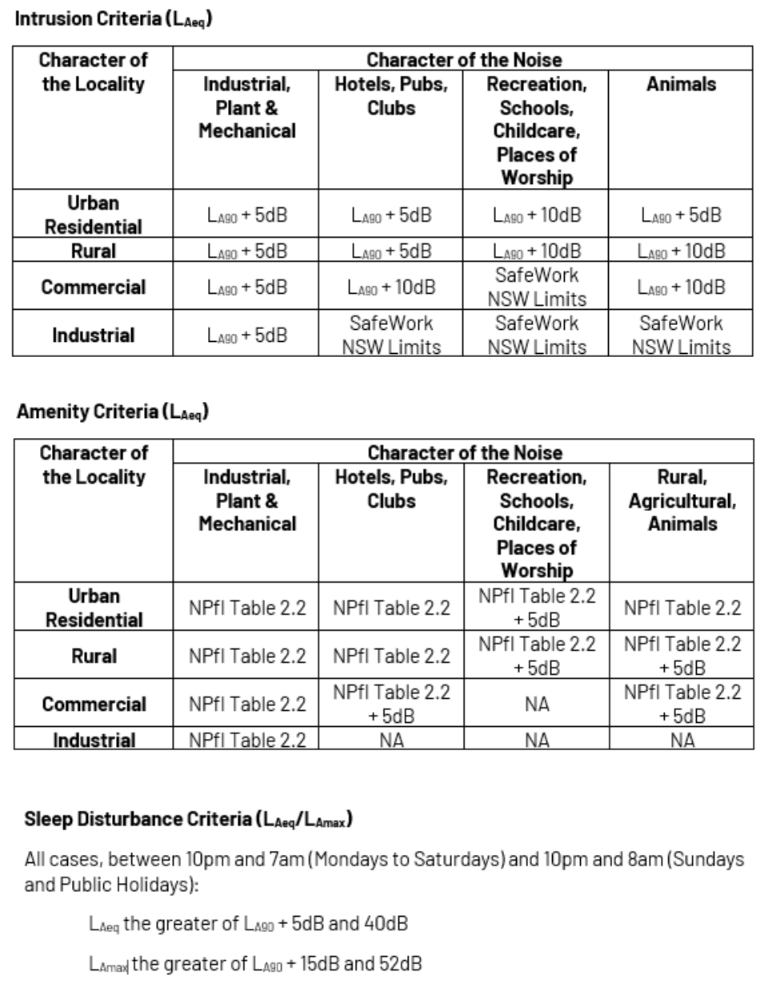

### 2.20 2.21 Accoustic Privacy

#### Land adjacent

### Accoustic

#### Objectives:

### Privacy

■ To ensure the provision of a reasonable level of acoustic amenity. ■ To ensure adverse noise and vibration impacts are appropriately mitigated.

#### Design Requirements

a)

a)	 Development shall comply with any

Development shall comply with any relevant provisions in the following

relevant provisions in the following documents. The event of an

documents. The event of an inconsistency between the noise related

inconsistency between the noise related controls in this plan and the documents

controls in this plan and the documents below, the documents below prevail to

below, the documents below prevail to the extent of the inconsistency.

the extent of the inconsistency. i)

i) The NSW Noise Policy for Industry

The NSW Noise Policy for Industry (NPfI)

(NPfI) ii)

ii)	 The NSW Road Noise Policy

The NSW Road Noise Policy iii)

iii)	 The NSW Development Near Rail

The NSW Development Near Rail Corridors and Busy Roads - Interim

Corridors and Busy Roads - Interim Guideline

Guideline iv)

iv)	 Association of Australasian

Association of Australasian Acoustical Consultants Guideline

Acoustical Consultants Guideline for Child Care Centre Acoustic

for Child Care Centre Acoustic Assessment

Assessment

b)

b)	 A Noise Impact Assessment prepared by

A Noise Impact Assessment prepared by a suitably qualified acoustic consultant

a suitably qualified acoustic consultant will be required in cases where the

will be required in cases where the consent authority is not satisfied that a

consent authority is not satisfied that a development will:

development will: i)

i) Achieve a satisfactory level of

Achieve a satisfactory level of acoustic amenity for occupants

acoustic amenity for occupants within the existing noise

within the existing noise environment; and

environment; and ii)

ii)	 Produce noise only at levels that

Produce noise only at levels that will not exceed the relevant noise

will not exceed the relevant noise criteria.

criteria.

c)

c)	 Subdivisions shall be designed to avoid

Subdivisions shall be designed to avoid physical noise barriers except along

physical noise barriers except along arterial roads.

arterial roads. d)

d)	 For development noise not regulated by

For development noise not regulated by the documents listed at point (a) above,

the documents listed at point (a) above,

the following criteria apply (after applying

the following criteria apply (after applying any corrections for annoying characteristics in

any corrections for annoying characteristics in accordance with the NPfI):

accordance with the NPfI):

> [Picture on page 53: a picture, saved as a picture (images/vol-1-part-02-requirements-applying-to-all-types-of-developm-page-53-7.gif, 150 dpi).]

### This page is intentionally left

### blank.
