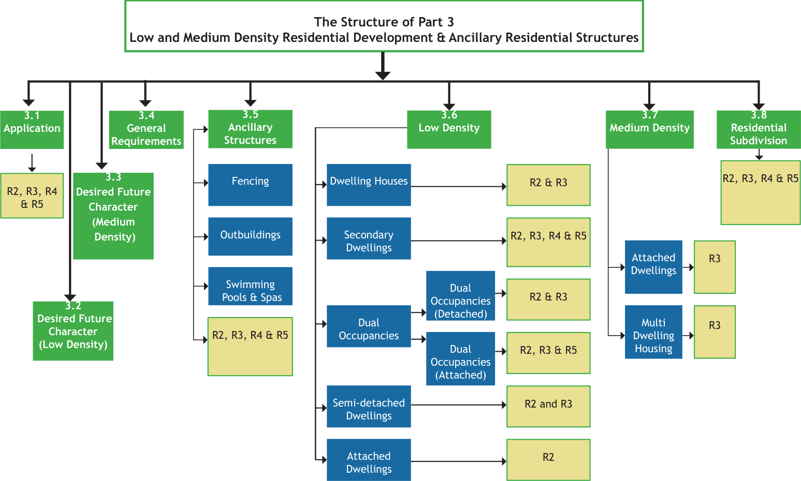

## Part 3 Low and Medium Density Residential Development and Ancillary Residential

### Structures

### 3.1 Application

#### Application

Part 3 sets out the following:

– Desired future character of low and medium density residential neighbourhoods;

– General Requirements for all Types of Residential Development in areas zoned R2, R3, R4 and R5;

– Development controls for the following ancillary residential structures in areas zoned R2, R3, R4 and R5  where they are associated with low and medium density residential development:

•	• fencing;

fencing;

•	• outbuildings; and

outbuildings; and

•	• swimming pools/spas;

swimming pools/spas;

– Development controls for the following low density residential development in areas zoned R2, R3, R4 and R5 :

•	• dwelling houses in areas zoned R2 and R3;

dwelling houses in areas zoned R2 and R3;

•	• secondary dwellings in areas zoned R2, R3, R4 and R5;

secondary dwellings in areas zoned R2, R3, R4 and R5;

•	• dual occupancies (attached and detached) in areas zoned R2 and R3 and

dual occupancies (attached and detached) in areas zoned R2 and R3 and dual occupancies (attached) in areas zoned R5;

dual occupancies (attached) in areas zoned R5;

•	• semi-detached dwellings in areas zoned R2 and R3; and

semi-detached dwellings in areas zoned R2 and R3; and

•	• attached dwellings in areas zoned R2.

attached dwellings in areas zoned R2.

– Development controls for the following medium density residential development in areas zoned R3 :

•	• attached dwellings in areas zoned

attached dwellings in areas zoned R3; and

; and

•	• multi dwelling housing in areas zoned

multi dwelling housing in areas zoned R3; and

– Development controls for residential subdivision The design requirements contained within this part are to be read in conjunction with the provisions contained in Part 2 of Volume 1.

| Zone Acronyms | Note: |
|---|---|
| R2 Low Density Residential: R2 | Numerical Development Standards |
| R3 Medium Density Residential: R3 | for floor space ratios, building |
| R4 High Density Residential: R4 | heights, qualifying site areas and minimum subdivision are provided |
| R5 Large Lot Residential: R5 | under the CLEP. |

#### Note:

Figures included under this Plan are for illustration purposes only and are not to be

interpreted or taken in any way or form as a development control.

> [Picture on page 3: a map, saved as a picture (images/vol-1-part-03-low-and-medium-density-residential-page-3-1.gif, 150 dpi); the street names and other small labels are on the picture.]
> Words printed on the picture (title and legend, copied from the PDF):
> R2 & R3
> R2, R3, R4
> R2 & R3
> Pools & Spas
> R2, R3 & R5
> R2 and R3

#### The Structure of Part 3

#### Low and Medium Density Residential Development & Ancillary Residential Structures

#### Medium Density

#### Application

#### Low Density

#### Ancillary

#### Structures

#### Residential

#### Subdivision

#### General

#### Requirements

R2, R3, R4 & R5

#### Desired Future Character

R2, R3, R4 & R5

(Medium

#### Density)

#### Desired Future

R2, R3, R4 & R5

#### Character

(Low Density)
