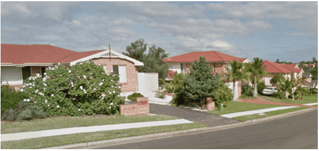
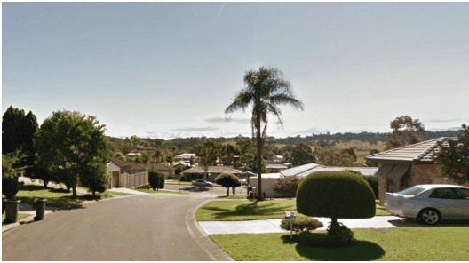

### 3.2 Desired Future Character for Low Density Residential

#### Neighbourhoods

#### Desired Future

The low density residential neighbourhoods shall continue to be characterised by:

Character for

#### Low Density

•	• one and two storey dwelling houses that are designed to provide a high level of

one and two storey dwelling houses that are designed to provide a high level of residential amenity for their occupants and the occupants of adjoining properties;

residential amenity for their occupants and the occupants of adjoining properties;

#### Residential

Neighbourhoods • streetscapes where buildings are setback from the primary street frontage to

provide opportunities for deep soil planting and landscaping; and

• articulated front facades where garages are setback and do not dominate the streetscapes; and

•	• limited stock of multi dwelling housing and attached dwellings that:

limited stock of multi dwelling housing and attached dwellings that:

– respect the existing character of the low density neighbourhoods; and

– are of low scale and density.

#### Note:

For the purpose of this part, low density residential development means any of the following:

•	• a dwelling house;

a dwelling house;

•	• a secondary dwelling;

a secondary dwelling;

•	• a dual occupancy (attached or detached);

a dual occupancy (attached or detached);

•	• a semi-detached dwelling; or

a semi-detached dwelling; or

•	• attached dwellings in areas zoned R2.

attached dwellings in areas zoned R2.

> [Picture on page 4: a picture, saved as a picture (images/vol-1-part-03-low-and-medium-density-residential-page-4-33.gif, 150 dpi).]

> [Picture on page 4: a picture, saved as a picture (images/vol-1-part-03-low-and-medium-density-residential-page-4-34.gif, 150 dpi).]

Figure 3.2.1 - Examples of streetscapes within existing low density residential neighbourhoods of Glen Alpine and Raby.
