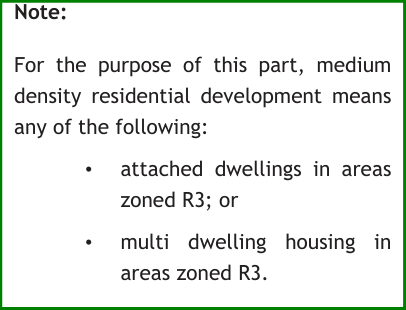
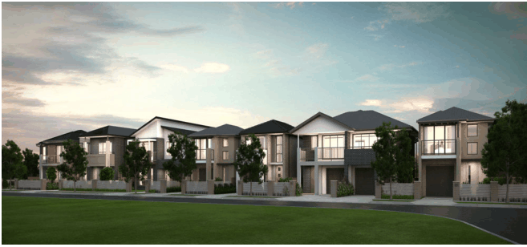
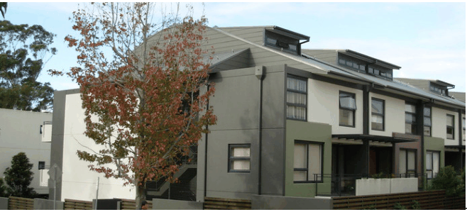

### 3.3 Desired Future Character for Medium Density Residential

#### Neighbourhoods

#### Desired Future

The medium density residential neighbourhoods shall be characterised by:

#### Character

for

#### Medium Density

•	• medium density housing comprising two storey  attached dwellings and multi

medium density housing comprising two storey  attached dwellings and multi dwelling housing  in a landscaped setting with additional habitable areas provided

dwelling housing  in a landscaped setting with additional habitable areas provided within the roof space;

within the roof space;

#### Residential

#### Neighbourhoods

•	• development footprints that are sited to achieve setbacks to boundaries and

development footprints that are sited to achieve setbacks to boundaries and provide for  landscaping and private open space;

provide for  landscaping and private open space;

•	• articulated front facades where garages and car parking spaces are setback and

articulated front facades where garages and car parking spaces are setback and do not dominate the streetscapes;

do not dominate the streetscapes;

•	• active residential facades with balconies;

active residential facades with balconies;

•	• soft landscaping along communal driveways and the front boundary;

soft landscaping along communal driveways and the front boundary;

•	• a high standard of architectural merit and urban design quality buildings; and

a high standard of architectural merit and urban design quality buildings; and

•	• development that incorporates a mix of dwelling sizes to provide housing choice.

development that incorporates a mix of dwelling sizes to provide housing choice.

> [Picture on page 5: a picture, saved as a picture (images/vol-1-part-03-low-and-medium-density-residential-page-5-32.gif, 150 dpi).]
> Words printed on the picture (title and legend, copied from the PDF):
> •	• attached dwellings in areas
> attached dwellings in areas
> zoned R3; or
> zoned R3; or
> •	• multi dwelling housing in
> multi dwelling housing in
> areas zoned
> areas zoned R3.

#### Note:

#### Note:

For the purpose of this part, medium density residential development means any of the following:

Clause 7.13 Design Excellence of the CLEP applies to zones R3, R4, B2,

B3 and B4 and aims to deliver the highest standard of architectural and urban design, as part of the built environment.

> [Picture on page 5: a picture, saved as a picture (images/vol-1-part-03-low-and-medium-density-residential-page-5-44.gif, 150 dpi).]

> [Picture on page 5: a picture, saved as a picture (images/vol-1-part-03-low-and-medium-density-residential-page-5-45.gif, 150 dpi).]

Figure 3.3.1 - Examples of a medium density development.
