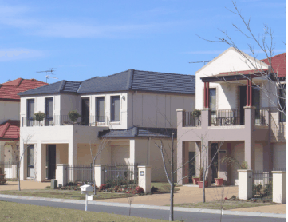

#### 3.4.1  Building Form and Character

#### Objectives:

#### 3.4.1

#### Building Form

#### & Character

■ Ensure that the massing and scale of new development are complementary to the desired future character of residential neighbourhoods. ■ Ensure that buildings are designed to enhance the existing and future desired built form and character of the neighbourhood by encouraging innovative and quality designs that fit harmoniously with their surroundings. ■ Ensure that parking areas, garages and driveways are appropriately sited, designed and constructed so that they do not detract from the appearance of the development or the streetscape. ■ Ensure the provision of equitable access to natural light and ventilation for the occupants of all residential dwellings.

#### 3.4.1.1 Streetscape

Design Requirements

#### Note:

a)	 Building design (including facade treatment, massing, roof design and entrance features), setbacks and landscaping shall complement the scale of development, and the desired future character of the residential

Numerical Development Standards for floor space ratios, building heights, qualifying site areas and subdivision for residential development  are provided under the CLEP.

neighbourhoods.

b)	 Development on corner sites shall incorporate facade treatments that address both street frontages and achieve positive articulation in building design. Landscaping shall be used to reduce the impact of any privacy fencing.

c)	 The built form shall relate to the natural landform and setting.

d)	 On-site parking areas shall be designed and sited to reduce the visual prominence of  garage doors and external parking spaces  as viewed from the street or other public place.

e)	 Garage doors facing a public street

shall not be wider than 50% of the width of the building’s facade fronting the street (refer to Figures 3.4.1.1).

#### General

#### Requirements

#### Note:

#### for all Types

#### of Residential

#### Development 3.4.1

#### Building Form

f) No carports  or garages (or like structures) shall be located within 6 metres of the primary street boundary, for additional requirements of setbacks for the various types of residential development refer to section 3.5,3.6 and 3.7 of this part of the plan.

#### & Character

Additional controls for landscaping, weed management, erosion and sediment controls, cut and fill, water cycle management and retaining walls are included under Part 2 of Volume 1 of the Plan.

> [Picture on page 7: a picture, saved as a picture (images/vol-1-part-03-low-and-medium-density-residential-page-7-26.gif, 150 dpi).]

g)	 No bathroom, ensuite, toilet or laundry windows shall face the primary street of an allotment.

h)	 Multi dwellings and dual occupancies shall satisfy the following architectural requirements: i)

i)	 incorporation of variations in roof

incorporation of variations in roof heights and wall planes to avoid long

heights and wall planes to avoid long unbroken ridge lines

unbroken ridge lines ii)

ii)	 incorporation of façade shifts and

incorporation of façade shifts and articulation, varied materials and

articulation, varied materials and colours in order to avoid duplication

colours in order to avoid duplication of the same building elements

of the same building elements

Figure 3.4.1.1 - Example of a streetscape with various architectural features.

iii)

iii)	provision of windows and active

provision of windows and active space in the building ends, to

space in the building ends, to provide additional security and

provide additional security and visual interest

visual interest

#### Note:

i)

i) All windows facing the street (primary

All windows facing the street (primary and secondary) must have a balanced

and secondary) must have a balanced architectural design.

architectural design.

#### 3.4.1.2 Building Height

For additional requirements on setbacks for the various types of residential development, refer to sections 3.5,3.6 and 3.7 of the Plan.

a)	 The height of development shall not result in any significant loss of amenity (including loss of solar access and visual and acoustic privacy) to adjacent properties and public places.

#### 3.4.1.3 Advertising Material

a)

a)	 As part of the letter box design for multi

As part of the letter box design for multi dwelling housing a special container

dwelling housing a special container shall be provided for the placement of

shall be provided for the placement of advertising and newspaper materials.

advertising and newspaper materials. Such container shall be located behind

Such container shall be located behind the building line and designed to be

the building line and designed to be part of the letter box arrangement for

part of the letter box arrangement for

the development.

the development.

#### General

#### Requirements

b)

b)	 The newspaper/advertisement container

The newspaper/advertisement container shall be regularly emptied by the manager/

shall be regularly emptied by the manager/ caretaker of the building.

caretaker of the building.
