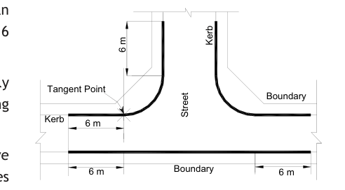
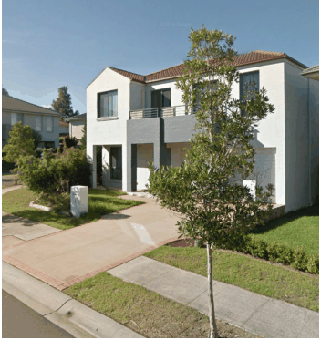

#### 3.4.2  Car Parking and Access

#### for all

Types of

#### Residential

#### Development

#### Objectives:

#### 3.4.2

#### Car Parking

■ Provide adequate on-site car parking for residents and visitors that is convenient, secure and safe having regard to the traffic generated by the proposed development.

#### & Access

■ Ensure efficient and safe vehicle and pedestrian movement within, into and out of the development.

■ Ensure that the location and design of driveways, parking, service areas and access areas are practical, easily maintained, convenient, safe and suitably landscaped.

■ Provide safe convenient access for vehicles, pedestrians and cyclists whilst minimising conflict between them.

■ Promote the use of electric vehicles across the Local Government Area.

■ Encourage the installation of electric vehicle charging infrastructure.

> [Picture on page 8: a picture, saved as a picture (images/vol-1-part-03-low-and-medium-density-residential-page-8-33.gif, 150 dpi).]
> Words printed on the picture (title and legend, copied from the PDF):
> Kerb
> 6 m
> Tangent Point
> Boundary
> Street
> Kerb
> 6 m
> 6 m
> 6 m
> Boundary

#### Design Requirements

a)

a)	 The minimum dimensions of any

The minimum dimensions of any required parking space shall be 2.5

required parking space shall be 2.5 metres x 5.5 metres. If the car parking

metres x 5.5 metres. If the car parking space adjoins a vertical edge which is

space adjoins a vertical edge which is 100mm or higher, the minimum width

100mm or higher, the minimum width of the car parking space shall be 2.7

of the car parking space shall be 2.7 metres.

metres. b)

b)	 The minimum internal dimension of an

The minimum internal dimension of an enclosed garage shall be 3 metres x 6

enclosed garage shall be 3 metres x 6 metres.

metres. c)

c)	 Transitional grades shall comply

Transitional grades shall comply with AS2890.1 (as amended) Parking

with AS2890.1 (as amended) Parking Facilities - Off-Street Car Parking.

Facilities - Off-Street Car Parking.

Figure 3.4.2.1 – Restricted locations of driveways entry as shown  heavy edged lines.

d)

d)	 The maximum garage floor levels (above

The maximum garage floor levels (above or below) for a garage setback 6 metres

or below) for a garage setback 6 metres from the front property boundary  shall

from the front property boundary  shall be in accordance with the requirements

be in accordance with the requirements contained under

contained under Council’s Engineering

Council’s Engineering

Guide for Development, (

Guide for Development, (Appendix K -

Appendix K -

Standard Drawings No. SD-R08 and SD-

Standard Drawings No. SD-R08 and SD- R09), which is

R09), which is available at Council’s

available at Council’s

website at www.campbeltown.nsw.

website at www.campbeltown.nsw. gov.au.

gov.au.

#### General

#### Requirements

e)

e)	 Driveways greater than 30 metres in

Driveways greater than 30 metres in length as viewed from the street shall

length as viewed from the street shall be avoided.

be avoided.

#### for all

Types of

#### Residential

#### Development 3.4.2

#### Car Parking

f)

f) Driveways shall be located a minimum

Driveways shall be located a minimum distance of 6 metres from the tangent

distance of 6 metres from the tangent point of any unsignalled intersection

point of any unsignalled intersection (refer to Figure 3.4.2.1).

(refer to Figure 3.4.2.1).

#### & Access

Note: In circumstances where an intersection is controlled by lights, a roundabout or the like, applicants are requested to contact Council for specific requirements. g)

g)	 The minimum width of the driveway

The minimum width of the driveway at the street kerb shall be:

at the street kerb shall be: i)

i)	 2.5 metres where the driveway

2.5 metres where the driveway provides access for one (1)

provides access for one (1) dwelling; and

dwelling; and ii)

ii)	 5 metres where a single driveway

5 metres where a single driveway provides access for two (2) or more

provides access for two (2) or more dwellings (excluding secondary

dwellings (excluding secondary dwellings).

dwellings).

> [Picture on page 9: a picture, saved as a picture (images/vol-1-part-03-low-and-medium-density-residential-page-9-61.gif, 150 dpi).]

Figure 3.4.2.2 – Example of a driveway that is of appropriate width and located perpendicular to the road.

Note: For additional technical specifications

Note: For additional technical specifications relating to the location, gradient and

relating to the location, gradient and driveway widths refer to Council’s

driveway widths refer to Council’s Engineering Guide for Development

Engineering Guide for Development available at Council’s website at www.

available at Council’s website at www. campbeltown.nsw.gov.au

campbeltown.nsw.gov.au

#### Note:

h)

h)	 For residential developments

For residential developments incorporating more than 20 dwellings,

incorporating more than 20 dwellings, a Traffic Impact Assessment Report

a Traffic Impact Assessment Report shall be prepared by a suitably

shall be prepared by a suitably qualified person and submitted with

qualified person and submitted with the development application.

the development application.

Council will not be liable to replace any driveway colour or pattern within public land in cases where damage to private driveways as a result of maintenance work undertaken by Council has occurred.

Note: For requirements relating to the preparation of a Traffic Impact Assessment Report refer to Appendix 12. i)

i) Driveways shall be designed and

Driveways shall be designed and located perpendicular to the road

located perpendicular to the road (Figure 3.4.2.

(Figure 3.4.2. 2 ).). j)

j) Plain concrete driveways including

Plain concrete driveways including

crossover and layback

crossover and layback shall not be

shall not be

permitted. Details of driveway colours

permitted. Details of driveway colours and patterns shall be submitted with the

and patterns shall be submitted with the development application.

development application.

#### General

#### Requirements

#### for all Type

#### of Residential

#### Development 3.4.3

#### Acoustic

k)

k)	 Garages and driveways shall be located

Garages and driveways shall be located and designed to minimise the loss of

and designed to minimise the loss of any on street parking and ensure that

any on street parking and ensure that sufficient area is maintained along the

sufficient area is maintained along the site frontage for the provision of on street

site frontage for the provision of on street parking spaces, where possible.

parking spaces, where possible.

#### &

#### Visual Privacy

l)

l) Internal driveways and vehicle access

Internal driveways and vehicle access shall be provided with sufficient widths to

shall be provided with sufficient widths to ensure easy access to and from designated

ensure easy access to and from designated car parking areas/garages.

car parking areas/garages. m)

m)	 Internal driveways for multi dwellings

Internal driveways for multi dwellings shall be designed to provide two-way

shall be designed to provide two-way vehicle  access

vehicle  access n)

n)	 Electric vehicle charging stations must be

Electric vehicle charging stations must be located behind the building line.

located behind the building line.
