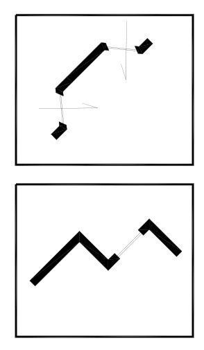

#### 3.4.3 Acoustic and Visual Privacy

#### Objective:

■ Provide adequate visual and acoustic privacy for residents of new and existing development.

#### 3.4.3.1 Acoustic Privacy

#### Design Requirements

#### Note:

Development Near Rail Corridors and Busy Roads – Interim Guideline provides a useful guide for all development that may be impacted by rail corridors or busy roads .

a)

a)	 Development that adjoins significant

Development that adjoins significant noise sources, (such as main roads,

noise sources, (such as main roads, commercial/industrial development,

commercial/industrial development, public transport interchanges and

public transport interchanges and railways) shall be designed to achieve

railways) shall be designed to achieve acceptable internal noise levels, based

acceptable internal noise levels, based on recognised Australian Standards and

on recognised Australian Standards and any criteria and standards regulated by

any criteria and standards regulated by a relevant State Government Authority.

a relevant State Government Authority.

#### Note:

b)

b)	 Development shall incorporate

Development shall incorporate noise attenuation measures that are

noise attenuation measures that are compatible with the scale, form and

compatible with the scale, form and character of the street.

character of the street.

The installation of air-conditioning units may be undertaken as exempt development under the E&CDC SEPP, providing that certain criteria are met.

c)

c)	 On-site noise generating sources

On-site noise generating sources including, but not limited to, plant rooms

including, but not limited to, plant rooms

#### General

#### Requirements

and equipment, air conditioning units,

and equipment, air conditioning units, pool pumps, and recreation areas shall be

pool pumps, and recreation areas shall be designed and located to ensure that the

designed and located to ensure that the noise levels generated by such facilities do

noise levels generated by such facilities do not exceed 5 dBA above background levels

not exceed 5 dBA above background levels at the property boundary.

at the property boundary.

#### for all Types

#### of Residential

#### Development 3.4.3

#### Acoustic

#### &

#### Visual Privacy

d)

d)	 Multi dwelling housing and attached

Multi dwelling housing and attached dwellings near railway corridors and

dwellings near railway corridors and major roads shall demonstrate to

major roads shall demonstrate to Council’s satisfaction  compliance with

Council’s satisfaction  compliance with the requirements under the Guidelines

the requirements under the Guidelines entitled

entitled Development Near Rail Corridors

Development Near Rail Corridors

and Busy Roads

and Busy Roads – Interim Guideline, 2008)

– Interim Guideline, 2008)

Note: This Guide is available for view/download from the NSW Department of Planning & Environment website at: www.planning.nsw. gov.au. Note: Applicants are encouraged to refer to the Office of Environment and Heritage Environmental Criteria for Road Traffic Noise.

#### 3.4.3.2 Visual Privacy

#### Design Requirements

a)

a)	 No window of a habitable room or balcony

No window of a habitable room or balcony shall directly face a window of another

shall directly face a window of another habitable room, balcony or private open

habitable room, balcony or private open space of another dwelling located within 6

space of another dwelling located within 6 metres of the proposed window or balcony

metres of the proposed window or balcony unless appropriately screened (refer to

unless appropriately screened (refer to Figure 3.4.3.1).

Figure 3.4.3.1).

> [Picture on page 11: a picture, saved as a picture (images/vol-1-part-03-low-and-medium-density-residential-page-11-63.gif, 150 dpi).]

Figure 3.4.3.1 – Illustrations of a method to offset windows to avoid potential privacy conflict.

b)

b)	 Notwithstanding Clause 3.4.3.2a) any

Notwithstanding Clause 3.4.3.2a) any window of a living room located on an

window of a living room located on an upper level shall:

upper level shall: i)

i)	 be offset by 2 metres to limit               views

be offset by 2 metres to limit               views between windows and balconies; or

between windows and balconies; or ii)

ii)	 have a sill height 1.7 metres above the

have a sill height 1.7 metres above the floor level; or

floor level; or iii)

iii)	be splayed to avoid direct views

be splayed to avoid direct views between windows; or

between windows; or iv)

iv)	have fixed translucent glazing in       any

have fixed translucent glazing in       any part of the window within 1.7  	 metres

part of the window within 1.7  	 metres of the floor level.

of the floor level.

c)

c)	 Notwithstanding 3.4.3.2a), a balcony will

Notwithstanding 3.4.3.2a), a balcony will be considered where the private open

be considered where the private open space area of any adjacent dwelling is

space area of any adjacent dwelling is

screened from view.

screened from view.

#### General

#### Requirements

#### for all Types

#### of Residential

#### Development

d)

d)	 No wall of a proposed building shall

No wall of a proposed building shall be permitted to be constructed on

be permitted to be constructed on the boundary for that portion of the

the boundary for that portion of the boundary that is directly adjacent to

boundary that is directly adjacent to an existing required private open space

an existing required private open space area on the adjoining allotment.

area on the adjoining allotment.
