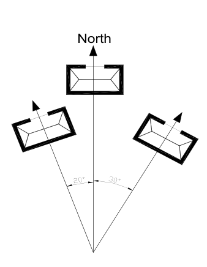

#### 3.4.4 Solar Access

#### 3.4.4

#### Solar

#### Access

#### Objectives:

■ Encourage building design and siting to take advantage of climatic factors and

reduce household energy consumption. ■ Encourage features to be incorporated into site and building design to optimise

> [Picture on page 12: a picture, saved as a picture (images/vol-1-part-03-low-and-medium-density-residential-page-12-29.gif, 150 dpi).]
> Words printed on the picture (title and legend, copied from the PDF):
> North

passive solar access to internal and external spaces.

#### Design Requirements

a)

a)	 Living areas shall generally have a

Living areas shall generally have a northerly orientation.

northerly orientation. b)

b)	 A minimum 20sqm fixed area of the

A minimum 20sqm fixed area of the required private open space shall

required private open space shall receive three (3) hours of continuous

receive three (3) hours of continuous direct solar access on  21 June, between

direct solar access on  21 June, between 9.00am and 3.00pm, when measured at

9.00am and 3.00pm, when measured at ground level.

ground level. c)

c)	 Development shall have appropriate

Development shall have appropriate regard to the impact on solar access to

regard to the impact on solar access to useable private open space and living

useable private open space and living areas, solar collectors and clothes

areas, solar collectors and clothes drying areas of adjoining residential

drying areas of adjoining residential development.

development. d)

d)	 Building siting shall take into

Building siting shall take into consideration the range of factors

consideration the range of factors that impact on solar access including

that impact on solar access including slope of land, vegetation and existing

slope of land, vegetation and existing building and other structures.

building and other structures.

Figure 3.4.4.1 – Desirable range of window orientation for north facing windows.

Note: Council may  consider the use

Note: Council may  consider the use of deciduous trees at the north and

of deciduous trees at the north and west elevations to protect against hot

west elevations to protect against hot summer temperature and to allow for

summer temperature and to allow for solar penetration in winter, where it may

solar penetration in winter, where it may otherwise be inappropriate to plant native

otherwise be inappropriate to plant native trees.

trees.
