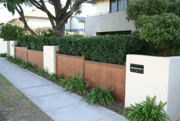

#### 3.5.1 Fencing

#### Objectives:

■ To ensure that  front fencing  design complements the  character and streetscape of residential neighbourhoods.

#### Design Requirements

a)	 Bonded sheet metal fencing shall not

#### Note:

Refer to Section 1.4 Definitions Part 1 Volume 1 for a definition of a building line under the plan.

> [Picture on page 14: a picture, saved as a picture (images/vol-1-part-03-low-and-medium-density-residential-page-14-20.gif, 150 dpi).]

be constructed at any location other than along side and rear boundaries shared with other private property, where such fencing is not highly visible from the street, public reserve or other public place, unless the site is within a bushfire prone area.

b)	 Residential fencing along the rear and side boundaries shall be:

i)	 located behind the primary street building line;

ii)	 a maximum 2.1 metres in height (excluding retaining walls); and

iii)	a maximum 1.8 metres in height, if adjoining a secondary street.

c)	 Front residential fencing shall be a maximum of 1.2 metres in height and complement the design of the development.

Figure 3.5.1.1 - Example of a part masonry/part timber fence that helps to define private space and adds interest to the character of the streetscape.

d)	 Fencing on corner allotments shall not obstruct the sight distance of traffic entering or within an intersection or roundabout.

e)	 Fencing shall not obstruct power, water, sewer, gas or telephone services, drainage systems, (including overland flow paths) or any easements or rights

f) Details for fencing shall be submitted with the development application.
