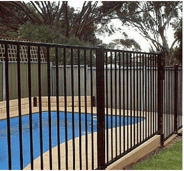

#### 3.5.3 Swimming  Pools/Spas

#### Objectives:

#### 3.5.3 Swimming Pools/Spas

■ Ensure that the location and design of swimming pools/spas minimises  adverse impacts on the amenity of adjoining properties, particularly in relation to noise,

> [Picture on page 17: a picture, saved as a picture (images/vol-1-part-03-low-and-medium-density-residential-page-17-15.gif, 150 dpi).]

privacy, drainage, visibility of pools and lighting.

#### 3.5.3.1  General Requirements

a)	 Safety fencing for Swimming pools/spas shall comply with the Swimming Pools Act 1992, Swimming Pools Regulation 2018 and the Australian Standard

1926.1 - 2012 - Swimming Pool Safety (As amended).

#### 3.5.3.2  Setbacks

a)	 Swimming pools/spas shall be located behind the front primary street building setback.

Figure 3.5.3.1 – Illustration of a fenced pool.

b)	 Swimming pools/spas that do not incorporate decking/coping greater than 600 mm above natural ground level at any point shall be setback a minimum of:

i)	 1 metre from the rear and side boundaries; and

ii)	 1 metre from the secondary boundary(corner allotments).

c)	 The setback requirements under Clause 3.5.3.2 b) shall be inclusive of any decking/coping associated with the pool ( i.e. the minimum 1 metre setback shall be calculated from the edge of the decking/coping to the side boundary, rear or secondary boundary).

d)	 Swimming pools/spas that incorporate decking/coping greater than 600mm above natural ground level at any point shall  be setback a minimum of:

i)	 5.5 metres  from the primary street boundary;

ii)	 3 metres from the secondary street

#### Ancillary Residential

boundary;

#### Structures

iii)	1.5 metres from the side and rear boundaries.
