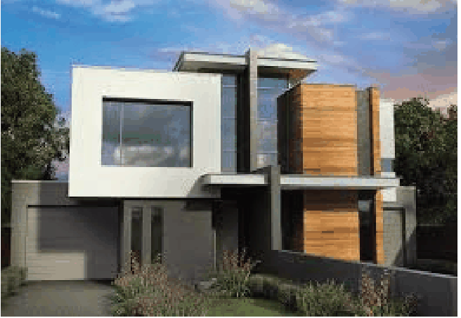
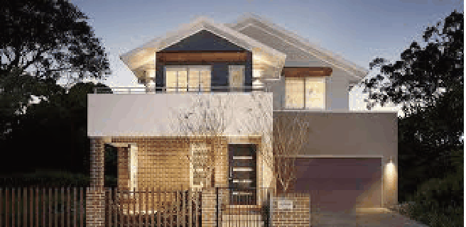

### 3.6 Low Density Residential Development - Zones  R2, R3, R4 & R5

#### Low Density

This section applies to:

#### Residential

#### Development

• dwelling houses in areas zoned R2 and R3;

• secondary dwellings in areas zoned R2, R3, R4 and R5;

• dual occupancies (attached and/or detached) in areas zoned R2, R3 and R5

• semi-detached dwellings in areas zoned R2 and R3;and

• attached dwellings in areas zoned R2.

Important Note: Numerical Development Standards for floor space ratios , building heights, qualifying site areas and subdivision for residential development are provided under the CLEP.

> [Picture on page 19: a picture, saved as a picture (images/vol-1-part-03-low-and-medium-density-residential-page-19-14.gif, 150 dpi).]

> [Picture on page 19: a picture, saved as a picture (images/vol-1-part-03-low-and-medium-density-residential-page-19-15.gif, 150 dpi).]

Figure 3.6.1 -  Examples of low density residential development.
