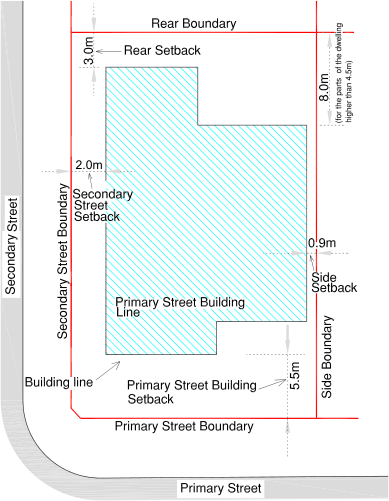

#### 3.6.1 Dwelling

A dwelling house (as defined under the CLEP) means a building containing only one dwelling.

#### Houses

#### Note:

a)

a)	 A dwelling house shall not be erected on

A dwelling house shall not be erected on land with an average width  less than 15

land with an average width  less than 15 metres (measured at the primary street

metres (measured at the primary street building setback), unless the allotment

building setback), unless the allotment was in existence at the date upon which

was in existence at the date upon which the Plan came into effect.

the Plan came into effect.

#### 3.6.1.2 Deep Soil Planting

Refer to Section 4.1C of the CLEP for the minimum qualifying site area and lot sizes for dwelling houses.

> [Picture on page 20: a picture, saved as a picture (images/vol-1-part-03-low-and-medium-density-residential-page-20-34.gif, 150 dpi).]
> Words printed on the picture (title and legend, copied from the PDF):
> 2.0m

a)

a)	 A dwelling house shall satisfy the following

A dwelling house shall satisfy the following provisions relating to deep soil planting:

provisions relating to deep soil planting: i)

i)	 no more than 30% of the area forward of

no more than 30% of the area forward of any building line shall be surfaced with

any building line shall be surfaced with impervious materials; and

impervious materials; and ii)

ii)	 a minimum of 20% of the total site area

a minimum of 20% of the total site area shall be available for deep soil planting.

shall be available for deep soil planting.

#### 3.6.1.3  Setbacks

a)

a)	 A dwelling house shall be setback a

A dwelling house shall be setback a minimum of:

minimum of: i)

i)	 5.5 metres from the primary street

5.5 metres from the primary street boundary for the dwelling;

boundary for the dwelling; ii)

ii)	 6.0 metres from the primary street

6.0 metres from the primary street boundary for the garage;

boundary for the garage; iii)

iii)	2 metres from the secondary                  street

2 metres from the secondary                  street boundary;

boundary; iv)

iv)	5.5 metres from the secondary street

5.5 metres from the secondary street boundary for the garage, where the

boundary for the garage, where the garage is accessed directly from the

garage is accessed directly from the secondary street;

secondary street;

Figure 3.6.1.1 - Illustration of the required setbacks for dwelling houses under the Plan

v)

v)	 0.9 metres from any side boundary; and

0.9 metres from any side boundary; and vi)

vi)	3 metres from the rear boundary for

3 metres from the rear boundary for any part of the building that is up to

any part of the building that is up to

4.5 metres in height from ground level

4.5 metres in height from ground level (existing); and

(existing); and vii)

vii)	8 metres from the rear boundary for any

8 metres from the rear boundary for any part of the building that is higher than

part of the building that is higher than

4.5 metres from ground level (existing).

4.5 metres from ground level (existing).

#### Low Density Residential Development

b)

b)	 Each dwelling shall have a minimum of

Each dwelling shall have a minimum of 0.9m unobstructed side access that is free

0.9m unobstructed side access that is free from air conditioning units, rainwater tanks

from air conditioning units, rainwater tanks hot water systems, or any other structure

or any other structure

that may block  access to the rear of the

that may block  access to the rear of the dwelling.

dwelling.

#### 3.6.1.4 Car Parking Rates
