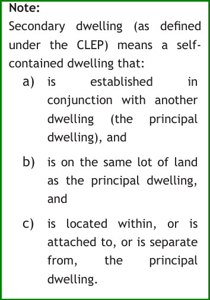

#### 3.6.2 Secondary Dwellings - Zones  R2, R3, R4 and R5

#### Objectives:

■ Ensure that secondary dwelling development is of a small scale.

■ Ensure that secondary dwellings do not adversely impact on the amenity of

> [Picture on page 22: a map, saved as a picture (images/vol-1-part-03-low-and-medium-density-residential-page-22-44.gif, 150 dpi); the street names and other small labels are on the picture.]
> Words printed on the picture (title and legend, copied from the PDF):
> a)	 is established in
> is established in
> conjunction with another
> conjunction with another
> dwelling (the principal
> dwelling (the principal
> b)	 is on the same lot of land
> as the principal dwelling,
> c)	 is located within, or is

adjoining properties.

#### 3.6.2.1  General Requirements

#### Note:

Secondary dwelling (as defined under the CLEP) means a self-contained dwelling that:

a)

a)	 A secondary dwelling shall incorporate

A secondary dwelling shall incorporate similar or complementary design

similar or complementary design and construction features, finishes,

and construction features, finishes, materials and colours to those of the

materials and colours to those of the principal dwelling house.

principal dwelling house. b)

b)	 Any new primary or secondary dwelling

Any new primary or secondary dwelling shall be designed to ensure that a

shall be designed to ensure that a front door and window are visible from

front door and window are visible from the public domain by installing these

the public domain by installing these elements into the front building wall

elements into the front building wall of any habitable room which faces the

of any habitable room which faces the primary street.

primary street.

attached to, or is separate from, the principal dwelling.

c)

c)	 A secondary dwelling shall be provided

A secondary dwelling shall be provided with at a least 12sqm area of private

with at a least 12sqm area of private open space for the exclusive use of the

open space for the exclusive use of the occupants of the secondary dwelling.

occupants of the secondary dwelling. The area shall be accessible from the

The area shall be accessible from the living area, have a minimum width of

living area, have a minimum width of 3sqm and not be steeper than 1:50.

3sqm and not be steeper than 1:50. Note: This area is to be included in the

Note: This area is to be included in the calculation for the requirement of open

calculation for the requirement of open space for the principle dwelling, i.e. the

space for the principle dwelling, i.e. the

combined area of private open space for

combined area of private open space for the secondary dwelling and the principle

the secondary dwelling and the principle dwelling shall be a minimum of 75sqm.

dwelling shall be a minimum of 75sqm.

#### Low Density Residential Development

d)

d)	 A BASIX certificate shall accompany

A BASIX certificate shall accompany a development application for a

a development application for a secondary dwelling.

secondary dwelling.
