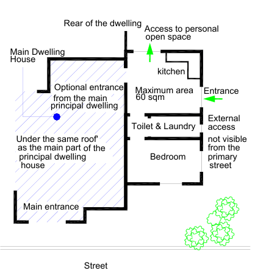

#### 3.6.2 Secondary

#### Note:

Nothing in the Plan shall be taken to mean that a secondary dwelling can be subdivided from  the principal dwelling on the allotment  unless such a subdivision is consistent with relevant development standards under the CLEP.

> [Picture on page 23: a map, saved as a picture (images/vol-1-part-03-low-and-medium-density-residential-page-23-28.gif, 150 dpi); the street names and other small labels are on the picture.]
> Words printed on the picture (title and legend, copied from the PDF):
> Rear of the dwelling
> Access to personal
> Maximum area Entrance
> from the main
> Toilet & Laundry
> Under the same roof'
> as the main part

e)

e)	 An attached secondary dwelling shall

An attached secondary dwelling shall be located under the same roof as the

be located under the same roof as the main part of the principal dwelling

main part of the principal dwelling house.

house.

#### Dwellings

f)

f) The principle dwelling shall continue to

The principle dwelling shall continue to meet all the relevant requirements and

meet all the relevant requirements and development controls under Part 3 of

development controls under Part 3 of Volume 1 of the Plan.

Volume 1 of the Plan.

#### 3.6.2.2 Setbacks

a)

a)	 A secondary dwelling land shall be

A secondary dwelling land shall be setback a minimum of:

setback a minimum of: i)

i)	 5.5 metres from the primary street

5.5 metres from the primary street boundary of the dwelling and  shall

boundary of the dwelling and  shall align with the existing front building

align with the existing front building line, alternatively it shall align with

line, alternatively it shall align with the predominant front building line

the predominant front building line of the street;

of the street; ii)

ii)	 3 metres from the secondary street

3 metres from the secondary street boundary;

boundary; iii)

iii)	0.9 metres from any side boundary;

0.9 metres from any side boundary; and

and

Figure 3.6.2.1 – Illustration of an attached secondary dwelling

iv)

iv)	3 metres from the rear boundary for

3 metres from the rear boundary for any part of the building that is up

any part of the building that is up to 3.8 metres in height from ground

to 3.8 metres in height from ground level (existing); and

level (existing); and v)

v)	 8 metres from the rear boundary for

8 metres from the rear boundary for any part of the building that is higher

any part of the building that is higher than 3.8 metres from ground level

than 3.8 metres from ground level (existing)

(existing) vi)

vi)	Where a secondary dwelling is

Where a secondary dwelling is located forward of the front building

located forward of the front building line consideration shall only be

line consideration shall only be given to such a proposal where the

given to such a proposal where the development is integrated with the

development is integrated with the existing dwelling and employs the

existing dwelling and employs the same building materials and features

same building materials and features as the existing dwelling including

as the existing dwelling including roof form and features such as

roof form and features such as Gables and the like.

Gables and the like.
