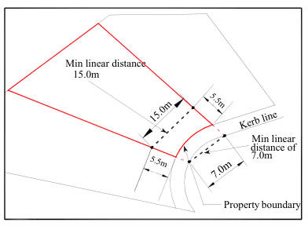

#### 3.6.3 Dual Occupancies (Attached or

Detached) a)	 Dual occupancies shall only be

permitted on an allotment having:

i)	 a minimum width of 15 metres

Dual occupancy (as defined under the CLEP) means a dual occupancy (attached) or a dual occupancy (detached).

measured along the side boundaries at a distance of 5.5 metres from the primary street boundary; and

ii)	 a minimum width of 7 metres

Dual occupancy (attached) (as defined under the CLEP) means 2 dwellings on one lot of land that are attached to each other, but does not include a secondary dwelling.

measured between the extended property side boundaries, or in the case of a corner allotment, the secondary street boundaries where they intersect with the kerb line (refer to Figure 3.6.3.1).

#### 3.6.3.2 Setbacks

Dual occupancy (detached) (as defined under the CLEP) means 2 detached dwellings on one lot of land, but does not include a secondary dwelling.

a)	 A dual occupancy shall be setback a minimum of:

#### Note:

i)	 5.5 metres from the primary street boundary for the dual occupancy;

Refer to Section 4.1C of the CLEP for the minimum qualifying site area for dual occupancies.

> [Picture on page 24: a map, saved as a picture (images/vol-1-part-03-low-and-medium-density-residential-page-24-52.gif, 150 dpi); the street names and other small labels are on the picture.]
> Words printed on the picture (title and legend, copied from the PDF):
> Min linear distance

ii)	 6.0 metres from the primary street boundary for the garage;

iii)	3 metres from the secondary street boundary;

iv)	5.5 metres from the secondary street boundary for the garage or the undercover parking space, where the garage is accessed directly from the secondary street;

v)	 0.9 metres from any side boundary; and

vi)	 3 metres from the rear boundary for

Figure 3.6.3.1 – Illustration of the requirements for the minimum  allotment frontage incorporating a dual occupancy.

any part of the building that is up to 4.5 metres in height from ground

level (existing); and

vii)	8 metres from the rear boundary for

#### Low Density Residential Development

any part of the building that is higher than 4.5 metres from ground level (existing).

b)	 Each Dwelling  shall have a minimum
