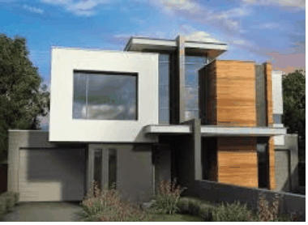

#### 3.6.3 Dual Occupancies (Attached or

of 0.9m unobstructed side access that is free from air conditioning units, rainwater tanks hot water systems, or any other structure that may block access to the rear of the dwelling.

#### Detached)

#### 3.6.3.3  Car Parking Rates

> [Picture on page 25: a picture, saved as a picture (images/vol-1-part-03-low-and-medium-density-residential-page-25-21.gif, 150 dpi).]

Figure 3.6.3.1 – An example of a contemporary design of an attached dual occupancy

a)	 Each dwelling that is part of a dual

#### Note:

occupancy development shall be provided with a minimum of one (1) single garage.

#### 3.6.3.4  Private Open Space

a)	 Each dwelling that is part of a dual occupancy shall be provided with an area of private open space that:

i)	 is located behind the primary building setback;

Private open space (as defined under the CLEP) means an area external to a building (including an area of land, terrace, balcony or deck) that is used for private outdoor purposes ancillary to the use of the building.

ii)	 has a minimum area of 60 sqm;

iii)	has a minimum width of 3 metres;

iv)	includes a minimum levelled area of (5x5) sqm;

#### Note:

Clause 7.13 Design Excellence

v)	 has a minimum unfragmented area of 40 sqm;

vi)	has an internal living room directly

of the CLEP applies to zones R3, R4, B2, B3 and B4 and aims to deliver the highest standard of architectural and urban design, as part of the built environment.

accessible to the outdoor private open space areas; and

vii)	satisfies solar access requirements contained in  Section 3.4.4. of the the Plan.

#### 3.6.3.5  Presentation to Public Streets

a)	 Where a dual occupancy development involves the retention of an existing dwelling , the  existing dwelling  shall be renovated to match the colour, material, texture and architectural style of the proposed building so as to create a harmonious development.

#### 3.6.3.6 Landscaping and Deep Soil Planting

#### Low Density Residential Development

a)

a)	 A development application for a dual

A development application for a dual occupancy shall include a detailed

occupancy shall include a detailed landscape plan prepared by a suitably

landscape plan prepared by a suitably qualified person.

qualified person. b)

b)	 A dual occupancy shall satisfy the

A dual occupancy shall satisfy the following provisions relating to deep

following provisions relating to deep soil planting:

soil planting:
