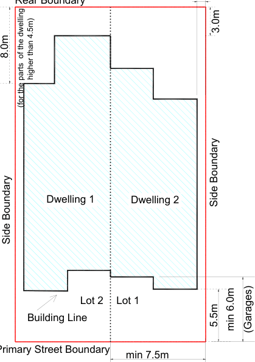

#### 3.6.4 Semi-Detached Dwellings

#### Note:

b)

b)	 Despite Clause 3.6.4.1 a)  above,  semi-

Despite Clause 3.6.4.1 a)  above,  semi-detached dwellings shall be permitted

detached dwellings shall be permitted on an allotment having a minimum

on an allotment having a minimum width less than 7.5 metres where

width less than 7.5 metres where each individual lot existed prior to the

each individual lot existed prior to the commencement of the CLEP.

commencement of the CLEP.

#### 3.6.4.2  Setbacks

Semi-detached dwellings (as defined under the CLEP)  means a dwelling that is on its own lot of land and is attached to only one other dwelling.

a)

a)	 Semi-detached dwellings shall be

Semi-detached dwellings shall be setback a minimum of:

setback a minimum of:

#### Note:

i)

i)	 5.5 metres from the primary street

5.5 metres from the primary street boundary for the semi-detached

boundary for the semi-detached dwellings;

dwellings;

Refer to Section 4.1C of the CLEP for the minimum qualifying site area and lot sizes for semi-detached dwellings

ii)

ii)	 6.0 metres from the primary street

6.0 metres from the primary street boundary for the garage or the under

boundary for the garage or the under cover parking space;

cover parking space;

0.9m

> [Picture on page 27: a map, saved as a picture (images/vol-1-part-03-low-and-medium-density-residential-page-27-65.gif, 150 dpi); the street names and other small labels are on the picture.]
> Words printed on the picture (title and legend, copied from the PDF):
> higher than 4.5m)
> (for the parts  of the dwelling
> Dwelling 1 Dwelling 2 Side Boundary
> min 6.0m (Garages)
> Primary Street Boundary

Rear Boundary

iii)

iii)	3 metres from the secondary street

3 metres from the secondary street boundary;

boundary; iv)

iv)	5.5 metres from the secondary

5.5 metres from the secondary street boundary for the garage or the

street boundary for the garage or the undercover parking space, where

undercover parking space, where the garage is accessed directly from

the garage is accessed directly from the secondary street;

the secondary street; v)

v)	 0.9 metres from any side boundary,

0.9 metres from any side boundary, for the part of the building that is

for the part of the building that is not attached to the other dwelling;

not attached to the other dwelling; and

and vi)

vi)	3 metres from the rear boundary for

3 metres from the rear boundary for any part of the building that is up

any part of the building that is up to 4.5 metres in height from ground

to 4.5 metres in height from ground level (existing); and

level (existing); and

Primary Street

vii)

vii)	8 metres from the rear boundary for

8 metres from the rear boundary for any part of the building that is higher

any part of the building that is higher than 4.5 metres from ground level

than 4.5 metres from ground level (existing) (refer to Figure 3.6.4.1).

(existing) (refer to Figure 3.6.4.1).

b)

b)	 Each dwelling shall have a minimum

Each dwelling shall have a minimum of 0.9m unobstructed side access that

of 0.9m unobstructed side access that is free from air conditioning units,

is free from air conditioning units,

Figure 3.6.4.1 – Illustration of the setbacks requirements for semi-detached dwellings.

rainwater tanks

rainwater tanks hot water systems, or any

or any

other structure that may block  access to

other structure that may block  access to the rear of the dwelling.

the rear of the dwelling.

#### Low Density

c)	 For the purpose of 3.7.2.4 a) above, the

#### Note:

#### Residential Development
