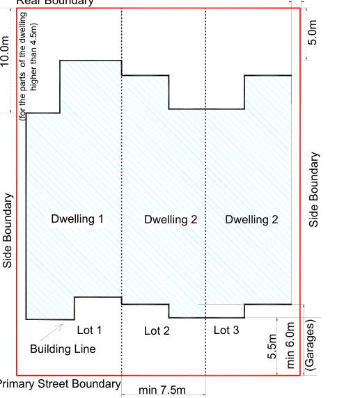

#### 3.6.5 Attached Dwellings

#### 3.6.5.2 Setbacks for Attached Dwellings - Zone R2

Rear Boundary

0.9m

> [Picture on page 31: a map, saved as a picture (images/vol-1-part-03-low-and-medium-density-residential-page-31-26.gif, 150 dpi); the street names and other small labels are on the picture.]
> Words printed on the picture (title and legend, copied from the PDF):
> higher than 4.5m)
> (for the parts  of the dwelling
> Dwelling 1 Dwelling 2 Dwelling 2 Side Boundary
> min 6.0m (Garages)
> Primary Street Boundary

a)

a)	 Attached dwellings shall be setback a

Attached dwellings shall be setback a minimum of:

minimum of: i)

i)	 5.5 metres from the primary street

5.5 metres from the primary street boundary

boundary; ii)

ii)	 6.0 metres from the primary street

6.0 metres from the primary street boundary for the garage or the under

boundary for the garage or the under cover parking space;

cover parking space; iii)

iii)	3 metres from the secondary street

3 metres from the secondary street boundary;

boundary; iv)

iv)	5.5 metres from the secondary

5.5 metres from the secondary street boundary for the garage or the

street boundary for the garage or the undercover parking space, where

undercover parking space, where the garage is accessed directly from

the garage is accessed directly from the secondary street;

the secondary street; v)

v)	 0.9 metres from any side boundary

0.9 metres from any side boundary for the ground level;

for the ground level;

Primary Street

vi)

vi)	1.5 metres from any side

1.5 metres from any side boundary for all levels above

boundary for all levels above the ground level; and

the ground level; and

Figure 3.6.5.1 – Illustration of the setbacks requirements for attached dwellings  - R2 Zone.

vii)

vii)	5 metres from the rear boundary for

5 metres from the rear boundary for any part of the building that is up

any part of the building that is up to 4.5 metres in height from ground

to 4.5 metres in height from ground level (existing); and

level (existing); and viii)

viii)	10 metres from the rear boundary

10 metres from the rear boundary for any part of the building that is

for any part of the building that is higher than 4.5 metres from ground

higher than 4.5 metres from ground level (existing) (refer to Figure

level (existing) (refer to Figure 3.6.5.1).

3.6.5.1).

#### 3.6.5.3  The Size of Indoor Living Areas for Attached Dwellings - Zone R2

a)

a)	 The indoor living areas (i.e family

The indoor living areas (i.e family

#### Low Density

room and lounges) within each

room and lounges) within each dwelling contained within attached

dwelling contained within attached dwellings shall have a minimum of one

dwellings shall have a minimum of one unfragmented area that is not less than:

unfragmented area that is not less than:

#### Residential

#### Development i)

i)	 (3x3)sqm in the case of a one

(3x3)sqm in the case of a one bedroom dwelling;

bedroom dwelling; ii)

ii)	 (3.5x4)sqm square meters in the case

(3.5x4)sqm square meters in the case of two or three bedroom dwelling;

of two or three bedroom dwelling;
