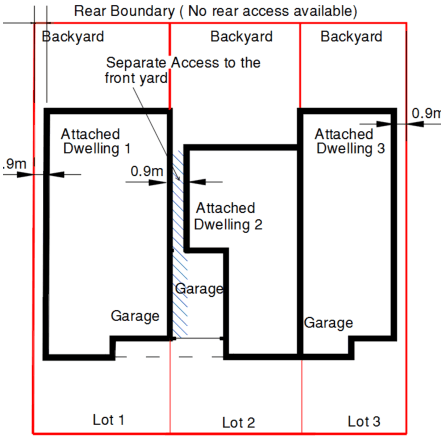

#### 3.6.5 Attached

#### Dwellings iii)

iii)	(4x5)sqm in case of four or more

(4x5)sqm in case of four or more bedroom dwelling.

bedroom dwelling.

b)

b)	 For the purpose of this clause, the

For the purpose of this clause, the total number of bedrooms within each

total number of bedrooms within each dwelling shall include any room that is

dwelling shall include any room that is capable of being used as a bedroom (i.e

capable of being used as a bedroom (i.e study room).

study room).

c)	 Master bedrooms shall have a minimum internal area of 12 square metres (excluding wardrobe space);

d)	 All other bedrooms proposed shall have

> [Picture on page 32: a picture, saved as a picture (images/vol-1-part-03-low-and-medium-density-residential-page-32-43.gif, 150 dpi).]

Figure 3.6.5.2 – Illustration of an example of a design solution for  ‘rear to front’ access requirement for attached dwellings at ground level.

a minimum internal area of 9 square metres (excluding wardrobe space);

e)	 All dining and living areas shall be well

#### Note:

The requirement for the rear-to front access is to enable occupants of an

designed and of sufficient size for both furniture and movement/circulation through the dwelling. Submitted plans shall include examples of furnished floor plans that demonstrate that the design enables the use of each room for its intended purpose in a manner that does not restrict the movement of people within and through the room.

attached dwelling to move organic waste bins, lawnmowers and the like from the backyard to the front of the building without the need to pass through the main living areas.

#### 3.6.5.4  Rear Access for Attached Dwellings - Zone R2

a)

a)	 Where there is no access to a rear

Where there is no access to a rear lane or rear street  directly available

lane or rear street  directly available from the back  of attached dwellings,

from the back  of attached dwellings, each dwelling shall be provided with

each dwelling shall be provided with a separate and direct access from the

a separate and direct access from the backyard to the front yard that does not

backyard to the front yard that does not pass through any habitable area of the

pass through any habitable area of the dwelling (Refer to Figure 3.6.5.2 for a

dwelling (Refer to Figure 3.6.5.2 for a suggested design solution).

suggested design solution). b)

b)	 For the purpose of 3.6.5.4 a) above, the

For the purpose of 3.6.5.4 a) above, the

#### Low Density Residential Development

direct access from the rear to the front

direct access from the rear to the front of the dwelling shall have a minimum

of the dwelling shall have a minimum width of 0.9 metres and shall not be

width of 0.9 metres and shall not be obstructed by hot water systems, air

obstructed by hot water systems, air conditioning units, gardens or anything

conditioning units, gardens or anything that may result in the obstruction of

that may result in the obstruction of the access way.

the access way.

#### 3.6.5.5  Car Parking Rates for Attached Dwellings - Zone R2
