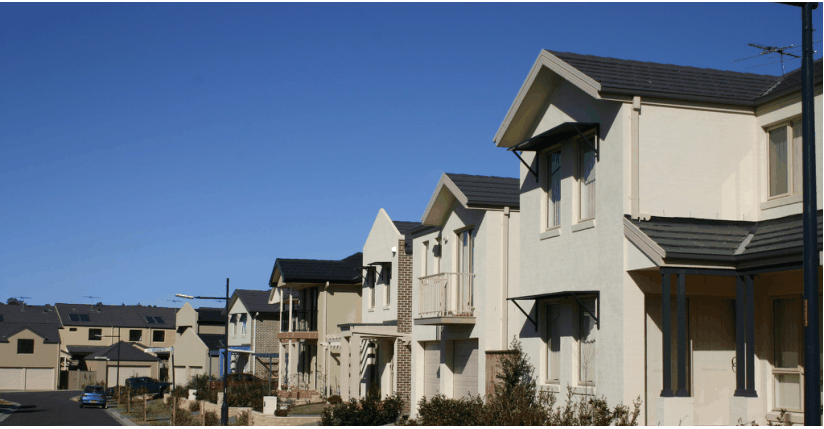
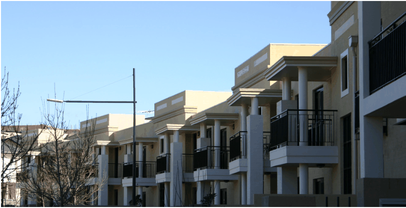

### 3.7 Medium Density Residential Development - Zone R3

#### Medium

This section applies to:

•	• attached  dwellings on areas zoned R3;and

attached  dwellings on areas zoned R3;and

•	• multi dwelling housing on areas zoned R3.

multi dwelling housing on areas zoned R3.

#### Density Residential Development

#### Note:

Clause 7.13 Design Excellence of the CLEP applies to zones R3, R4, B2, B3 and B4 and aims to deliver the highest standard of architectural and urban design, as part of the built environment.

#### Note:

Numerical Development Standards for floor space ratios, building heights and subdivision for residential development  are provided under the CLEP.

> [Picture on page 36: a picture, saved as a picture (images/vol-1-part-03-low-and-medium-density-residential-page-36-18.gif, 150 dpi).]

> [Picture on page 36: a picture, saved as a picture (images/vol-1-part-03-low-and-medium-density-residential-page-36-19.gif, 150 dpi).]

Figure 3.7.1 - Examples of medium density residential development.
