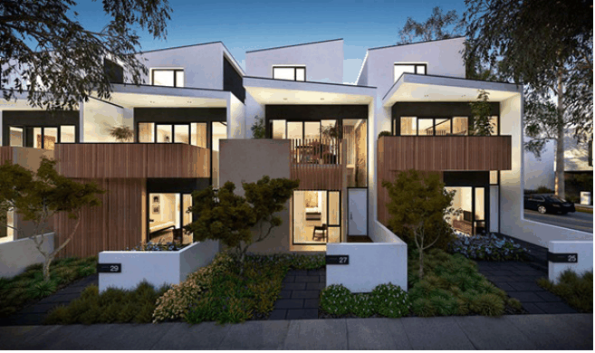

#### 3.7.1 Attached Dwelling

■ Encourage the use of roof space to provide habitable areas.

#### Housing

■ Encourage innovative designs and layout to produce a medium density style development with contemporary buildings that utilise facade modulation and incorporate shade elements, such as pergolas, verandahs and the like.

#### Note:

#### 3.7.1.1 Site Requirements for Attached Dwellings - Zone R3

Design Requirements

Attached dwelling (as defined under the CLEP) means a build­ ing containing 3 or more dwell­ ings, where:

a)	 Each lot of land  for each dwelling that

a)	 each dwelling is attached to another dwelling by a common wall, and

b)	 each of the dwellings is on its own lot of land, and

forms part of an attached dwelling development shall have  a minimum width of 7.5 metres measured along the side boundaries at a distance of

5.5 metres from the primary street boundary, unless the individual lots existed prior to the commencement of the CLEP.

c)	 none of the dwellings is

b)	 Attached dwellings shall not be erected

located above any part of another dwelling.

> [Picture on page 37: a picture, saved as a picture (images/vol-1-part-03-low-and-medium-density-residential-page-37-46.gif, 150 dpi).]

Figure 3.7.1.1 - An example of attached dwellings.

on an existing battle-axe allotment.

#### Medium

c)	 With any development application involving the construction of a building wall on a boundary, the creation of an easement for access and maintenance on the adjoining land may be required.

#### Density Residential Development

d)	 Subject to the satisfaction of other
