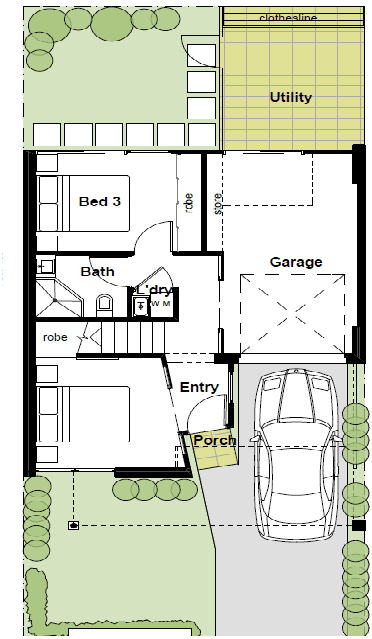
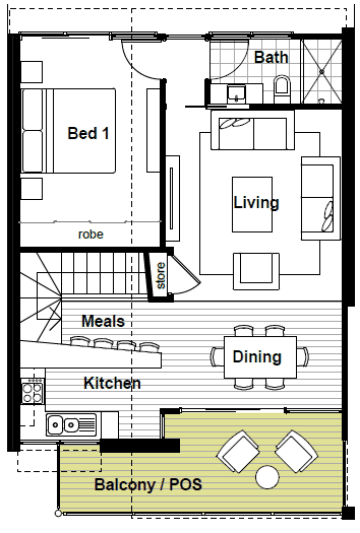
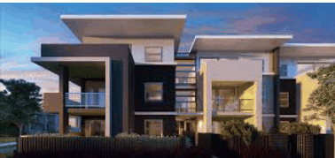
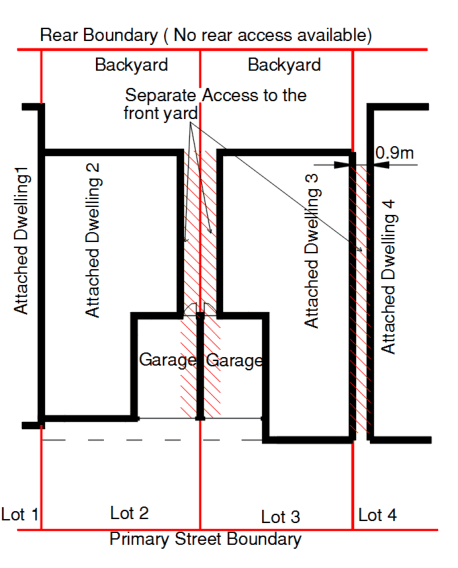

#### 3.7.1 Attached Dwellings

requirements within the Plan, the number of dwellings permitted within attached dwellings development shall not exceed 6 dwellings within the R3 zone.

#### 3.7.1.2 Setbacks for Attached Dwellings - Zone R3

a)	 Attached dwellings shall be setback a minimum  of:

i)	 4.0 metres from the primary street boundary;

ii)	 2 metres from the secondary street boundary;

> [Picture on page 38: a picture, saved as a picture (images/vol-1-part-03-low-and-medium-density-residential-page-38-28.gif, 150 dpi).]

Ground Floor

> [Picture on page 38: a picture, saved as a picture (images/vol-1-part-03-low-and-medium-density-residential-page-38-30.gif, 150 dpi).]

iii)	0.9 metres from any side boundary;

iv)	3 metres from the rear boundary for the ground level;  and

v)	 6 metres from the rear boundary for all levels above ground level.

b)	 Notwithstanding Section 3.7.1.2a),  car parking spaces/garages shall be setback a minimum of 6 metres from the primary street setback.

c)	 Despite Clause 3.7.1.2a) above, where car parking spaces/garages are located and accessed from the back of the site (i.e via a rear lane) an attached dwelling development shall be permitted to be setback by:

First Floor

i)	 3 metres from the primary street boundary;

ii)	 2 metres from the secondary street boundary;

Figure 3.7.1.2 - An example of attached dwellings floor plans ( Source Dwelling Density Guide, NSW Planning & Environment, 2014)

iii)	0.9 metres from any side boundary;

iv)	3 metres from the rear boundary for

for

the ground level;

#### Medium

v)	 6 metres from the rear boundary for all levels above ground level;

vi)	1 metre from the rear boundary

#### Density Residential Development

for the garage component of the building.

d)	 Where garages are located and accessed

> [Picture on page 39: a picture, saved as a picture (images/vol-1-part-03-low-and-medium-density-residential-page-39-14.gif, 150 dpi).]

Figure 3.7.1.3 - Examples of medium density type residential development with articulated facade  treatment.

> [Picture on page 39: a picture, saved as a picture (images/vol-1-part-03-low-and-medium-density-residential-page-39-18.gif, 150 dpi).]
