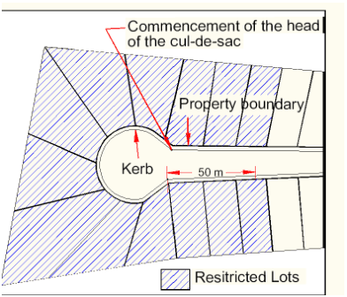

#### 3.7.2 Multi Dwelling

■ Ensure that multi dwelling housing offers a high standard of internal and external amenity for its occupants and maintains the amenity of other residents in the locality.

#### Housing

■ Encourage innovative designs and layout to produce a medium density style development with contemporary buildings that utilise facade modulation and incorporate shade elements, such as pergolas, verandahs and the like.

■ Promote electric vehicle usage across the Local Government Area.

■ Provide and encourage the installation of electric vehicle charging infrastructure.

#### Note:

#### 3.7.2.1  Site Requirements for Multi Dwelling Housing  - Zone R3

a)	 Multi dwelling housing shall only be

Multi dwelling housing (as defined under the CLEP) means 3 or more dwellings (whether attached or detached) on one lot of land, each with access at ground level, but does not include a residential flat building.

> [Picture on page 44: a picture, saved as a picture (images/vol-1-part-03-low-and-medium-density-residential-page-44-31.gif, 150 dpi).]

permitted on an allotment having a minimum width of 25 metres measured between the extended property side boundaries, or in the case of a corner allotment, the secondary street boundaries where they intersect with the kerb line.

b)	 Multi dwelling housing shall not be erected on an existing battle-axe allotment.

c)	 For the purpose of calculating the developable area of an allotment a right of carriage way  shall not be included within the developable area of the allotment, unless the relevant public agency  is satisfied that, that part of the allotment is capable of being developed for the purpose of multi dwelling housing.

d)	 Multi dwelling housing shall only be

Figure 3.7.2.1 – Illustration of the 50 metre distance from the commencement of the head of a cul-de-sac where multi dwelling housing development are restricted.

permitted on a site where no part of the allotment is within 50 metres of

#### Medium

the commencement of the head of a cul-de-sac to which vehicular access to the site is obtained (refer to Figure 3.7.2.2).

e)	 A minimum of 10% of the total number

#### Density Residential Development

of dwellings within a multi dwelling housing development containing 10 or more dwellings shall be adaptable dwelling(s).
