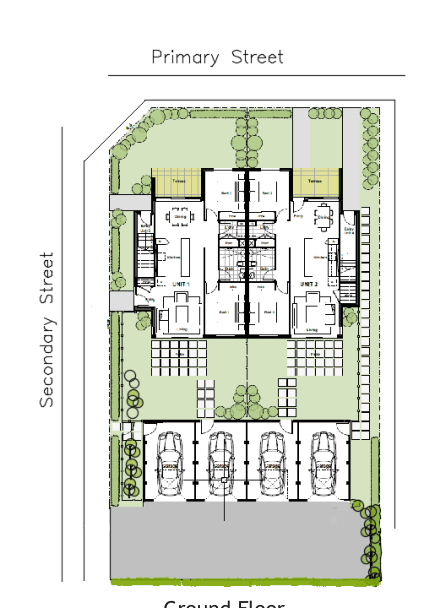
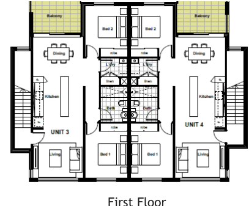

#### 3.7.2 Multi Dwelling Housing

f) Multi dwelling housing  shall not incorporate vehicular access that utilises any gate structure /mechanism other than access to basement car parking.

#### 3.7.2.2  Setbacks  for Muti Dwelling Housing - Zone R3

a)	 A multi dwelling housing development shall be set back a minimum of:

i)	 4.0 metres from the primary street boundary;

ii)	 2 metres from the secondary street

> [Picture on page 45: a picture, saved as a picture (images/vol-1-part-03-low-and-medium-density-residential-page-45-29.gif, 150 dpi).]

Ground Floor

> [Picture on page 45: a picture, saved as a picture (images/vol-1-part-03-low-and-medium-density-residential-page-45-31.gif, 150 dpi).]
> Words printed on the picture (title and legend, copied from the PDF):
> First Floor

boundary;

iii)	0.9 metres from any side boundary;

iv)	3 metres from the rear boundary for the ground level;  and

v)	 6 metres from the rear boundary for all levels above ground level.

b)	 Notwithstanding Section 3.7.2.2a), the car parking space shall be setback a minimum of 6 metres from the primary street setback.

c)	 Despite Clause 3.7.1.2a) above, where car parking spaces/garages are located and accessed from the back of the site (i.e via a rear lane) a multi dwelling housing development shall be permitted to be setback by:

i)	 3 metres from the primary street boundary;

ii)	 2 metres from the secondary street boundary;

Figure 3.7.2.2 - An example of Multi dwelling housing floor plans located on a corner site where dwellings are located on top of each other with separate access for each dwelling from the ground floor.  (Source Dwelling Density Guide, NSW Planning & Environment, 2014 (Slightly modified))

iii)	0.9 metres from any side boundary;

#### Medium

iv)	3 metres from the rear boundary for the ground level;

v)	 6 metres from the rear boundary for

#### Density Residential Development

all levels above ground level; and

vi)	1 metre from the rear boundary for the garage component of the building.
