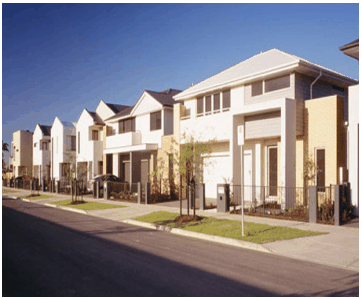
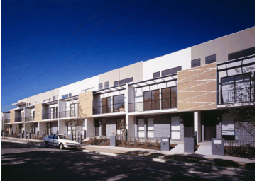

#### 3.7.2 Multi Dwelling

and lounges) within a dwelling (that forms part of a multi dwelling housing development) shall have a minimum of one  unfragmented area that is not less than:

#### Housing

i)	 (3x3)sqm in case of a dwelling with 1 bedroom;

ii)	 (3.5x4)sqm in case of a dwelling with 2 or 3 bedrooms;

iii)	(4x5)sqm in case of a dwelling with 4 or more bedrooms.

b)	 For the purpose of clause 3.7.2.3a) above, the total number of bedrooms within a dwelling shall include any room that is capable of being used as a bedroom (i.e study room).

c)	 Master bedrooms shall have a minimum internal area of 12 square metres (excluding wardrobe space);

d)	 All other bedrooms proposed shall have a minimum internal area of 9 square metres (excluding wardrobe space);

e)	 All dining and living areas shall be well

> [Picture on page 47: a picture, saved as a picture (images/vol-1-part-03-low-and-medium-density-residential-page-47-36.gif, 150 dpi).]

> [Picture on page 47: a picture, saved as a picture (images/vol-1-part-03-low-and-medium-density-residential-page-47-37.gif, 150 dpi).]

Figure 3.7.2.3 - Examples of residential medium density development.

designed and of sufficient size for both furniture and movement/circulation through the dwelling. Submitted plans shall include examples of furnished floor plans that demonstrate that the design enables the use of each room for its intended purpose in a manner that does not restrict the movement of people within and through the room.

#### 3.7.2.4  Rear Access  - Zone R3

a)	 Where there is no access to a rear lane or rear street  directly available from the back  of attached dwellings, each dwelling shall be provided with a separate and direct access from the

#### Medium

backyard to the front yard that does not pass through any habitable area of dwelling (Refer to Figure 3.6.5.1 for a suggested design solution).

b)	 For the purpose of 3.7.2.4 a) above, the

#### Density Residential Development
