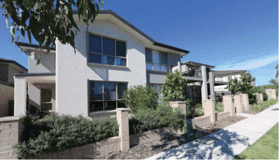

#### 3.7.2 Multi Dwelling Housing

direct access from the rear to the front of the dwelling shall have a minimum width of 0.9 metres and shall not be obstructed by hot water systems, air conditioning units, gardens or anything that results in the obstruction of the access way.

#### 3.7.2.5 Private Car Parking Requirement for Multi Dwelling Housing  - Zone R3

a)

a)	 Each multi dwelling housing unit shall

Each multi dwelling housing unit shall be provided with a minimum of one

be provided with a minimum of one single garage or car parking space.

single garage or car parking space. b)

b)	 One (1) external additional visitor car

One (1) external additional visitor car parking space shall be provided for every

parking space shall be provided for every three (3) units (or part thereof), unless

three (3) units (or part thereof), unless all dwellings within the development

all dwellings within the development have direct frontage to a public street.

have direct frontage to a public street. c)

c)	 No visitor car parking space shall be

No visitor car parking space shall be located forward of the primary or

located forward of the primary or secondary street boundary.

secondary street boundary.

> [Picture on page 48: a picture, saved as a picture (images/vol-1-part-03-low-and-medium-density-residential-page-48-48.gif, 150 dpi).]

Figure 3.7.2.4 - An example of multi dwelling housing, with separate dwellings on each floor. (Source  Dwelling Density Guide, NSW Planning & Environment, 2014)

d)

d)	 No visitor car parking space shall be in a

No visitor car parking space shall be in a ‘stacked’ configuration.

‘stacked’ configuration.

e)	 Electric vehicle charging stations must be located behind the building line.

#### 3.7.2.6 Requirements for the Use of Roof Space for  Habitable Areas for Multi Dwelling Housing - Zone R3

a)

a)	 Council may consider the use of the roof

Council may consider the use of the roof space for a habitable room, but only if:

space for a habitable room, but only if: i)

i)	 it is appropriately designed;

it is appropriately designed; ii)

ii)	 it is part of the overall design of the

it is part of the overall design of the building;

building; iii)

iii)	appropriate light and ventilation is

appropriate light and ventilation is supplied to rooms; and

supplied to rooms; and iv)

iv)	it does not negatively impact on the

it does not negatively impact on the design quality of the streetscape.

design quality of the streetscape.

#### Medium

#### 3.7.2.7 Private and Communal Open Space Requirement for Multi Dwelling Housing - Zone R3

a)

a)	 Each  multi dwelling housing unit shall

Each  multi dwelling housing unit shall be provided with an area or areas  of

be provided with an area or areas  of private open space that:

private open space that:

#### Density Residential Development

i)

i)	 are not located within the primary

are not located within the primary street setback;

street setback; ii)

ii)	 have a minimum area of 40 sqm,

have a minimum area of 40 sqm,
