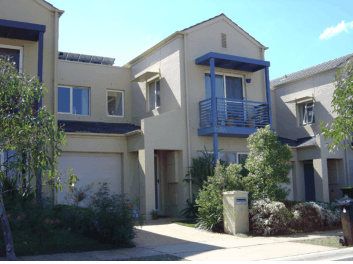

#### 3.7.2 Multi Dwelling

iii)

iii)	have a minimum width of 3 metres;

have a minimum width of 3 metres;

#### Housing

iv)

iv)	include a minimum levelled area of

include a minimum levelled area of (3x3) sqm;

(3x3) sqm; v)

v)	 have an internal living room directly

have an internal living room directly accessible to the outdoor private

accessible to the outdoor private open space areas; and

open space areas; and vi)

vi)	satisfy solar access requirements

satisfy solar access requirements contained in  section 3.4.4.

contained in  section 3.4.4.

b)

b)	 No part of an outdoor living area is

No part of an outdoor living area is permitted to be located within the

permitted to be located within the primary or secondary street setback

primary or secondary street setback area.

area.

c)	 Any communal open space or recreation facility provided as a part of a development shall be designed and constructed to: i)

i)	 ensure safe access by the occupants

ensure safe access by the occupants of the development;

of the development; ii)

ii)	 prevent access by members of the

prevent access by members of the public; and

public; and iii)

iii)	provide for the safety and well being

provide for the safety and well being of children in accordance with any

of children in accordance with any applicable Australian Standard.

applicable Australian Standard.

#### 3.7.2.8  Presentation to Public Streets for Multi Dwelling Housing - Zone R3

> [Picture on page 49: a picture, saved as a picture (images/vol-1-part-03-low-and-medium-density-residential-page-49-78.gif, 150 dpi).]

Figure 3.7.2.5 - Examples of residential medium density  development.

a)

a)	 Multi dwelling housing shall

Multi dwelling housing shall satisfy the following architectural

satisfy the following architectural requirements:

requirements: i)

i)	 	a distinctive and innovative

a distinctive and innovative architectural  design that presents

architectural  design that presents visually interesting facades to the

visually interesting facades to the streets;

streets;

| 3.7 | ii) ii) incorporation incorporation of of variations variations in in roof roof heights heights and and wall wall planes planes to to avoid avoid |
|---|---|
| Medium | long long unbroken unbroken ridge ridge lines; lines; |
| Density | iii) iii) incorporation incorporation of of facade facade shifts shifts |
| Residential | and and articulation, articulation, varied varied materials materials |
| Development | and and colours colours in in order order to to avoid avoid duplication duplication of of the the same same building building |
| 3.7.2 | elements; elements; and and |
| Multi Dwelling | iv) iv) provision provision of of windows windows and and active active |
| Housing | spaces spaces in in the the building building ends, ends, to to provide provide additional additional security security and and visual visual interest. interest. |
| b) b) | Multi Multi dwelling dwelling housing housing shall shall satisfy satisfy the the |
|  | following following additional additional provisions provisions relating relating |
|  | to to streetscape: streetscape: |
|  | i) i) architectural architectural features features (such (such as as |
|  | balconies, balconies, openings, openings, columns, columns, |
|  | porches, porches, colours, colours, materials materials etc) etc) |
|  | and and articulation articulation in in walls walls are are to to be be |
|  | incorporated incorporated into into the the front front facade facade of of |
|  | each each dwelling. dwelling. |
| c) c) | Unless Unless Council Council can can be be satisfied satisfied that that |
|  | an an existing existing dwelling dwelling located located on on the the |
|  | site site makes makes a a positive positive contribution contribution to to |
|  | the the character character of of the the streetscape, streetscape, that that |
|  | dwelling dwelling shall shall be be demolished. demolished. |
| d) d) | Where Where a a development development involves involves the the |
|  | construction construction of of additional additional dwellings dwellings |
|  | to to create create multi multi dwelling dwelling housing, housing, the the |
|  | existing existing dwelling dwelling ( ( where where it it is is proposed proposed |
|  | to to be be retained) retained) shall shall be be renovated renovated to to |
|  | match match the the colour, colour, material, material, texture texture |
|  | and and architectural architectural style style of of the the proposed proposed |
|  | buildings buildings so so as as to to create create a a harmonious harmonious |
|  | development. development. |

#### 3.7.2.9 Landscaping and deep soil planting Requirements for Multi Dwelling Housing - Zone R3

a)

a)	 Multi dwelling housing  shall satisfy

Multi dwelling housing  shall satisfy the following requirements relating to

the following requirements relating to landscape:

landscape: i)

i)	 a detailed landscape design

a detailed landscape design plan shall be submitted by a

plan shall be submitted by a

suitably qualified person with the

suitably qualified person with the development application; and

development application; and

#### Medium

ii)

ii)	 a minimum of 20% of the total site

a minimum of 20% of the total site area shall be available for deep soil

area shall be available for deep soil planting; and

planting; and

#### Density Residential Development

iii)

iii)	 no more than 30% of the area

no more than 30% of the area forward of any building line shall be

forward of any building line shall be surfaced with impervious  materials.

surfaced with impervious  materials.
