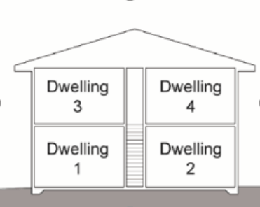

#### 3.7.3 Manor Houses

■ Encourage innovative designs and layout to produce a medium density style development with contemporary buildings that utilise facade modulation and incorporate shade elements, such as pergolas, verandahs and the like.

> [Picture on page 55: a picture, saved as a picture (images/vol-1-part-03-low-and-medium-density-residential-page-55-17.gif, 150 dpi).]

#### 3.7.3.1  Site Requirements for Manor Houses - Zone R3

a)	 The minimum lot area for a manor house is 600 square metres with a minimum frontage width of 15m, which is required to adequately achieve setback requirements and sufficient space for landscaping and car parking.

b)	 This building type is best suited to corner lots or sites with rear lane access in order to adequately accommodate garages and car parking.

c)	 The proposal may include a strata title

Figure 3.7.3.1 - An example of a cross section - Manor

subdivision, with a common entry and internal hallway.

d)	 Like other medium density proposals within the Campbelltown LGA, manor houses shall only be permitted on a site where no part of that allotment is located within 50 metres of the commencement of a cul-de-sac head to which vehicular access has been retained.

#### 3.7.3.2 - Strata title subdivision

a)	 A manor house containing three or four dwellings on one lot may be strata titled to allow for separate ownership of each dwelling.

b)	 Development that complies with this Section may receive concurrent

#### 3.7.3.1  Site Requirements for Manor Houses - Zone R3

#### Medium

a)	 The minimum lot area for a manor house is

#### Density Residential Development

600 square metres with a minimum frontage width of 15m, which is required to adequately achieve setback requirements and sufficient space for landscaping and car parking.

b)	 This building type is best suited to corner
