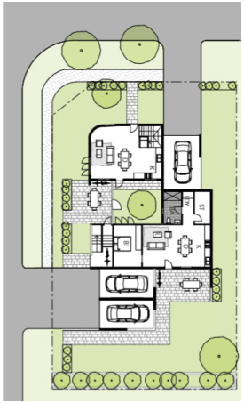

#### 3.7.3 Manor Houses

lots or sites with rear lane access in order to adequately accommodate garages and car parking.

c)	 The proposal may include a strata title subdivision, with a common entry and internal hallway.

> [Picture on page 56: a picture, saved as a picture (images/vol-1-part-03-low-and-medium-density-residential-page-56-21.gif, 150 dpi).]

Figure 3.7.3.2 - An example of a ground floor Manor House

d)	 Like other medium density proposals within the Campbelltown LGA, manor houses shall only be permitted on a site where no part of that allotment is located within 50 metres of the commencement of a cul-de-sac head to which vehicular access has been retained.

#### 3.7.3.2 - Strata title subdivision

a)	 A manor house containing three or four dwellings on one lot may be strata titled to allow for separate ownership of each dwelling.

b)	 Development that complies with this Section may receive concurrent approval for both the development and strata title subdivision.

c)	 Development that complies with this Section may receive concurrent approval for both the development and strata title subdivision.

#### 3.7.3.3 - Setbacks for Manor Houses – Zone

#### 3.7.3.3 - Setbacks for Manor Houses – Zone R3

#### R3

a)	 The development shall provide the following front and side boundary setback distances which reflect the existing and/or future intended character of the area in addition to an appropriate separation between buildings on adjoining sites.

b)	 A manor house must be setback from the front boundary, or public space, so that it:

(i)	 defines the street edge;

(ii)	creates a clear threshold and transition between common private areas of the site;

#### Medium

(iii)	assists in achieving visual privacy to ground floor dwellings from the street;

(iv)	 contributes to the streetscape character

#### Density Residential Development

and landscape; and

(v)	 relates to the desired future streetscape pattern without any unreasonable, adverse impacts on the existing streetscape.
