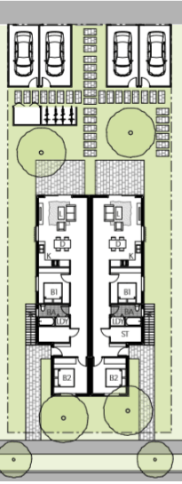
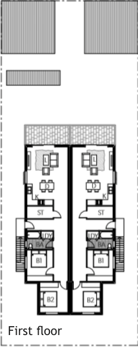

#### 3.7.3 Manor Houses

c)	 Any infill development must reflect the average setback distance of   the two nearest residential accommodation buildings, located on either side of the proposed site.

d)	 A manor house development shall be set back a minimum of:

> [Picture on page 57: a picture, saved as a picture (images/vol-1-part-03-low-and-medium-density-residential-page-57-22.gif, 150 dpi).]

Ground floor

> [Picture on page 57: a picture, saved as a picture (images/vol-1-part-03-low-and-medium-density-residential-page-57-24.gif, 150 dpi).]
> Words printed on the picture (title and legend, copied from the PDF):
> First floor

i)

i)	 5.5 metres from the primary street

5.5 metres from the primary street boundary;

boundary;

ii)	 2 metres from the secondary street boundary;

iii)	0.9 metres from any side boundary;

iv)	3 metres from the rear boundary for the ground level;  and

v)	 6 metres from the rear boundary for all levels above ground level.

e)	 Notwithstanding Section (d) above, all car parking spaces shall be setback a minimum of 6 metres from the primary street setback.

f) Despite above, where car parking spaces/ garages are located and accessed from the back of the site (i.e via a rear lane), all manor house development shall be permitted to be setback by: i)

i)	 5.5 metres from the primary street

5.5 metres from the primary street boundary;

boundary;

ii)	 2 metres from the secondary street boundary;

Figure 3.7.3.3 - An example of a ground floor and a first floor design of a Manor House

iii)	0.9 metres from any side  boundary;

iv)	Where garages are located and accessed from the back of the site (i.e. via a rear

| 3.7 Medium | lane) they shall not exceed 50% of the width of the rear elevation. | Note: |
|---|---|---|
| Density | 3.7.3.4 – The Size of Indoor Living Areas for Manor Houses – Zone R3 | For more examples of Manor Houses designs, please refer to the ‘Low |
| Residential Development | a) Any dwellings that form part of a manor house development are required to have the following minimum internal floor areas: | Rise Medium Density Design Guide, 2018’, which is available from the Department of Planning and |
| 3.7.3 | i) i) Studio Studio = = 35m² 35m² | environment website at the following link: |
| Manor Houses | ii) ii) 1 1 bed bed = = 50m² 50m² iii) iii) 2 2 bed bed = = 70m² 70m² iv) iv) 3+ 3+ bed bed = = 90m². 90m². b) The minimum area of any bedroom is 12m² which comprises a minimum length of 4m and width of 3m, excluding space for a wardrobe. c) The indoor living areas within a dwelling that forms part of a manor house development shall have combined, minimum living and dining room areas of: i) i) 1 1 and and 2 2 bedrooms bedrooms = = 24m² 24m² ii) ii) 3+ 3+ bedrooms bedrooms = = 28m² 28m² d) All living / lounge rooms shall have a minimum length and width of 4m, which excludes any fixtures. e) Kitchens are not to be part of a circulation space such as a hallway, except in studio apartments. 3.7.3.5 - Rear Access for Manor Houses - Zone R3 a) Where there is no access to a rear lane or rear street, directly available from the back of the proposed manor house, each ground floor dwelling shall be provided with a separate and direct access from the backyard to the front yard which does not pass through any habitable area of the dwelling. | https://www.planning.nsw.gov.au/ Policy-and-Legislation/Housing/ Medium-Density-Housing Note: All the figures used under Section 3.7.3 Manor Houses have been copied form the ‘Low Rise Medium Density Design Guide, 2018’, which is available from the Department of Planning and environment website at the following link: https://www.planning.nsw.gov.au/ Policy-and-Legislation/Housing/ Medium-Density-Housing |

b)	 For these purposes, direct access from the rear to the front of the dwelling shall have a minimum width of 0.9 metres and shall

#### Medium

not be obstructed by hot water systems, air conditioning units, gardens or anything that may result in the obstruction of the access way.

#### 3.7.3.6 – Private Car Parking Requirements for Manor Houses – Zone R3

#### Density Residential Development

a)	 A minimum of one (1) car parking space shall be provided for each dwelling proposed as part of a manor house development.
